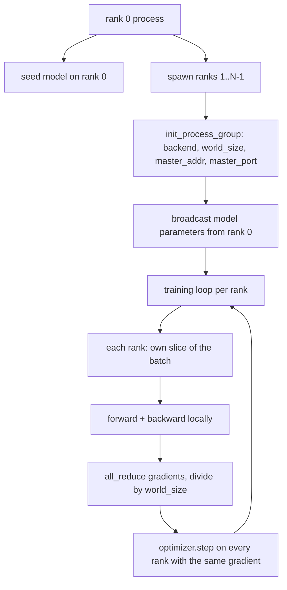
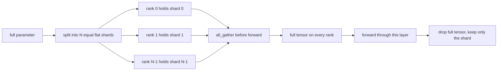

# 从零实现 Distributed Data Parallel 与 FSDP

> Multi-rank training 本质上是两个 collectives 加一条规则。启动时 broadcast parameters，backward 后 average gradients，永远不要让各个 ranks 对自己处在哪个 step 产生分歧。

**Type:** Build
**Languages:** Python
**Prerequisites:** Phase 19 lessons 42 to 45
**Time:** ~90 minutes

## 学习目标

- 使用 `gloo` backend 在 N 个 ranks 之间启动 process group，不依赖特殊硬件。
- 实现一个 minimal DDP wrapper：construction 时 broadcast parameters，backward 后 all-reduce gradients。
- 证明 per-rank gradients 的 all-reduce 与在拼接 input 上运行的 single-process gradient 匹配。
- 勾勒 FSDP parameter sharding：每个 rank 持有一个 slice，forward pass 前 gather full tensor，用完后丢弃。

## 问题

模型能放进单个 device。Dataset 放不下。Optimization budget 说你希望每 wallclock second 看到 N 倍 examples。第一根杠杆是 data parallel：每个 rank 在 batch 的不同 slice 上运行同一个 model，然后在 optimizer step 前 average gradients。第二根杠杆是 FSDP：当模型本身也放不进单个 device 时，每个 rank 持有每个 parameter 的一部分，并在 forward pass 中逐 layer 重建 full tensors。

痛点是 bookkeeping。如果 parameters 在 ranks 间漂移，run 会静默损坏。如果你 average gradients 但不 average loss，dashboard 会撒谎。如果 collective backend 无法就 topology 达成一致，run 会永远 hang 住。修复方法是亲手写一次 collectives，并且永远不要信任一个你无法复现的 wrapper。

本课在 CPU 上运行。不假设 CUDA。`gloo` backend 随每个 PyTorch build 一起发布，并支持 `torch.multiprocessing` workers；同一份代码在 multi-GPU node 上只要切到 `nccl`，结构不需要改变。

## 核心概念



### 真正重要的两个 collectives

| Collective | 作用 | 时机 |
|------------|------|------|
| `broadcast` | 从一个 rank 把 tensor copy 到所有其他 ranks | Parameter init、scheduler state、任何 one-to-all sync |
| `all_reduce` | 跨所有 ranks sum（或 mean、max）一个 tensor，每个 rank 都拿到结果 | Backward 后做 gradient averaging |
| `all_gather` | 每个 rank 贡献一个 tensor，每个 rank 拿到拼接结果 | Logits collection、FSDP parameter unshard |

DDP contract 是 construction 时 `broadcast`，backward 后 `all_reduce`。FSDP sketch 会在每个 layer 的 forward pass 前额外加 `all_gather`。

### Gradient averaging 匹配 single-process gradient

一个模型如果在 N 个 ranks 上训练，每个 rank 的 batch size 是 B，就必须产生与 single process 在 N*B batch 上训练相同的 gradient。技巧是：把 per-rank gradients 相加再除以 N，会得到 average loss gradient，也就是 full batch 上 mean reduction 的 cross entropy 会产生的 gradient。本课代码会用 `max-abs-diff < 1e-3` 断言 manual all-reduce gradient 与 reference single-process gradient 之间的差异。

### FSDP sketch



内存收益是精确的：每个 rank 的 parameter memory 降到 1/N。代价是 gather，而且每次 forward pass 都要支付。Production FSDP 会把 gather 与前一层 compute overlap，因此 wallclock 成本远小于朴素估算。本课会对每个 parameter 做 round trip，并断言 reconstruction 与 original bit-equal。

### CPU 与 gloo backend

CUDA 是 production target，但相同 code paths 也存在于 CPU 上。`gloo` 是 CPU collective backend。它在 GPU 上比 `nccl` 慢几个数量级，但 API surface 完全相同。本课的 process group 用 `backend="gloo"` 初始化，并用 `torch.multiprocessing` spawn ranks，而不是用 `torchrun`；两者最终都会走到同一组 `torch.distributed` calls。在 multi-GPU node 上，唯一变化是 `backend="nccl"`、device tensors，以及用 `torchrun` 启动。

## Build It

`code/main.py` 是可运行 artifact。

### Step 1: 启动 process group

```python
os.environ["MASTER_ADDR"] = "127.0.0.1"
os.environ["MASTER_PORT"] = str(port)
dist.init_process_group(backend="gloo", rank=rank, world_size=world_size)
```

`MASTER_ADDR` 和 `MASTER_PORT` 是 rendezvous：每个 rank 都会拨同一 host 上的同一 port。本课会通过 bind-and-close trick 选择一个空闲 port，避免多次 run 共用机器时发生冲突。

### Step 2: construction 时 broadcast

`MinimalDDP.__init__` 会遍历每个 parameter 和 buffer，并调用 `dist.broadcast(tensor, src=0)`。Rank 0 的值会成为 canonical init。没有这一步，每个 rank 会用自己的 seed 初始化，ranks 从第一步开始就会 diverge。

### Step 3: backward 后 all-reduce gradients

```python
def all_reduce_grads_(module, world_size):
    for p in module.parameters():
        if p.grad is None:
            p.grad = torch.zeros_like(p.data)
        dist.all_reduce(p.grad.data, op=dist.ReduceOp.SUM)
        p.grad.data.div_(world_size)
```

每个 rank 最终都会得到同一个 averaged gradient。Optimizer step 现在在每个 rank 上都是同一 input 的函数，这就是 parameters 能在整个 run 中保持同步的原因。

### Step 4: 证明等价性

`manual_all_reduce_matches_single_process` 会在 rank 0 上构建同一个 model，并把 post-all-reduce gradient 与 single process 在 concatenated input 上算出的 gradient 比较。Max-abs-diff 大约是 1e-8。

### Step 5: FSDP round trip

`fsdp_round_trip_sketch` 会 flatten 每个 parameter，pad 到 `world_size` 的倍数，slice，all-gather，再 unpad。每个 rank 的 reconstruction 都等于 original。这就是 unshard step；反向操作（forward 后 re-shard）就是从 gathered tensor 上切出一个 slice。

运行：

```bash
python3 code/main.py
```

默认 world size 是 2。两个 CPU processes 会 spawn，通过 `gloo` 互相通信，并以 zero exit 结束。输出 `outputs/ddp-demo.json` 会捕获每个 rank 的 parameter sums、all-reduce 后的 gradient norm、FSDP round-trip result，以及 manual-vs-reference gradient diff。

## Use It

Production training stacks 调用的是同一批 primitives。PyTorch 的 `DistributedDataParallel` 额外增加了：post-backward gradient hooks，用于把 all-reduce 与 backward overlap；bucketed all-reduce，用于把多个小 gradients 合成一次 collective；以及第 46 课用到的 `no_sync` context。

PyTorch 的 FSDP 额外增加了：每层一个 flat parameter view，让每个 rank 持有一个连续 buffer；把下一层 unshard 与当前层 compute overlap；以及可选的 shard CPU offload。

形状保持不变：startup 时 broadcast，backward 后 reduce，当 parameters 放不下时 shard parameters。

## Ship It

`outputs/skill-distributed-fsdp-ddp.md` 携带一份新 training script 的 recipe：用 `gloo` 启动 CPU process group，用 `nccl` 启动 GPU process group；把 model 包进一个 construction 时 broadcast、backward 后 reduce 的 DDP shell；可选地用 FSDP sketch 中的 all_gather pattern shard parameters。

## 练习

1. 用 `--world-size 4` 运行，并确认整个 run 中 param spread 保持在 1e-3 以下。
2. 把 manual averaging 替换成 `dist.all_reduce(op=dist.ReduceOp.AVG)`，并测量差异。
3. 给 DDP wrapper 添加 post-backward hook，让 all-reduce 与剩余 backward overlap；测量 wallclock improvement。
4. 实现 FSDP re-shard step：forward pass 后重新用 local shard 替换 full tensor。确认 per-rank memory 下降。
5. 在 CUDA 机器上把 backend 切换为 `nccl`。记录哪些 environment variables 改变，哪些保持不变。

## 关键术语

| Term | 大家常说 | 实际含义 |
|------|----------|----------|
| Backend | "gloo or nccl" | 实现 collective ops 的 library；gloo 用于 CPU，nccl 用于 GPU |
| World size | "Total ranks" | Group 中的 process 数量；collectives 操作的单位就是 group |
| Rank | "Worker id" | Group 内的 process identifier，从零开始编号 |
| All-reduce | "Sum the grads" | 跨所有 ranks sum 一个 tensor，每个 rank 最后得到同一个结果 |
| Unshard | "Gather the params" | 通过 all_gather 从 per-rank slices 重建 full tensor |

## 延伸阅读

- PyTorch `torch.distributed` documentation，了解本课依赖的 collective semantics。
- `gloo` library 的 collective list，它与 CUDA-backed `nccl` primitives 在形状上相同。
- Phase 19 lesson 46，了解把 DDP all-reduce 包进 `no_sync` 的 gradient accumulation pattern。
- Phase 19 lesson 47，了解能承受 DDP 和 FSDP runs 的 checkpoint layout。
- PyTorch FSDP documentation，了解这里 sketched parameter sharding 的生产实现。
