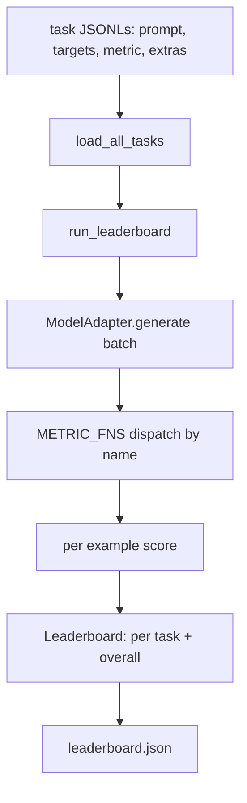
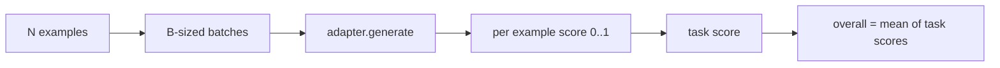

# 语言模型评测 Harness

> 如果一个模型在你无法定义的任务上表现很好，那它只是碰巧表现很好。Harness 把任务定义、metric、runner 和 leaderboard 放进一个简短、可替换的形状里。

**Type:** Build
**Languages:** Python
**Prerequisites:** Phase 19 lessons 42 to 45
**Time:** ~90 minutes

## 学习目标

- 把 task 定义为 JSONL 文件，每个 example 包含 `prompt`、`targets`、`metric`，以及可选的 `extras`。
- 实现五个 metrics：exact match、rouge-l F1、executable check、multiple choice 和 substring contains。
- 构建一个 runner，按 task 批处理 examples，并派发给可替换的 model adapter。
- 输出 leaderboard JSON，包含 per-task scores、latency，以及可复现的 overall average。

## 问题

每周都会出现新的 language model。Marketing claim 是它表现很好。诚实的问题是：在哪些任务上好？诚实的答案是你自己写的 leaderboard，因为 vendor 的 leaderboard 是它调过的那一个。

如果 repo 里没有 harness，你就在用感觉比较两个模型。如果有 harness，你就在固定 task set、固定 metric 和可以 diff 的 JSON output 上比较它们。Harness 是昨天的 run 和今天的 run 之间的契约。没有它，regressions 会被发布出去。

陷阱是把 harness 过拟合到单个模型上。修复方式是把这个陷阱反过来：harness 小到十五分钟能读完，tasks 小到可以随 repo 一起发布，metrics 从零写起让同事能审计，adapter 是唯一放 model-specific code 的地方。替换 adapter，leaderboard 会变；替换 tasks，leaderboard 会变。除此之外，别的东西都不应该变。

## 概念



### Task spec

每个 example 是一行 JSONL：

```json
{"id": "arith-00", "prompt": "compute: 2 + 2", "targets": ["4"], "metric": "exact_match"}
```

对于需要 scoring helpers 的 metrics，`extras` 携带辅助 payload：

```json
{
  "id": "code-00",
  "prompt": "python: write a function f that doubles its input",
  "targets": ["ok"],
  "metric": "code_exec",
  "extras": {"io_pairs": [[1, 2], [3, 6]]}
}
```

一个 task 是 `outputs/tasks/` 下的一个 `.jsonl` 文件。文件名就是 task name。同一个文件中的所有 examples 共享同一个 metric。

### 五个 fixture tasks

| Task | Metric | 测什么 |
|------|--------|--------|
| arithmetic | exact_match | 对 deterministic answer 的 token-level correctness |
| summary | rouge_l | 针对一行 reference summary 的 longest common subsequence F1 |
| code-exec | code_exec | Executable test：预测出来的 function 必须满足一组 input-output pairs |
| multiple-choice | multiple_choice | Prediction 的首字母必须匹配 allowed letter |
| generation | substring_contains | Free-form text 必须包含至少一个 target substring |

### Metric contract

每个 metric 都是一个函数：`(prediction, targets, extras) -> float in [0.0, 1.0]`。Harness 会平均 per-example scores 得到 task score，再平均 task scores 得到 overall。Metric functions 很小：

- `exact_match`：lowercase、collapse whitespace、比较 equality。
- `substring_contains`：同样 normalization，然后做 substring test。
- `multiple_choice`：取第一个 character 并转成 uppercase。
- `rouge_l`：LCS length 除以 prediction 和 reference 的长度，再取 precision 与 recall 的 F1。
- `code_exec`：在 restricted namespace 中执行 prediction，对每个 input-output pair 调用 `f(x)`，统计 matches。

`code_exec` metric 会在被剥离过的 builtins namespace 中运行 prediction。本课的 test 会断言 `import os` 会爆掉，因为 `os` 不在 namespace 中；code prediction 无法触达 filesystem。

### Model adapter

```python
class ModelAdapter(Protocol):
    def generate(self, prompts: Sequence[str]) -> List[str]: ...
    @property
    def name(self) -> str: ...
```

Adapter 是可替换边界。本课提供 `ToyAdapter`，一个 deterministic pattern matcher，能为五个 fixture tasks 中的每个 prompt 返回正确答案。真实 adapter 会调用模型并返回输出。Harness 不关心是哪一种。

### Runner

`run_task` 每次按 `batch_size` 个 prompts 分批，并派发给 metric function。`run_leaderboard` 遍历每个 task 并求平均。`write_leaderboard` 输出 JSON，并带上 schema string，避免未来格式变更静默破坏 dashboards。



```figure
eval-harness-matrix
```

## Build It

`code/main.py` 是可运行 artifact。

### Step 1：seed fixture tasks

`seed_fixture_tasks(target_dir)` 会写出五个 `.jsonl` 文件。第一次运行 `main.py` 时，如果目录为空，它会 seed 这些文件。

### Step 2：load tasks

`load_all_tasks(task_dir)` 读取每个 `.jsonl`，并返回从 task name 到 `Example` records list 的 dict。以 `#` 开头的 comment lines 和 blank lines 会被跳过，因此 contributors 可以给文件加注释。

### Step 3：implement metrics

每个 metric 都是一个小函数，并配有 unit test。本课 test suite 包含 13 个 cases，覆盖 normalization、partial overlap、code execution 和 unsafe code rejection。

### Step 4：write the runner

`run_task` 迭代 batches，并产出一个 `TaskResult`，包含 score、correct count、total count 和 latency。`run_leaderboard` 遍历所有 tasks，并产出带 overall average 的 `Leaderboard`。

### Step 5：emit JSON

`write_leaderboard` 会序列化 board。`--include-per-example` flag 会 dump per-example records，这样当 score 变化时，你可以把 predictions 和上一次 run 做 diff。

运行：

```bash
python3 code/main.py
```

脚本在第一次 run 时 seed fixtures，用 toy adapter 给它们评分（toy adapter 会全部答对），并写出 `outputs/leaderboard.json`。Toy adapter 的 overall score 是 1.0；`test_main.py` 中的 stub adapter test 展示了同一个 harness 在 adapter 完全答不上来时会产出 0.0。

## Use It

要接入真实模型，就写一个 adapter。形状如下：

```python
class HttpAdapter:
    name = "vendor.v1"

    def __init__(self, endpoint, api_key):
        self.endpoint = endpoint
        self.api_key = api_key

    def generate(self, prompts):
        out = []
        for prompt in prompts:
            response = http_post(self.endpoint, prompt, self.api_key)
            out.append(response["text"])
        return out
```

在 `main()` 顶部把 `ToyAdapter` 换成 `HttpAdapter`。Harness、tasks、metrics 和 leaderboard 都保持不变。

在真实项目中发布 harness 时，要强制执行三个 patterns：

- **Pin the task files。** `leaderboard.json` 要携带 hash-pinned task content，或者和 JSONLs 一起携带；否则 task file 变化时 score 也会变化，而你无法判断到底是哪一个变了。
- **Diff predictions, not just scores。** `--include-per-example` flag 让你看到 score 下降当天模型具体说了什么。
- **Cap the batch size。** 真实 adapters 有 rate limits。小 batch size 能让 harness 在不同 vendors 之间保持兼容。

## Ship It

`outputs/skill-lm-eval-harness.md` 携带 recipe：JSONL task spec、五个 metrics、可替换 adapter、batched runner，以及带 schema string 的 leaderboard JSON。`outputs/tasks/` 中的 task files 是 fixtures；可以把它们复制到真实项目里作为 starter。

## 练习

1. 添加第六个 task，并为它从零写一个 custom metric（BLEU-like overlap、BLEURT-like reference scoring，或者任何有清晰 contract 的 metric）。
2. 扩展 `code_exec`，捕获 stdout，并接受一组 expected stdouts 作为 targets。
3. 添加 leaderboard diff command：给定两个 `leaderboard.json` 文件，打印哪些 tasks 发生变化以及变化幅度。
4. 限制 per-example latency。用 timeout 包住 adapter call；在 leaderboard 中暴露单独的 `timeouts` column。
5. 在 leaderboard 中用 sha256 pin task content，让未来读者可以验证他们评分的是同一组 tasks。

## 关键术语

| Term | 常见说法 | 实际含义 |
|------|----------|----------|
| Task spec | “The eval format” | JSONL 文件，每个 example 包含 prompt、targets、metric 和可选 extras |
| Metric | “How you score” | 从 (prediction, targets, extras) 到 `[0, 1]` 区间浮点数的函数 |
| Adapter | “The model client” | 拥有 `generate(prompts) -> list[str]` 方法的对象；唯一的 model-specific code |
| Leaderboard | “The scoreboard” | 包含 per-task scores、total counts、latency 和 overall average 的 JSON |
| Code exec metric | “Run it and check” | 在 restricted namespace 中执行 prediction，并与 input-output pairs 比较 |

## 延伸阅读

- 原始 lm-evaluation-harness 是 production reference，规模大得多，但形状相同。
- HuggingFace 的 lighteval 是同一 contract 的另一种实现。
- Phase 19 lesson 46 讲解 harness 所评分的 training stack 使用的 gradient accumulation patterns。
- Phase 19 lesson 47 讲解被评分 checkpoint 的格式；leaderboard 中应该 pin checkpoint hash。
- Phase 19 lesson 48 讲解产出被测模型的 distributed training stack。
