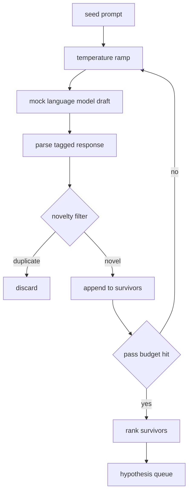

# 假设生成器

> 一个 research agent 如果把同一个问题问两遍，就是在浪费 tokens。关键技巧是强制每个 draft 落在新的位置上。

**Type:** Build
**Languages:** Python
**Prerequisites:** Phase 19 Track A lessons 20-29
**Time:** ~90 minutes

## 学习目标

- 从 seed prompt 驱动 sampler，并把输出转换成 typed hypothesis records。
- 每一轮都提高 sampler temperature，让下一份 draft 比上一份漂移得更远。
- 用一个小 embedding model 和 cosine distance threshold 过滤 near duplicates。
- 用融合 novelty、specificity 和 testability 的 scoring function 对幸存项排序。
- 让每一步都保持 deterministic，确保同一个 seed 总是生成同一个 queue。

## 为什么先生成、再过滤

一个 planner 只问一个 model 一次，就只会得到一个 hypothesis。对于 worked example，这可以接受。对于 research loop，这个形状不对。Loop 需要的是一个有深度的 ranked queue，这样当第一个 hypothesis 失败时，runner 可以直接拿到下一个，而不必再次支付完整 sampling pass 的成本。

两种想法组合起来生成这个 queue。第一种是 temperature ramping：每次经过 sampler 都把 temperature 提高一点，鼓励后面的 drafts 走得更远。第二种是 novelty filtering：每生成一个 draft，generator 就测量它和所有 prior survivors 之间的 embedding distance，并拒绝任何落在同一个 cluster 内的内容。

本课附带一个 mock language model，它会针对固定 prompts 返回 scripted token sequences。这个 mock 足够 exercise 完整路径：seed prompt 进入，temperature ramp 被应用，candidates 被解析，novelty filter 运行，ranked queue 输出。

## Hypothesis 形状

```text
Hypothesis
  id             : int           (monotonic within a run)
  text           : str           (the claim)
  variables      : list[str]     (what changes between conditions)
  metric         : str           (what the runner will measure)
  baseline_ref   : str | None    (which paper or run the comparison cites)
  draft_pass     : int           (which sampler pass produced this)
  temperature    : float         (the sampler setting at draft time)
  novelty_score  : float         (distance from prior survivors, 0..1)
  rank_score     : float         (weighted sum used for ordering)
```

`variables` 和 `metric` 不是自由文本。Parser 会从 tagged response 中提取它们。Lesson fifty-two 中的 runner 在构建 experiment config 时会直接读取这些字段。

`baseline_ref` 是 optional，但推荐提供。Lesson fifty-three 中的 evaluator 需要一个 baseline 作为比较对象。如果 hypothesis 省略它，evaluator 会 fallback 到同一 metric 上的 previous run。

## 架构



Loop 很直接。真正有意思的是，每个 box 都有硬 contract。

## Temperature ramp

从 `t_min` 开始，到 `t_max` 结束，step 是 `(t_max - t_min) / (n_passes - 1)`。每一 pass 都用当前 temperature 调用 sampler，从 `GeneratorConfig.schedule()` 生成 `n_passes` 个等间隔 values。Mock model 会通过在一小组 scripted responses 之间切换来遵守 temperature，这些 responses 以 `(prompt, temp_bucket)` 为 key。Buckets 是 open intervals，因此 temperature 的小变化也会选中不同 bucket，产出不同 draft。在 production 中，sampler 会是真实模型，并把 `temperature=t` 传进去。

默认 schedule 是从 `0.2` 到 `1.2` 的六次 passes。六次足以填满 queue，同时不会为了最终会被 novelty filter 拒绝的 samples 支付过多成本。低于 `0.2` 时，model 会鹦鹉学舌般重复 seed。高于 `1.2` 时，responses 往往会偏离主题并 fail parser。

## Novelty filter

每个 draft 被解析后，generator 会 embed 它的 text，并与每个 accepted hypothesis 比较。Embedding 是一个小的 hashed bag of word tokens，并被 normalised 到 unit length。两个 unit vectors 的 cosine distance 是 `1 - dot(a, b)`。如果一个 draft 到任何 prior survivor 的最小 distance 都高于 `novelty_threshold`，它就通过。默认值是 `0.25`。

Hashed embedding 并不精巧。它 deterministic、零依赖，并且足以抓住最明显的情况：两个 drafts 共享了大部分 nouns。Production deployment 会换成一个小 sentence model。Interface 保持不变。

## Rank score

```text
rank_score = w_novelty * novelty_score
           + w_specificity * specificity_score
           + w_testability * testability_score
```

三个 sub scores。`novelty_score` 是到 prior survivors 的最小 embedding distance。`specificity_score` 是 hypothesis 中 concrete variables 的数量除以 target count。`testability_score` 在 hypothesis 同时指定 metric 和 baseline 时为 one，只指定 metric 时为 half，其他情况为 zero。

默认 weights 是 `0.4`、`0.3`、`0.3`。Weights 放在 generator config 中，因此 downstream lesson 可以调整它们，而不必 fork code。

## Mock language model

```python
class MockLLM:
    def sample(self, prompt: str, temperature: float, seed: int) -> str:
        ...
```

给定 `(prompt, temperature, seed)` triple，sampler 是 deterministic 的。Mock 会维护一张 scripted response table，以 `(prompt_signature, temperature_bucket)` 为 key。如果 table 中没有某个 key，sampler 会返回一个 fallback，让 parser fail。其中一个 test 会 exercise 这条 fallback path。

Seed 会混入 response，因此相同 `(prompt, temperature)` pair 搭配不同 seeds 会生成不同 drafts。Tests 会 pin seed，以保持结果 reproducible。真实部署中，seed 会来自 system clock 或 counter。

## Output queue

输出是一个按 `rank_score` descending 排序的 `Hypothesis` records list。Lesson fifty-two 中的 runner 会 pop head，运行 experiment；lesson fifty-three 中的 evaluator 会写回 verdict。如果 verdict 说这个 hypothesis 是错的，runner 就 pop 下一个。

Queue 是 finite 的。当它为空时，orchestrator 可以 widen seed prompt 并再次运行 generator，也可以停止并报告 budget exhausted。

## 如何阅读代码

`code/main.py` 定义了 `Hypothesis`、`MockLLM`、`HypothesisGenerator` 和一个 deterministic demo。Generator 暴露单一 `run(seed_prompt)` method，返回一个 sorted queue；pass count 从 `GeneratorConfig.n_passes` 读取，而不是作为 argument 传入。Embedding 是 hashed bag of tokens。Novelty filter 是一个单独 function。Rank score 也是一个单独 function。没有任何东西依赖 `numpy`；embedding math 是 pure stdlib，因此 lesson 保持 portable。

`code/tests/test_generator.py` 覆盖 linear path、duplicate rejection path、parser failure path、temperature ramp boundaries 和 rank ordering。

## 它在整体流程中的位置

Lesson fifty 生成 queue。Lesson fifty-one 取 queue head 并运行 literature search 来 confirm 或 refute 它。Lesson fifty-two 取同一个 head 并运行真实 experiment。Lesson fifty-three 读取两边 outputs 并写出 verdict。这四课组合成一个没有人类参与的 research loop；人类可以在任意 boundary 介入。
