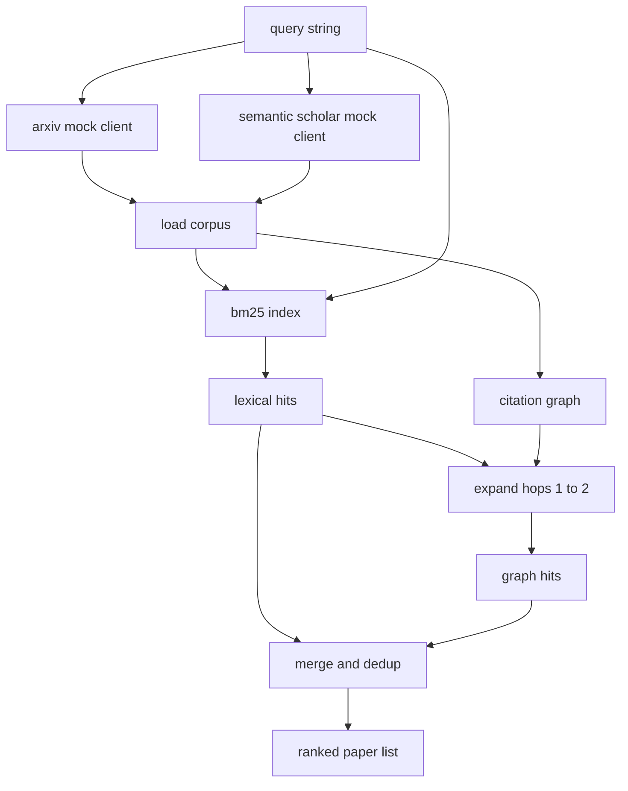

# 文献检索

> 一个 hypothesis 很便宜。知道是否已经有人证明过它，才是昂贵的部分。在 runner 启动 sandbox 之前，先构建能回答这个问题的 retrieval layer。

**Type:** Build
**Languages:** Python
**Prerequisites:** Phase 19 Track A lessons 20-29
**Time:** ~90 minutes

## 学习目标

- 用下游 loop 会读取的字段，建模一个小型 paper record。
- 只用 stdlib data structures，在 abstracts 上构建 BM25 index。
- 遍历 citation graph，把 lexical search 漏掉的 papers 浮出来。
- 通过 stable paper id，对 lexical pass 和 graph pass 中的 hits 做 deduplicate。
- 把两个 mock external APIs 包在一个 client 后面，这样真实 endpoints 接入后，上游 call site 不需要改变。

## 为什么需要两轮检索

对 abstracts 做 keyword search，会返回和 query 共享 vocabulary 的 papers。这覆盖了大部分表面结果。它会漏掉两种情况。第一种是 foundational paper 使用了不同 vocabulary；例如搜索 "sparse attention" 时，可能漏掉一篇题为 "block selection in transformer routing" 的论文。第二种是相关 paper 是某个已知 anchor 的 follow-up；与其 brute force 整个 abstract pool，不如先找到 anchor，再沿 citation graph 向前走。

本课会构建两种 pass。Abstracts 上的 BM25 捕捉 lexical hits。Citation graph traversal 从 seed set 开始，向前和向后扩展一到两跳。二者的 union 会按 paper id 去重，并用一个小的 combined score 排序。

## Paper 形状

```text
Paper
  id          : str           (stable identifier, "p001" for the mock corpus)
  title       : str
  abstract    : str
  year        : int
  authors     : list[str]
  references  : list[str]     (paper ids this paper cites)
  citations   : list[str]     (paper ids that cite this paper)
  source      : str           (which mock api supplied it, "arxiv" or "s2")
```

`references` 和 `citations` 字段共同形成 directed citation graph。两个 mock APIs 返回的字段有重叠，但并不完全相同，因此 corpus loader 会按 `id` 对它们做 union。

## 架构



Retrieval client 拥有两种 passes 和 merge。Caller 只交给它一个 query，然后得到 ranked list；每个 entry 都携带 per paper score fields（`bm25_score`、`graph_distance`、`recency_score`、`final_score`），用来解释排序。

## 从零实现 BM25

Implementation 使用标准 Okapi BM25，默认参数是 `k1=1.5`、`b=0.75`。Index 是两个 dictionaries：`term -> doc_frequency` 和 `term -> list of (doc_id, term_count)`。Document length 是 abstract 的 token count。Average document length 在 index build time 计算一次。Scoring query 时，会对 query terms 求和，形式是 `idf * tf_norm`，其中 `tf_norm` 是标准 BM25 的 length-normalised term frequency。

Tokenizer 会先 `lower`，再按 non alphanumeric split。它不做 stemming。Production system 会换成一个小 stemmer。Interface 保持不变。

```text
idf(t)      = log((N - df + 0.5) / (df + 0.5) + 1.0)
tf_norm(t)  = (f * (k1 + 1)) / (f + k1 * (1 - b + b * dl / avgdl))
score(d, q) = sum over t in q of idf(t) * tf_norm(t)
```

## Citation graph traversal

Graph 会从 corpus 中构建一次。Forward edges 从一篇 paper 指向它的 references。Backward edges 从一篇 paper 指向 citations 它的 papers。Traversal 是 breadth first search，以 top BM25 hits 作为 seeds，并限制在两跳内。

两跳是刻意设置的上限。一跳太浅；agent 经常需要 immediate ancestor 或 descendant。三跳会在 connected graph 上让 result size 爆炸，并且容易偏离主题。本课把 hop limit 暴露成 config knob，方便 downstream loop 收紧它。

## Dedup 与 ranking

两种 passes 会返回重叠 sets。Merge 用 paper id 做 key。每篇 paper 的 final score 是一个 weighted blend。

```text
final_score = w_bm25 * bm25_score_norm
            + w_graph * graph_score
            + w_recency * recency_score
```

`bm25_score_norm` 是 BM25 score 除以 merged set 中最大的 BM25 score，因此该字段位于 zero 到 one。`graph_score` 对 direct lexical hits 为 one，对 one hop 为 `0.6`，对 two hops 为 `0.3`，其他情况为 zero。`recency_score` 是从 corpus minimum year 的 zero 到 maximum year 的 one 的 linear ramp。

默认 weights 是 `0.5`、`0.3`、`0.2`。Weights 是 config；陈旧主题可能会降低 recency，而快速变化的主题会提高它。

## Mock corpus

Corpus 有一百篇 papers，由 `build_corpus()` 生成。每篇 paper 都有一个 hand-written title 和 abstract，主题来自五类之一：attention sparsity、retrieval augmentation、low rank adapters、dataset distillation 和 evaluation harnesses。References 和 citations 会被连线，使每个 topic 形成一个 connected sub graph，并带有少量 cross-topic edges。

两个 mock API clients（`ArxivMockClient`、`SemanticScholarMockClient`）读取同一个 corpus，但暴露不同字段。Arxiv 返回 title、abstract、year、authors。Semantic Scholar 添加 references 和 citations。Retrieval client 按 id 做 union；cross client field disagreement handling 留给后续课程处理。

## Lessons 52 和 53 会读取什么

Lesson fifty-two 中的 runner 会读取 `paper.id`、`paper.title`，以及 abstract 的前三句，作为 experiment context。Lesson fifty-three 中的 evaluator 会读取 `paper.year` 和 `paper.references`，以便把 baseline 归因到某篇具体 paper。

Retrieval client 返回一个 `RetrievalResult`，其中同时包含 ranked list 和 per query metrics：hit count、average score、top score、total wall time。Runner 会记录这些 metrics，让 downstream observability pass 可以随时间绘制 quality。

## 如何阅读代码

`code/main.py` 定义了 `Paper`、`ArxivMockClient`、`SemanticScholarMockClient`、`BM25Index`、`CitationGraph`、`RetrievalClient` 和一个 deterministic demo。Mock clients 和 corpus 都在同一个文件中，让 lesson 保持 portable。BM25 implementation 是一个 class，约六十行。Graph traversal 是一个 method。

`code/tests/test_retrieval.py` 覆盖 lexical path、graph path、merge、dedup 和 empty query。

## 它在整体流程中的位置

Lesson fifty 生成一个 hypothesis。Lesson fifty-one 搜索 literature，判断这个 hypothesis 是否已经 settled。Lesson fifty-two 在它尚未 settled 时运行 experiment。Lesson fifty-three 读取 retrieval result 和 experiment metrics 来写 verdict。Retrieval client 是四个 stages 里最便宜的一个，因此会在 orchestrator 中最先运行。
