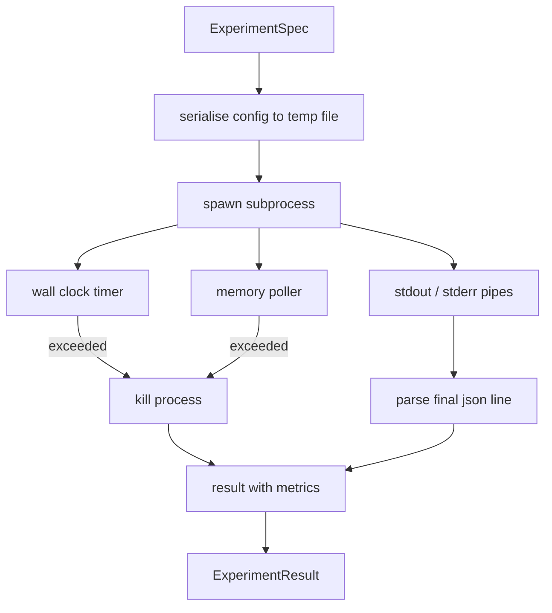

# 实验运行器

> Loop 的诚实程度，取决于它的测量是否诚实。构建一个 runner：接收 spec，在 sandboxed subprocess 中执行它，并输出 evaluator 可以信任的 JSON metrics blob。

**Type:** Build
**Languages:** Python
**Prerequisites:** Phase 19 Track A lessons 20-29
**Time:** ~90 minutes

## 学习目标

- 把 experiment 编码成 typed spec，让 runner 可以把它 serialise 给 subprocess。
- 启动一个带 hard wall clock timeout 和 soft memory cap 的 subprocess，并把二者都暴露为 terminal conditions。
- 把 stdout、stderr 和 structured metrics blob 捕获进单个 result record。
- 构建 ablation table，在固定 base spec 上一次 sweep 一个 configuration knob。
- 给定 seed 时保持每个 result deterministic，让 evaluator 跨 runs 看到相同数字。

## 为什么用 subprocess

Research loop 会运行不可信代码。Hypothesis 来自 sampler，experiment script 也来自同一路径；把其中任何一个当作 in-process safe，就是在等待一次会拖垮 orchestrator 的 crash。Subprocess 是语言自带的最简单隔离：独立 process、独立 address space，以及 parent side 上的 signal handle。

这里的 runner 不实现完整 sandboxing。没有 cgroup，没有 seccomp filter，也没有 namespace remapping。它拥有的是 wall clock timeout、用于观察 memory growth 的 polling loop，以及在任一 limit 被超过时终止 process 的 kill path。这是每个更复杂 sandbox 都会扩展的 runtime contract。本课把 contract 控制在一次阅读能读完的大小。

## ExperimentSpec 形状

```text
ExperimentSpec
  spec_id        : str            (stable id, "exp_001")
  hypothesis_id  : int            (link back to the queue from lesson 50)
  script_path    : str            (path to the python script to run)
  config         : dict           (passed to the script as one json arg)
  seed           : int            (deterministic seed for the experiment)
  wall_timeout_s : float          (hard timeout, killed on exceed)
  memory_cap_mb  : int            (soft cap, polled; killed on exceed)
  metric_keys    : list[str]      (which fields the evaluator will read)
```

Script 位于磁盘上；runner 会把 config 写到一个 temp file path，script 再读取它。Script 需要在 stdout 上打印一行 JSON，其中 keys 是 `metric_keys` 的 superset。Stdout 上其它内容也会被捕获，但 metrics parser 会忽略它们。

## 架构



Runner 是一个 class，核心 method 只有一个。Poller 是一个小 thread，每隔一个 poll interval 醒来一次；如果平台暴露 proc filesystem，它会读取 subprocess 的 `psutil` 等价信息；如果平台不暴露，就 fallback 成 no op。

## 为什么是 soft memory cap

Hard memory caps 需要 `resource.setrlimit`，并且只在 POSIX 上工作。本课交付一种 portable approach：从平台读取 resident set size，如果超过 cap，就 kill subprocess。这个 cap 是 soft 的，因为 poller 有非零 interval；process 可能在两次 polls 之间 spike 到 cap 以上，然后又降回来。Runner 会记录 maximum observed RSS，让 evaluator 知道这次 run 离 limit 有多近。

在不支持 process inspection 的系统上，poller 会记录一次 one-time warning，并禁用自身。Wall clock timeout 仍然生效。本课 tests 会覆盖两条路径。

## 捕获 stdout 和 stderr

Runner 会在 completion 时 drain 两个 pipes。Stdout 会逐行扫描；最后一行能 parse 为 JSON 且包含所有 required `metric_keys` 的内容，会被当作 metrics blob。更早的 JSON lines 会作为 `intermediate_metrics` 保存在 result 里；evaluator 可以用这些数据绘制 learning curves。

Stderr 会原样捕获进 result。Runner 不会因为 non zero exit code 而 raise；它会把 code 记录到 result 中。任何 non zero exit 都会被标记为 `"crash"`，即使 script 已经打印了 metrics，因此 evaluator 默认会把 partial runs 当作 failures。

## Ablation table

```python
def ablate(base: ExperimentSpec, knob: str, values: list[Any]) -> list[ExperimentSpec]:
    ...
```

给定一个 base spec 和 knob name，这个 helper 会为每个 value 返回一个 spec，其中 `config[knob]` 被 override。每个 spec 都会得到 derived `spec_id`（`f"{base.spec_id}_{knob}_{value}"`）。Runner 提供一个 `AblationRunner`，按顺序运行这些 specs，并返回一个按 knob value keyed 的 `AblationTable`。

为什么一次只改一个 knob。Full factorial sweeps 会指数级爆炸，并产出 evaluator 难以解释的 results。一次一个 knob 会产生一条干净轴，evaluator 可以直接 plot。本课只通过 caller 组合多次 single knob ablations 来支持 multi knob sweeps。

## Determinism

每个 spec 都携带 seed。Runner 会通过 config dict 把 seed 转发给 script（`config["__seed"] = spec.seed`）。`code/experiments/` 中的 mock experiment scripts 会 honour 这个 seed，并在跨 runs 时产出相同 metrics。第五十三课的 evaluator 依赖这个性质；没有 determinism，一个“regression”可能只是不同 random initialisation。

## Mock experiment script

本课提供一个 experiment script：`code/experiments/sparsity_experiment.py`。它是一个真实 script，会读取自己的 config file，使用 numpy random pass 模拟一个小 training run，并打印 JSON metrics blob。这个 script honour 一个 `sleep_s` knob，用来测试 timeouts；也 honour 一个 `allocate_mb` knob，用来测试 memory poller。

Simulation 并没有训练任何真实模型。它是一个 numerical computation，模仿 training loop 的形状：loss curve、final perplexity、wall time。本课重点是 runner，不是 simulation。真实 experiment script 会 import 一个 model。

## Result 形状

```text
ExperimentResult
  spec_id              : str
  hypothesis_id        : int
  exit_code            : int
  terminal             : "ok" | "timeout" | "oom" | "crash"
  wall_time_s          : float
  peak_rss_mb          : float | None
  metrics              : dict
  intermediate_metrics : list[dict]
  stdout_tail          : str
  stderr_tail          : str
```

Evaluator 会优先读取 `metrics` 和 `terminal`。如果 terminal 不是 `"ok"`，experiment 会被算作 failed run，evaluator 的 verdict 会自动生成。否则，metrics 会继续进入 significance test。

## 如何阅读代码

`code/main.py` 定义 `ExperimentSpec`、`ExperimentResult`、`ExperimentRunner`、`AblationRunner` 和一个 deterministic demo。Subprocess management 集中在一个 class 里。Memory poller 是一个小 thread。Ablation helper 是一个单独 function。

`code/experiments/sparsity_experiment.py` 是 tests 使用的 mock experiment。它从 argv 读取 config file path，并在完成时写出一行 JSON metrics。

`code/tests/test_runner.py` 覆盖 success path、timeout path、crash path、ablation table，以及跨两次 runs 的 determinism check。

## 它在整体流程中的位置

第五十课生成 hypothesis。第五十一课过滤掉文献中已经解决的问题。第五十二课为剩下的问题运行 experiment。第五十三课读取 result，运行 significance test，并写出 orchestrator 存到 hypothesis id 上的 verdict。
