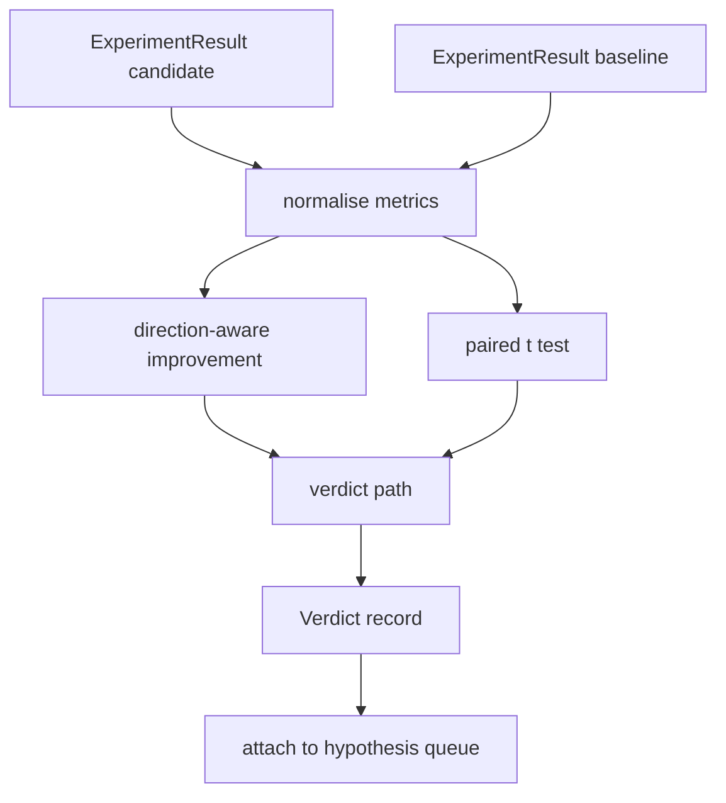

# Result Evaluator

> Runner 已经产出数字。Evaluator 要判断这些数字是 improvement、regression，还是 noise。构建一条 verdict path，把 metrics 变成一句结论。

**Type:** Build
**Languages:** Python
**Prerequisites:** Phase 19 Track A lessons 20-29
**Time:** ~90 minutes

## 学习目标

- 使用 direction-aware improvement 和固定 threshold，把 candidate run 与 baseline 做比较。
- 从头实现基于 per-seed metrics 的 paired t test，并读取得到的 p value。
- 归一化 log-scaled metrics，让 downstream report 可以把它们和 linear metrics 混合展示。
- 输出 per-hypothesis verdict，让 orchestrator 能把它附回 lesson fifty 的 queue。
- 让每一步都保持 pure，确保同一组 inputs 总是得到同一个 verdict。

## 为什么要用 paired test

Runner 产出的单个数字并不能说明变化是否真实。同一个 configuration 换一个 seed，就会得到不同的 perplexity。这个变化可能只是 noise。正确的比较方式是 paired：使用相同 seeds 和相同 data，candidate 跑一次，baseline 跑一次。每个 seed 贡献一个 difference。differences 的 mean 是 effect。differences 的 standard error 是 noise floor。

本课会从头实现这个 test。不使用 `scipy.stats`。这段数学足够小，一屏就能读完。

```text
diffs    = [a_i - b_i for i in seeds]
mean     = sum(diffs) / n
variance = sum((d - mean) ** 2 for d in diffs) / (n - 1)
t_stat   = mean / sqrt(variance / n)
df       = n - 1
p_value  = two_sided_p(t_stat, df)
```

Two-sided p value 使用 regularised incomplete beta function。本课附带一个小实现，内部使用 Lentz continued fraction。整个实现只是大约六十行 stdlib math。

## Direction-aware improvement

有些 metrics 越高越好，比如 accuracy 和 throughput。另一些 metrics 越低越好，比如 loss、perplexity 和 wall time。Evaluator 会在每个 metric 上携带一个 `direction` 字段。

```text
if direction == "higher_is_better":
    improvement = (candidate - baseline) / abs(baseline)
elif direction == "lower_is_better":
    improvement = (baseline - candidate) / abs(baseline)
```

Improvement 是带符号的。在 higher-is-better metric 上，负 improvement 意味着 candidate 更差。Verdict path 会同时读取 sign 和 magnitude。

一个固定 threshold（`improvement_threshold=0.02`，也就是 2%）决定变化是否大到值得下结论。低于这个 threshold 时，不管 p value 是多少，verdict 都是 `"noise"`；这个 loop 不关心用户无法测量到的变化。

## 架构



Evaluator 会运行三段相互独立的 computation，并在 verdict path 中把它们合并。每段 computation 都是没有 shared state 的 pure function。

## Log normalisation

Perplexity 是 loss 的 exponential。Loss 降低 0.1，会带来更大的 perplexity 降幅。直接比较两个 configuration 的 perplexity 没问题，但如果要把它和 linear metrics 混在同一份 report 里，就需要先归一化。

本课会对任何 `scale` 字段为 `"log"` 的 metric 先取 natural log，再计算 improvement。Threshold 也在 log space 中应用。Perplexity 从 32 降到 28 时，`log(28) - log(32) = -0.133`；对于 lower-is-better metric，这已经远超 2% threshold。

```text
if scale == "log":
    a = log(candidate)
    b = log(baseline)
else:
    a = candidate
    b = baseline
```

`scale="linear"` 的 metrics（默认值）会跳过这个 transform。同一条 code path 同时处理两种情况。

## Per-seed paired test

Lesson fifty-two 的 runner 会为每次 run 产出一个 final metrics blob。对于 paired test，evaluator 需要 candidate 的每个 seed 一个 blob，baseline 的每个 seed 也一个 blob。Orchestrator 会在一组 seeds 上分别用两种 configuration 运行同一个 experiment，然后把两组 `ExperimentResult` records 交给 evaluator。

Evaluator 会按 seed 配对它们（seed 存在 `result.metrics["seed"]` 中），然后遍历 requested metric。如果两组 list 的 seeds 无法匹配，evaluator 会抛出 `PairingError`。这时 orchestrator 应该重新运行。

## Verdict shape

```text
Verdict
  hypothesis_id          : int
  metric                 : str
  direction              : "higher_is_better" | "lower_is_better"
  scale                  : "linear" | "log"
  candidate_mean         : float
  baseline_mean          : float
  improvement            : float       (signed, fraction; see direction rules)
  p_value                : float | None  (None if n < 2)
  significance_threshold : float
  improvement_threshold  : float
  verdict                : "improved" | "regressed" | "noise" | "failed"
  rationale              : str
```

Verdict path 是一个很小的 decision table：

```text
1. If any candidate result has terminal != "ok": verdict = "failed"
2. else if |improvement| < improvement_threshold:  verdict = "noise"
3. else if p_value is None or p_value > significance: verdict = "noise"
4. else if improvement > 0:                          verdict = "improved"
5. else:                                             verdict = "regressed"
```

`rationale` 是一句 human-readable sentence，orchestrator 可以把它按 hypothesis id 记入 log。

## 如何阅读代码

`code/main.py` 定义了 `MetricSpec`、`Verdict`、`Evaluator`、t statistic、incomplete beta helpers，以及一个 deterministic demo。T test 使用 pure stdlib math 实现；numpy 只用于读取 metrics list，并计算 means 和 variances。

`code/tests/test_evaluator.py` 覆盖 improved path、regressed path、noise path（small improvement）、noise path（low n）、failed terminal path、log-normalised path、对照 known reference value 的 t test，以及 pairing error。

## 它在系统中的位置

Lesson fifty 产出 hypothesis queue。Lesson fifty-one 会过滤掉 literature 已经 settle 的内容。Lesson fifty-two 会在多个 seeds 上，用 candidate 和 baseline configurations 运行 experiment。Lesson fifty-three 读取这些 runs，并写出 verdict。Orchestrator 会把四课拼在一起：

```text
for hypothesis in queue:
    literature = retrieval.search(hypothesis.text)
    if literature_settles(hypothesis, literature):
        attach(hypothesis, verdict="settled")
        continue
    candidates = runner.run_all(specs_for(hypothesis))
    baselines  = runner.run_all(baseline_specs_for(hypothesis))
    metric_spec = MetricSpec("perplexity", direction=LOWER, scale=LOG)
    verdict = evaluator.evaluate(hypothesis.id, metric_spec, candidates, baselines)
    attach(hypothesis, verdict)
```

这个 orchestrator 不在本课中；这四课可以直接组合起来，除了它们各自定义的 dataclasses 之外，不需要额外 glue。
