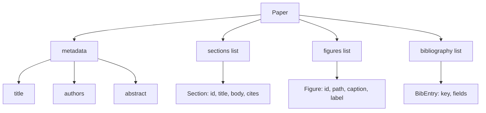
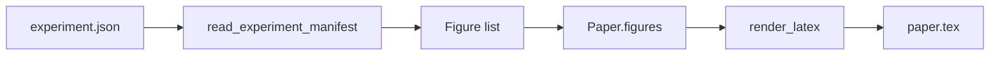
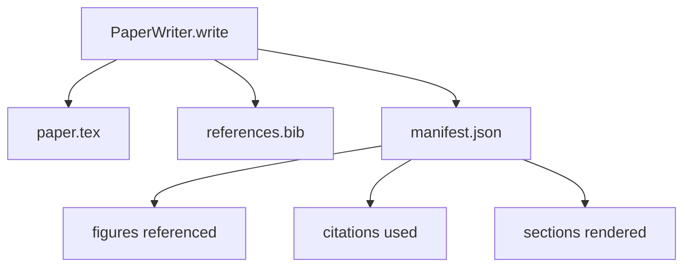

# Paper Writer

> LaTeX skeleton 是 researcher 和 typesetter 之间的 contract。Contract 一旦破坏，document 就不会 compile，而且失败会很响亮。先构建 skeleton，再填充内容。

**Type:** Build
**Languages:** Python
**Prerequisites:** Phase 19 lessons 50-53
**Time:** ~90 minutes

## 学习目标

- 把 research paper 当作带有已知 section graph 的 structured artifact，而不是 freeform document。
- 在写任何 prose 之前，生成一个声明 abstract、sections、figure slots 和 bibliography keys 的 LaTeX skeleton。
- 通过 deterministic slot mechanism，把 experiment outputs（paths 和 captions）中的 figures 注入 skeleton。
- 接入一个 mocked prose generator，让它从 structured outline 填充每个 section，使 harness 可以在没有 model 的情况下测试。
- 输出单个 `paper.tex`、一个 `references.bib`，以及一个 manifest，列出每个被引用的 figure 和每个用到的 citation。

## 为什么先做 skeleton

从 prose 开始的 draft 会积累 structural debt。Introduction 长出三段本该放在 related work 的内容。Figure 在定义之前就被引用。Bibliography 最后为同一篇 paper 留下三个 keys。等 author 注意到时，rewrite cost 已经高于 writing cost。

Skeleton 会把这个过程反过来。Structure 先作为 data 声明。Sections 是带名字和顺序的 slots。Figures 是带 ids 和 captions 的 slots。Bibliography keys 在顶部声明，并指向它们对应的 entries。Prose 一次一个 slot 地生成进去。Harness 可以在任何 prose 写入之前验证：每个 figure 都有 slot，每个 citation 都有 entry，每个 section 都会出现在 table of contents 中。

这和前面 lessons 对 plans、tool calls、traces 使用的 discipline 一样。Structure 就是 contract。

## Paper shape

每个 field 都只是普通 Python data。Renderer 是从 `Paper` 到 LaTeX string 的 pure function。Harness 可以在 rendering 前 introspect 这篇 paper：统计 sections，列出缺失的 figure files，检查每个 `\cite{key}` 都有匹配的 `BibEntry`。

## Render contract

Renderer 保证三个 properties。第一，skeleton 中的每个 figure slot 都会 emit 一个 `\begin{figure}` block，并使用 `fig:<id>` 形式的 stable label。第二，每个 section 都会 emit 一个 `\section{}`，并使用 `sec:<id>` 形式的 stable label，让 cross-references 可以工作。第三，bibliography 会 emit 一个 `\bibliography` block，而它的 `references.bib` 只包含 paper 上声明的 entries，不多也不少。

违反其中任何一条都是 render error，而不是 warning。Skeleton 就是 contract；如果 render 静默丢掉了一个 figure，那就是 contract break。

## 从 experiments 注入 figures

这个 track 前面的 lessons 会把 experiment outputs 生成为 JSON manifests。每个 manifest 都带有一组 artifacts，其中包含 paths 和 short captions。Paper writer 会读取这个 manifest，并产出 `Figure` records。

Injection 是 deterministic 的。Figure ids 由 experiment name 加 monotonic counter 派生。Captions 来自 manifest。Paths 会被 normalised 成相对于 paper output directory 的路径，这样即使 experiment outputs 位于磁盘其他位置，LaTeX 也能 compile。

## Mocked prose generator

本课不会调用 model。`MockProseGenerator` 会读取一个 outline shape，并 deterministic 地 emit prose。Outline shape 是每个 section 一条 short string。Generator 会把这条 string 扩展成两个 short paragraphs，并把 section title 编织进去。Generated prose 只会在 outline 声明时提到 figures 和 citations。

这已经足够测试 writer 的每个 behaviour。真实实现会把 generator 换成 model call。它周围的 harness 不需要变化。这就是把 prose generator 声明成 callable 的价值：test 替换成 deterministic generator，production 替换成 model，pipeline 其余部分完全相同。

## Manifest output

Writer 会向 output directory 输出三个文件。

Manifest 是 downstream evaluator 或 critic loop 会读取的内容。它不会 parse LaTeX；它读取 manifest。下一课 critic loop 会把这个 manifest 作为 input，并产出 feedback list。因此 manifest 是 contract 的一部分，而 LaTeX 不是。

## Validation gates

Writer 在写入任何文件之前会运行四个 gates。

1. Paper 内每个 figure id 都是 unique 的。
2. 每个 section 的 `cites` field 都引用 paper 上声明过的 bibliography key。
3. Abstract 非空。
4. Title 非空。

Gate 失败会抛出 `PaperValidationError`，并给出精确原因。Harness 会把这个 reason 暴露为 failure mode。这里没有 partial write：要么三个文件全部 emit，要么一个都不写。

## 如何阅读代码

`code/main.py` 定义了 `Paper`、`Section`、`Figure`、`BibEntry`、`PaperValidationError`、`MockProseGenerator`、`PaperWriter`，以及 `render_latex` function。`write` method 接收一个 output directory，并 emit `paper.tex`、`references.bib` 和 `manifest.json`。`read_experiment_manifest` helper 会把一组 experiment manifests 转换成 `Figure` records。

`code/tests/test_paper_writer.py` 覆盖：没有 sections 时的 skeleton render、带两个 sections 和两个 figures 的 full render、missing-citation gate、duplicate-figure-id gate、manifest content，以及 LaTeX-string contract（每个 section 都 emit 一个 `\section{}`，每个 figure 都 emit 一个 `\begin{figure}`）。

## 继续扩展

真实实现会需要两个 extension。第一，multi-format render：同一个 `Paper` shape 可以 compile 成 blog posts 用的 Markdown，也可以 compile 成 preview 用的 HTML。Renderer 会变成 `Paper` 上的一种 strategy。第二，citation enrichment：writer 根据 citation key 拉取 BibTeX entries，并使用本地 DOI cache。这两者都有价值，而且都可以在不触碰 skeleton contract 的前提下加入。

Skeleton 是这套方案押下的 bet。Sections、figures 和 citations 以 data 的形式声明，prose 被生成进 slots，manifest 与 LaTeX 一起 emit。其他所有改进都可以叠在它上面。
