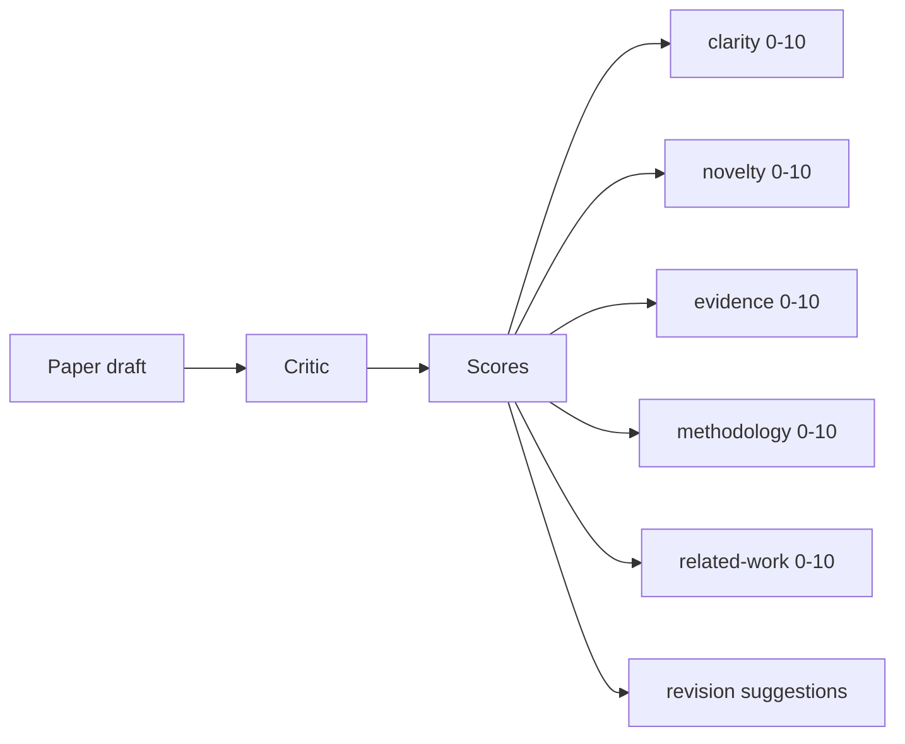
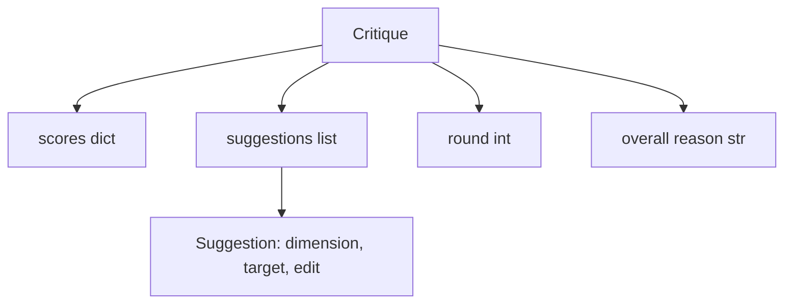
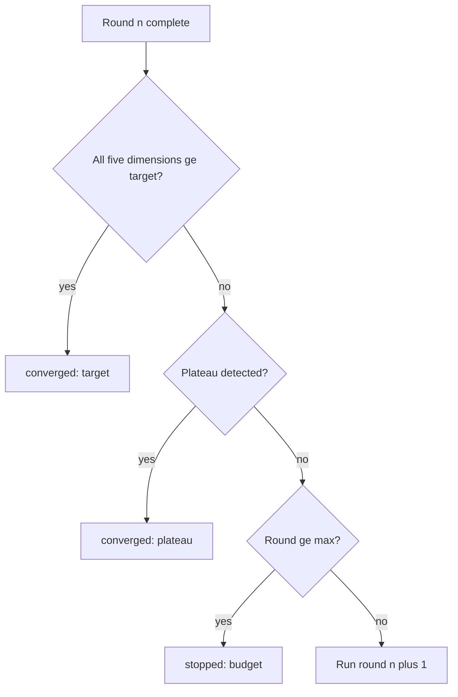
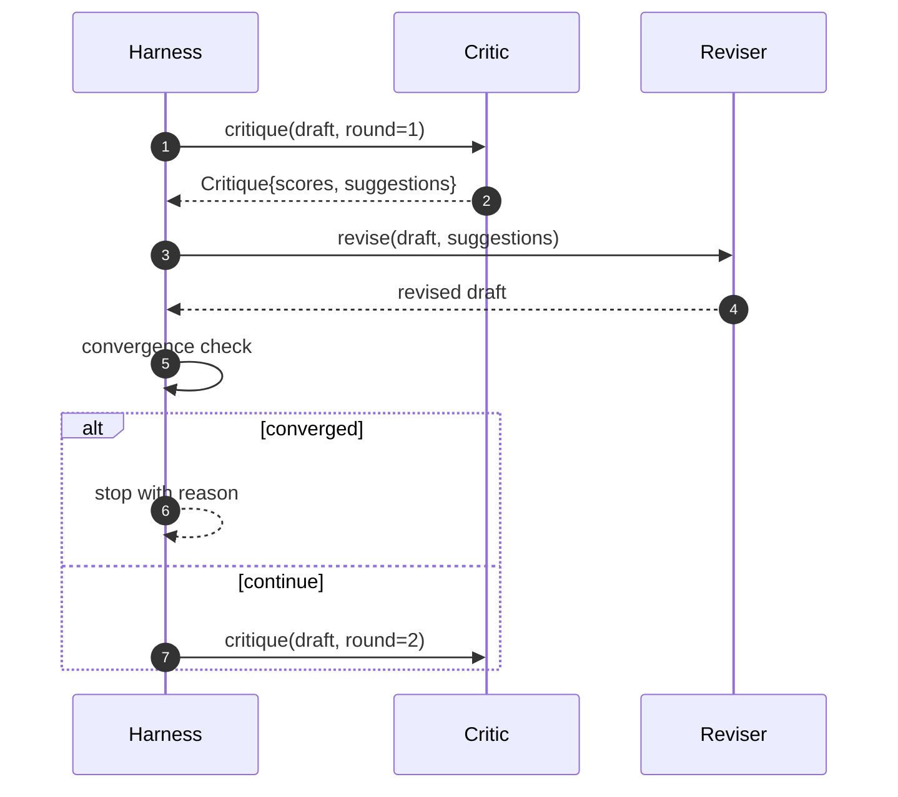

# Critic Loop

> 第一次就返回“looks good”的 critic 是坏的。永远返回“needs work”的 critic 也是坏的。真正有意思的 critic 是会收敛的那个，而你必须工程化这种收敛。

**Type:** Build
**Languages:** Python
**Prerequisites:** Phase 19 lessons 50-53
**Time:** ~90 minutes

## 学习目标

- 从五个固定维度给 paper draft 打分：clarity、novelty、evidence、methodology、related-work。
- 把每一轮 critique 应用为 structured revision diff，而不是 freeform rewrite。
- 通过比较各轮 scores 检测 convergence；在 plateau、target met 或 budget exhausted 时停止。
- 用 max-iteration budget 限制 rounds，避免 non-converging critic 永远运行。
- 输出 per-round trace，让 dashboard 或下一阶段可以渲染 score trajectory。

## 为什么是五个固定维度

Freeform critic 是一个返回建议段落的模型。下一轮 revision 会把这段话当作 ambient context。Rewrite 是否回应了 criticism 无法验证，因为 criticism 从来没有结构。

五个维度给 harness 一个契约。



Score 是一个 vector。Harness 会观察每个 dimension 在 rounds 之间如何变化。一个 revision 提高了 clarity，却把 evidence 打崩，就是 evidence 上的 regression，convergence check 会看见它。纯 model critic 无法提供这个保证。

## Critique 形状



每条 suggestion 都携带它要改善的 dimension、目标 section，以及 reviser 可以应用的 `edit` instruction。Reviser 也是一个 callable。本课提供一个 deterministic reviser，它会把 edit instruction 解释成对目标 section 的 append operation。Model-driven reviser 会把同一个字段解释成 prompt。契约不变。

## Convergence rules，按顺序

Critic loop 会在三个条件中的任意一个触发时终止。



Target 是最严格的情况：五个维度（clarity、novelty、evidence、methodology、related_work）中的每一个都必须达到 `>= target_score`（默认 `8.0`），loop 才会返回 success。Mean 很高但有一个弱维度，并不够。Plateau detection 会比较当前 round 的 mean 和上一轮 mean。如果 improvement 连续两轮低于 `plateau_epsilon`（默认 `0.1`），loop 就以 `plateau` 退出。Budget 是 rounds 的 hard cap（默认 `5`），会以 `budget` 退出。

顺序很重要。Target 优先于 plateau，plateau 优先于 budget。如果第三轮命中 target，同时这一轮也会触发 plateau，那么结果是 `target`，不是 `plateau`。

## 为什么 plateau detection 要看两轮

一轮 plateau 只是 noise。真实 critic 即使面对固定 draft，每次 iteration 也会返回略有不同的 score，因为 deterministic scoring 仍然依赖哪些 suggestions 被应用，以及应用顺序。要求连续两轮 plateau 可以过滤掉这种 noise。如果 harness 报告 plateau，就说明 draft 确实停止改善了。

## 本课中的 deterministic critic

本课不调用模型。附带的 critic 是一个 callable，它会基于三个 signals 给 draft 打分：平均 section body length（clarity）、figure count 和 citation count（evidence），以及 paper metadata 上的 `originality_tag` 字段（novelty）。Reviser 知道如何把每个 score 往上推。

```text
clarity      grows when the average section body length increases
novelty      grows when originality_tag is set to "high"
evidence     grows when a section's figure_refs is non-empty
methodology  grows when a section titled "Method" exists with body
related-work grows when a section titled "Related Work" exists with body
```

Reviser 会把每条 suggestion 解释成 targeted append。第一轮之后，harness 可以观察到 score 上升。Tests 使用这个性质来断言 loop 会缩小 gap。

## 完整 loop contract



Harness 拥有 round counter、trace 和 convergence check。Critic 拥有 score。Reviser 拥有 diff。三者都不触碰彼此的 state。

## Trace output

每一轮都会发出一个 trace event，包含 round number、score vector、suggestion count 和 convergence verdict。完整 trace 会和 final draft 一起返回。下游 dashboard 可以渲染 score-per-round chart。下一课 iteration scheduler 会读取 trace，判断这个 branch 是否值得保留。

## 防止坏 critic 的 budgets

如果 critic 产生的 suggestions 永远无法改善 score，loop 会撞上 max-iteration ceiling。Trace 会让这一点可见：五轮、scores flat、verdict `budget`。用户会把它读成 critic bug，而不是 draft bug。另一种做法是只暴露 final draft，但那会隐藏诊断信息。Trace-first design 会把问题摊开。

## 如何阅读代码

`code/main.py` 定义 `Critique`、`Suggestion`、`Critic` protocol、`Reviser` protocol、`CriticLoop`，以及一个 `make_deterministic_critic_pair` factory，返回 deterministic critic 和 matching reviser。文件里还包含一个 minimal `Paper` shape，让 lesson 可以独立运行。

`code/tests/test_critic_loop.py` 覆盖：第一轮后的 monotone improvement、tuned draft 上的 target convergence、两轮 flat 后的 plateau detection、没有 suggestion 改善时的 budget exhaustion、reviser 对 suggestions 的应用，以及 trace shape。

## 继续扩展

真实实现会想要两个 extensions。第一，dimension weights：workshop paper 会更重视 novelty；journal paper 会更重视 methodology。Convergence check 变成 weighted mean。第二，paired critics：一个 critic 打分，另一个 critic 在 reviser 看到 suggestions 之前裁决这些 suggestions。二者都有价值，也都能组合在同一个 `Critique` shape 上。

赌注在 score vector 上。一旦 critique 结构化，其它改进、convergence rule、dashboard、paired critic 都能 drop in，而不需要改变 loop。
