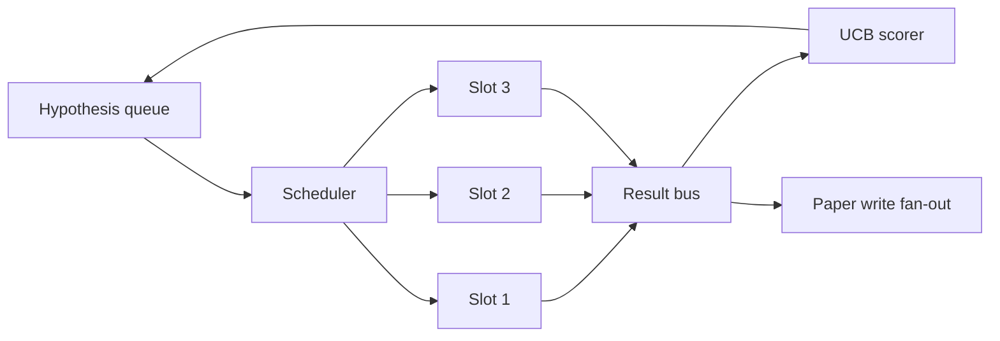
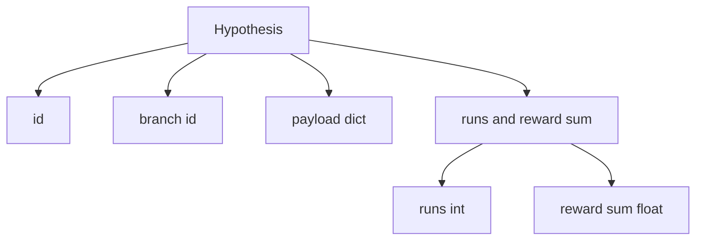
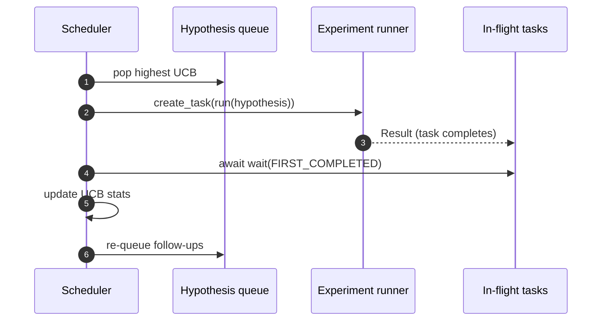

# 迭代调度器

> 没有 scheduler 的 research loop，只是一个自以为聪明的 queue。Scheduler 决定 loop 应该停止探索什么，而这个决定就是整场游戏。

**Type:** Build
**Languages:** Python
**Prerequisites:** Phase 19 lessons 50-53
**Time:** ~90 minutes

## 学习目标

- 把 research workflow 建模为 hypothesis queue，喂给 parallel experiment slots，并让 results fan back in。
- 用 asyncio 并发运行多个 experiments，让 scheduler 可以保持所有 slots 忙碌。
- 用 UCB 给每个 hypothesis branch 打分，让 scheduler 能 prune low-yield branches，同时不放弃 exploration。
- 把完成的 results fan out 到 paper-write stage 和 re-queue stage，让 high-yield branch 生成 follow-up hypotheses。
- 暴露 per-iteration trace，包含 branch scores、slot occupancy 和 pruning decisions。

## 为什么是 scheduler，而不是 worklist

Flat worklist 会按提交顺序运行 jobs。当每个 job 都独立时，这没有问题。Research 并不独立：第三个 experiment 的发现会改变第四个和第五个 experiment 的优先级。一个能读取 result fan-in 并重新排序 queue 的 scheduler，能用同样的 compute 做出更多有用工作。

有意思的设计选择是 scoring rule。Greedy scorer 总是选择当前 leader，因此永远不探索。Uniform scorer 永远不利用。UCB（upper confidence bound）是中间路径：利用 leader，同时为尝试次数较少的 branches 保留容量。

## 系统形状



Queue 保存 hypotheses。某个 slot 空出来时，scheduler 会选择 UCB 最高的 hypothesis。每个 slot 异步运行一个 experiment。完成的 experiments 会把 result fan 到 bus。Bus 会更新 originating branch 的 UCB statistics，并在某个 branch 的 yield 跨过 threshold 时 fan out 到 paper-write stage。

## Hypothesis 形状



`branch` 是 UCB statistics 的 key。多个 hypotheses 可以共享一个 branch（branch 是 research direction；hypothesis 是其中一次 trial）。`runs` 是该 branch 已完成 experiments 的计数，`reward_sum` 是 cumulative reward。UCB 会读取二者。

## UCB scoring

本课使用的 UCB formula 是经典 UCB1。

```text
ucb(branch) = mean_reward(branch) + c * sqrt( ln(total_runs) / runs(branch) )
```

`total_runs` 是所有 branches 上已经完成的 experiment 总数。`c` 是 exploration weight；本课默认是 `sqrt(2)`。Zero-run branch 会得到 `+inf`，因此未尝试过的 branches 总是先被 scheduled。Mean reward 高的 branch 会保持高 score，直到其它 branches 追上；一个运行很多次但 reward 不高的 branch 会被尝试次数较少的 alternatives 盖过去。

Pruning gate 和 picker 是分离的。当某个 branch 已经至少经过 `prune_after_runs` 次 trials（默认 `3`），且 mean reward 低于 absolute floor（默认 `0.2`）时，pruning 会把它从未来 scheduling 中移除。这能让 queue 保持有界。

## 使用 asyncio 的 parallel slots

Scheduler 用 `asyncio.create_task` 驱动 experiments。每个 task 运行 experiment runner（一个 `async def` callable），并返回 `Result`。Main loop 用 `asyncio.wait(..., return_when=asyncio.FIRST_COMPLETED)` 等待 in-flight tasks 集合，并在每次 completion 后触发 scoring update。



三个 slots 会并发运行。Main loop 永远不会 block 在单个 experiment 上。Scheduler 会在 slot 释放后立刻启动新 task，直到 queue 为空且没有 in-flight tasks。

## Fan-out：paper triggers

当一个 branch 的 mean reward 跨过 `paper_threshold`（默认 `0.7`），并且这个 branch 还没有产出过 paper，scheduler 会把一个 `paper.trigger` event fan 到 output list。下游第五十四课的 paper writer 会接住它。本课中 trigger 被捕获为一个 list，方便 tests 断言。

## Fan-out：follow-up hypotheses

当 high-yield result 落地时，scheduler 可以调用 user-supplied `expander`，在同一个 branch 上生成一个或多个 follow-up hypotheses。Expander 是从 `Result` 到 `list[Hypothesis]` 的 pure function。本课提供 deterministic expander：任何 reward 超过 paper threshold 的 result，都会产出两个 follow-ups。

## Budgets

两个 budgets 会保护 scheduler，避免 runaway loops。

```text
max_experiments    : total count of experiments run across all branches
max_seconds        : wall-clock cap (asyncio time)
```

任意一个 budget 触发时，scheduler 会停止调度新 tasks，等待 in-flight tasks 完成，然后返回 final trace。Trace 包含一个 `stop_reason`。

## Trace 和 final report

每个 scheduling decision（pick、dispatch、result、prune、fan-out）都会发出一个 event。Final report 会总结 per-branch stats、total runs、total wall-clock，以及已经触发的 paper triggers。下一课 end-to-end demo 会读取这份 report 来驱动 paper writer。

## 如何阅读代码

`code/main.py` 定义 `Hypothesis`、`Result`、`BranchStats`、`IterationScheduler`，以及一个 `make_deterministic_runner` factory，返回一个 rewards 可预测的 asyncio experiment runner。Runner 会 sleep 固定的 `delay_ms`（默认 `5ms`），这样 concurrency 可以被观察到。

`code/tests/test_scheduler.py` 覆盖：UCB 优先选择 untried branches、parallel slot occupancy、跨过 threshold 后触发 paper triggers、low-yield trials 后的 branch pruning、fan-out follow-up hypotheses，以及 budget exit（experiment count 和 wall clock 两种）。

## 继续扩展

真实实现会想要三个 extensions。第一，跨 sessions 持久化 UCB stats：当前 statistics 位于内存中；真实 scheduler 会 checkpoint 它们，让 restart 保留已经花掉的 exploration budget。第二，multi-objective scoring：每个 result 不再发出 scalar reward，而是发出 vector，UCB 变成 Pareto-style picker。第三，contextual bandits：picker 会根据 hypothesis features（length、complexity）做条件选择，让相似 hypotheses 共享 exploration。

Scheduler 是 research 超越 worklist 的地方。一旦 UCB 接好，slots 并行运行，其它所有改进都可以叠加在它上面。
