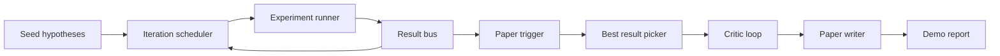
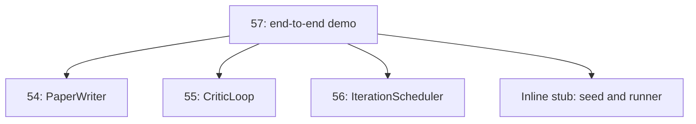
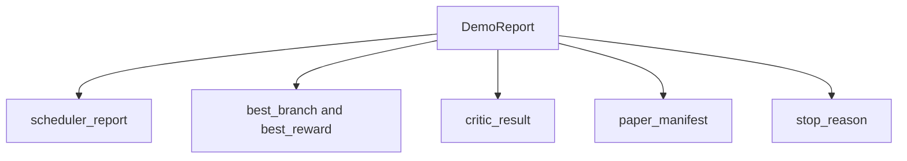

# 端到端研究 Demo

> Demo 是你前面写过的每个 contract 都必须组合起来的地方。只要其中任意一个漏水，这一课就会抓住它。

**Type:** Build
**Languages:** Python
**Prerequisites:** Phase 19 lessons 50-53
**Time:** ~90 minutes

## 学习目标

- 把 auto-research loop 端到端接起来：hypothesis seed、experiment runner、scheduler、critic loop、paper writer。
- 通过普通 Python imports 组合前面四个 Track D lessons 的 primitives，而不是引入 framework。
- 让 loop 运行到 self-terminating end，并输出一份列出每个 stage output 的 demo report。
- 保持 demo deterministic，让 test suite 可以断言最终形状。
- 当任意 stage 的 contract 破坏时，暴露清晰 failure mode，避免下一阶段拿着 broken input 继续运行。

## 这里组合了什么



五个 stages。Seed 是三个 hypotheses 的 list。Scheduler 用三个 parallel slots 在它们上面运行六个 experiments。Bus 报告一个或多个 paper triggers。Picker 选择单个 best result。Critic loop 在基于该 result 构建的 draft 上迭代。Paper writer 输出最终 LaTeX、BibTeX 和 manifest。

## 为什么 import，而不是 copy

前面每一课都会交付一个 `main.py`，里面有 public dataclasses 和 functions。Demo 会通过调整 `sys.path` 到每一课的 parent directory 来 import 它们。这不是 framework wiring；它和前面课程的 test files 已经使用的 import 是同一种东西。



Inline stub 代替第五十到第五十三课：一个小的 seed hypotheses generator 和一个 synchronous reward function。用户只要调整两个 imports，就可以把 inline stub 换成那些课程中的真实 primitives。

## Determinism guarantees

Demo 从构造上就是 deterministic 的。Experiment runner 使用 seeded numpy。Critic loop 的 reviser 按固定顺序遍历固定 dimensions。Paper writer 的 prose generator 使用第五十四课中的 mocked generator。Scheduler 的 UCB picker 用 iteration order 打破 ties，而不是 random choice。

给定同一个 seed，demo 会输出同一份 report。Test 会通过运行 demo 两次并比较 manifest 来断言这个性质。

## Demo report 形状



每个 field 都逐字来自上游 stage。Demo 不 transform 任何 output；它只组合它们。这正是 demo 要测试的内容。

## Failure mode handling

每个 stage 要么成功，要么抛出 typed error。

```text
Scheduler ........ returns SchedulerReport with stop_reason
                   in {queue_empty, max_experiments, deadline}
Best-result pick . raises NoTriggerError if no paper trigger fired
Critic loop ...... returns LoopResult with status converged or stopped
Paper writer ..... raises PaperValidationError on contract break
```

任意 stage 失败都会用 typed exception short-circuit demo。Tests 会固定这个 contract：`test_no_triggers_raises_typed_error` 和 `test_best_picker_raises_when_no_triggers` 会断言没有 branch 触发 trigger 时，picker 抛出 `NoTriggerError` / `BestResultError`，并且 writer 永远不会被调用。

## Best-result picker

Scheduler 会按 branch 发出 paper triggers。Picker 会选择所有 triggers 中 mean reward 最高的 branch。Tie 会按 branch id 的字母序打破，因此 demo 保持 deterministic。Picker 是一个很小的 pure function；test 会在固定 scheduler report 上 pin 住它。

## 接线 critic loop

第五十五课的 critic loop 操作的是 `MiniPaper`。Demo 会从 picked branch 构建一个 `MiniPaper`：把 branch id 填进 abstract，seed 两个 sections（Introduction 和 Results），并根据 branch mean reward 设置 `originality_tag`（`>= 0.8` 为 high，`>= 0.6` 为 medium，否则为 low）。

随后 reviser 会迭代 draft，直到 convergence。Output 会进入 paper writer。

## 接线 paper writer

第五十四课的 paper writer 操作的是完整 `Paper` shape，带 figures 和 bibliography。Demo 通过 `mini_to_full_paper` 把 converged `MiniPaper` 升级为 full paper：为 selected branch 附上一个 figure，并基于 critic 建议过的 cite keys 的 union 构建一个小 synthetic bibliography。Demo 添加的每个 cite 也都会加入 bibliography list，因此 validation 会通过。

## 如何阅读代码

`code/main.py` 定义 `BestResultError`、`NoTriggerError`、`DemoReport`、`pick_best_branch`、`build_mini_paper`、`mini_to_full_paper` 和 `run_demo`。文件顶部的 imports 会调整一次 `sys.path`，并从对应课程拉取 `PaperWriter`、`CriticLoop` 和 `IterationScheduler`。

`code/tests/test_e2e.py` 覆盖：demo 端到端运行，并输出五个 fields 全部填充的 report；两次 runs 之间的 determinism；没有 branch 跨过 threshold 时的 `NoTriggerError`；writer contract 破坏时的 `PaperValidationError`；paper manifest 包含 picked branch 的 figure；以及 scheduler stop reason 属于 expected values。

## 继续扩展

Demo 变绿之后，值得接上三个 extensions。第一，persistent state：每个 stage 的 result 都写入一个小 JSON store，让 restart 可以 resume，而不必重新运行便宜 stages。第二，dashboard：把 scheduler 和 critic loop 的 trace events 渲染成一条 timeline。第三，真实 model calls：把 mocked prose generator 和 deterministic critic 换成 model-driven 版本；wiring 不需要改变。

Demo 的职责是证明 composition 就是 architecture。五节课，四个 imports，一份 report。下次你添加一个 stage，wiring 只应该多一行。
