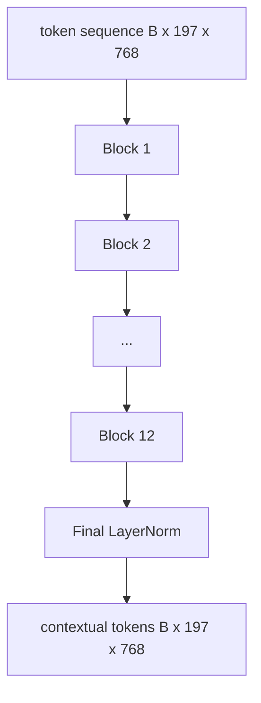
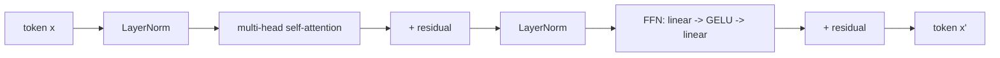

# Vision Transformer 编码器

> Patch 本身看不见全局。一个 12 层 pre-LN transformer，加上 12 个 attention heads，会把 patch token 序列变成 contextual token 序列，并让 CLS token 在最终 hidden state 中汇聚整张图像的特征。本课是每个现代视觉语言模型的引擎室。

**Type:** Build
**Languages:** Python
**Prerequisites:** Phase 19 lessons 30-37 (Track B foundations)
**Time:** ~90 minutes

## 学习目标

- 实现一个 pre-LN transformer block，包含 multi-head self-attention 和 feed-forward sub-layer。
- 堆叠 12 个 blocks、每层 12 个 heads，形成 ViT-Base 编码器。
- 把第 58 课的 patch 前端接入编码器，并跑通一次 forward pass。
- 验证 CLS token 会从每个 patch 聚合信息。

## 问题

Patch embedding 会生成一个包含 197 个 tokens 的序列，每个 token 都是一个向量，但它不知道其它 patch 的存在。一张猫的图片需要每个 patch 都知道哪些 patch 里有胡须，哪些是背景，哪些包含眼睛。Transformer 正是逐层建立这种感知能力的机制。没有它，patch 前端只是一个聪明的 tokenizer，却没有理解能力。

标准配方是十二层深、十二个 heads，使用 pre-LayerNorm 放置方式、GELU activation，以及 4x 的 feed-forward expansion。这个配方是 CLIP ViT-L、SigLIP、DINOv2、Qwen-VL family、InternVL，以及 2025-2026 年每个其它 open-weight vision encoder 的骨架。它已经稳定到这种程度：你读这些论文时，除非作者明确说明，否则都可以默认它们使用这种 block 形状。

## 核心概念





### Pre-LN vs post-LN

原始 Transformer 把 LayerNorm 放在 residual 之后。Pre-LN（在每个 sub-layer 之前放 LayerNorm）是每个现代视觉语言模型都会使用的版本，因为它不用学习率 warm-up 技巧也能稳定训练。差异只是 forward pass 里的一行，但在 12 层以上深度中的 gradient flow 表现完全不同。

### Multi-head self-attention

每个 head 都会把 token vector 投影成自己的 `(query, key, value)` 三元组，维度是 `head_dim = hidden / num_heads`。当 `hidden = 768` 且 `heads = 12` 时，每个 head 的 `dim = 64`。12 个 heads 并行做 attention，然后把输出 concat 回 768 维，再通过一个 output projection。Multi-head 的意义在于，一个 head 可以学习“关注猫眼”，另一个 head 可以学习“关注背景渐变”，二者互不干扰。

### 为什么 feed-forward expansion 是 4x

FFN 的形状是 `hidden -> 4 * hidden -> hidden`，中间使用 GELU。4 这个倍数是经验结果，并且自 2017 年以来一直贯穿语言和视觉 transformers。更小的 2x 容易 underfit；在固定数据预算下，更大的 8x 容易 overfit。MLP 是模型存放大部分 learned facts 的地方，而更宽的中间层就是这些 facts 所在的位置。

| Component | Parameters at ViT-Base scale |
|-----------|------------------------------|
| qkv projection per block | `3 * 768 * 768 = 1.77M` |
| output projection per block | `768 * 768 = 590K` |
| FFN per block (4x expansion) | `2 * 768 * 4 * 768 = 4.72M` |
| LayerNorm per block | `4 * 768 = 3K` |
| Total per block | about 7.1M |
| 12 blocks | about 85M |
| Plus front end | about 86M total |

ViT-Base 是一个 8600 万参数的编码器。按 2026 年标准看它很小（SigLIP-So400M 是 4 亿参数，Qwen-VL ViT 是 6.75 亿参数），但除宽度和深度之外，架构完全相同。

### 是否需要 causal mask？

Vision Transformers 是 encoder-only 且 bidirectional 的：对于任意 token pair，token `i` 都可以 attend to token `j`。不需要 mask。第 61 课中的 decoder-side cross-attention 会使用 causal mask，但在 vision encoder 内部，attention 是 fully connected 的。

### CLS token 学到了什么

CLS token 一开始是一个 learned parameter，本身没有任何 patch 内容；它会通过每个 block 中的 attention 从所有 patch 中累积信息。到了最后一层，CLS 这一行就是整张图像的向量摘要；下游 heads 会把这个单一向量投影成 class logits、contrastive embeddings，或者文本 decoder 的 cross-attention keys。

## Build It

`code/main.py` 实现了：

- `MultiHeadSelfAttention`：包含 `qkv` 和 output projections、scaled-dot-product attention 数学，以及 shape assertions。
- `FeedForward`：4x expansion 的 GELU MLP。
- `Block`：一个 pre-LN block，用 residuals 组合 attention 和 feed-forward sub-layers。
- `ViT`：堆叠 12 个 blocks，并在最后接一个 LayerNorm。
- `VisionEncoder`：把第 58 课的 `VisionFrontEnd` 接到 `ViT` stack，并暴露一个 `forward()`，返回 contextual sequence 和 pooled CLS vector。
- 一个 demo：把一张合成的 224x224 fixture image 送入完整 encoder，打印 input shape、output shape、parameter count，以及每隔一层的 CLS norm。

运行：

```bash
python3 code/main.py
```

输出：fixture 会被编码成一个 `(1, 197, 768)` tensor。随着各层组合，CLS norm 会逐渐上移，然后在最终 LayerNorm 后稳定下来。总参数量会报告为约 86M。

## Use It

这里定义的 encoder，在宽度和深度可变的前提下，就是 2025-2026 年每个 open-weight VLM 内部使用的同一套 block stack。差异主要在：

- **宽度和深度。** ViT-Large 是 `hidden=1024, depth=24, heads=16`；SigLIP So400M 是 `hidden=1152, depth=27, heads=16`。Block 相同。
- **Pooling head。** CLS pooling（本课）vs average pooling（SigLIP）vs attention pooling（后来的 VLMs）。
- **Position handling。** Fixed sinusoidal（第 58 课）vs learned 1D vs ALiBi vs 2D RoPE。Block 数学不变。
- **Register tokens。** DINOv2 会 prepend 4 个额外的 learned tokens。只是一行代码。

这个 block stack 是底座。后续课程（60-63）都会站在它上面。

## Tests

`code/test_main.py` 覆盖：

- 单个 block 会保持 shape，并且对 input batch size 不敏感
- attention scores 在 key axis 上求和为 1（softmax sanity）
- residual paths 已正确接线（zero input 仍会通过 CLS token 产生 non-zero output）
- 4 层 stack 的 forward pass 会产生正确 shape
- gradients 会从 CLS output 流回 patch projection

运行：

```bash
python3 -m unittest code/test_main.py
```

## 练习

1. 添加 register tokens（在 CLS 之后 prepend 4 个 learned vectors）并重新运行。通过最后一层 softmax distribution 的 entropy 比较 attention map smoothness。

2. 把 pre-LN 换成 post-LN，并在一个 synthetic shape classifier 上训练一个 epoch。观察哪一种可以在没有 LR warm-up 的情况下稳定训练。

3. 实现一个作为 `attn_mask` argument 的 causal masking，让同一个 block 可以复用成 decoder block。Mask shape 是 `(seq, seq)`，lower-triangular。

4. 用 `torch.profiler` 分别 profile batch size 为 1、8、64 的 forward pass。占用 wall time 最多的是 MLP layer，不是 attention。

5. 把某个 attention head 的 q-k-v projections 替换成 low-rank LoRA adapter，freeze 其它部分，并验证 gradient 只流向你预期的位置。

## 关键术语

| Term | What it means |
|------|---------------|
| Pre-LN | 在每个 sub-layer 之前而不是之后应用 LayerNorm |
| Self-attention | 每个 token 都 attend to 同一 sequence 中的所有其它 token |
| Multi-head | Hidden dim 被拆分到 `H` 个独立 attention heads |
| FFN expansion | Feed-forward layer 在收缩回原维度之前先扩展到 `4 * hidden` |
| CLS pooling | 使用第一个 token 的最终 hidden state 作为图像摘要 |

## 延伸阅读

- An Image is Worth 16x16 Words（ViT, 2021）：理解 encoder recipe。
- DINOv2（2023）：理解 register tokens 和 self-supervised pretraining objective。
- SigLIP（2023）：理解 average-pooling 变体，以及第 62 课会用到的 sigmoid contrastive loss。
