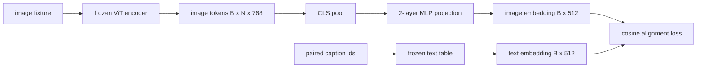

# 用于模态对齐的投影层

> 视觉编码器会产生图像 tokens。文本解码器会消费文本 tokens。两者生活在不同的向量空间里。一个小型两层 MLP 会把图像 tokens 投影到文本 embedding 空间，再用成对 caption 的 cosine alignment loss 把两个空间拉到一起。这个投影层是视觉语言模型里最小的一块，也是迁移时最关键的一块。

**Type:** Build
**Languages:** Python
**Prerequisites:** Phase 19 lessons 30-37 (Track B foundations)
**Time:** ~90 minutes

## 学习目标

- 构建一个两层 MLP projection，把 image features 映射到 text embedding space。
- 构造一个 mock text embedding table，不依赖 pretrained tokenizer 或真实 corpus。
- 计算 projected image tokens 与 paired caption embedding 之间的 cosine alignment loss。
- 在 frozen vision encoder 和 frozen text table 的前提下，只训练 projection。

## 问题

你有一个视觉编码器（第 58-59 课）会产生维度为 `vision_hidden = 768` 的 tokens。你还有一个想接在上面的文本解码器，它的 embedding 维度是 `text_hidden = 512`（换成别的数字也同样合理）。解码器期待的是文本形状的 tokens。图像 tokens 不是文本形状：它们生活在编码器通过纯视觉预训练学到的 basis 里，和解码器的 word vectors 没有天然关系。

两层 MLP projection（linear、GELU、linear）就是跨过这道缝隙的桥。它足够小（大约 `768 * 1024 + 1024 * 512 = 1.3M` 参数），可以在单张 GPU 上几分钟内训完，而且它是 alignment 阶段唯一需要学习的部分。视觉编码器保持 frozen。文本 embedding table 保持 frozen。只有 projection 会移动。这是 LLaVA 在 2023 年使用的 recipe，也是 BLIP-2 用 Q-Former 重新表述过的思想；此后几乎每个 open-weight VLM 都以某种形式采用了它。

## 核心概念



### 先 pooling，再 projection

视觉编码器会发出 197 个 tokens。文本侧只有一个 caption-level embedding。要对齐它们，你需要每个样本一个 image-level vector。CLS pooling 是最简单的做法：取编码器的第一个 token 并投影它。对全部 197 个 tokens 做 mean pooling 也是另一种选择，SigLIP 用的就是这种方式。无论哪种 pooling，目的都是把 197 个 vectors 压成一个。

### 为什么是两层，而不是一层

单层 linear projection 可以旋转和缩放，但如果两个空间的 basis 存在曲率不匹配，它就修不好。两个 linear layers 中间夹一个 GELU，会给 projection 一次非线性弯折；经验上这已经足够把 CLIP-style features 对齐到 language model embeddings。更深的 projection（LLaVA-NeXT 用 GLU；Qwen-VL 用 attention layers stack）都是扩展；两层 MLP 是 canonical baseline，也正是 BLIP-2 的 Q-Former projection head 在底层采用的形状。

| Layer | Shape | Parameters |
|-------|-------|------------|
| fc1 | `(vision_hidden, projection_hidden)` | `768 * 1024 + 1024` |
| activation | GELU | 0 |
| fc2 | `(projection_hidden, text_hidden)` | `1024 * 512 + 512` |

对于一个 `768 -> 1024 -> 512` 的 head，大约是 1.3M 参数。

### Cosine alignment loss

Align 并不是说 `image_emb == text_emb`。Align 的意思是，在 joint space 里，`image_emb` 和 `text_emb` 指向同一个方向。Cosine loss 是 `1 - cos_sim(image, text)`，范围从 0（完全对齐）到 2（方向相反）。训练会推动每一对样本的 loss 接近 0。第 62 课会把它推广成 contrastive batch（InfoNCE），让每张图都必须比 batch 里其他 captions 更接近自己的 caption；本课使用 per-pair 版本，这样动态更容易看清楚。

### Frozen encoder 是关键技巧

视觉编码器有 86M 参数。文本表还有几百万参数。想用 mock corpus 训练它们全部并不现实。把两者都 freeze 之后，projection 的 1.3M 参数就是唯一会变化的部分；在 synthetic pairs 上跑几百步就足以把 loss 拉下来。这正是每个 adapter-based VLM 的操作形状：重的部分保持 frozen，轻的桥负责训练。

## Build It

`code/main.py` 实现：

- `MLPProjector(in_dim, hidden_dim, out_dim)`，带 GELU activation 的两层 linear MLP。
- `MockTextEmbedding(vocab_size, dim)`，使用 seed 做 deterministic init 的 frozen embedding table。
- `make_pair(seed, vocab_size)`，合成一条 paired（image、caption）样本。Captions 是短 id sequences；caption embedding 是 token embeddings 的 mean pooling。
- `cosine_alignment_loss(image_emb, text_emb)`，per-pair 的 `1 - cos_sim` objective。
- 一个 training loop：在 32 条 synthetic pairs 上循环训练 projection 200 steps，vision encoder 和 text table 都保持 frozen，并且每 25 steps 打印一次 loss。

运行：

```bash
python3 code/main.py
```

输出：训练报告会显示 loss 从初始大约 1.07 降到 200 steps 内约 0.80，证明只靠 projection 就能把 image tokens 拉向 text space。最后还会打印每一对样本的 cosine similarity。

## Use It

同样的 pattern 出现在每个 open-weight VLM 里：

- **LLaVA 1.5.** 从 CLIP-ViT-L hidden 到 LLaMA embedding dim 的两层 GELU MLP projection。Frozen vision encoder、frozen LLM，只训练 projection（然后在第二阶段 unfreeze LLM）。
- **BLIP-2.** Q-Former 让 32 个 learned query tokens 通过 cross-attention 读取 image tokens，然后投影到 LLM embedding dim。Q-Former 最末端的 projection head，就是本课 MLP 的对应物。
- **MiniGPT-4.** 从 BLIP-2 Q-Former output 到 Vicuna embedding dim 的单层 linear projection。
- **Qwen-VL.** 使用多层 cross-attention adapter，但最后一块仍然是投影到 LM embedding dim。

形状会变化，但角色完全相同：pool image tokens，project 到 text embedding dim，然后单独训练。

## Tests

`code/test_main.py` 覆盖：

- projector output shape 匹配配置的 `out_dim`
- frozen text embedding table 的所有参数都是 zero `requires_grad`
- cosine loss 在 identical vectors 上为 0，在 anti-parallel vectors 上为 2
- 一次 backward pass 后 projector gradient 会流动
- training loop 会让 step 0 到 step 200 之间的 loss 下降

运行：

```bash
python3 -m unittest code/test_main.py
```

## 练习

1. 把 CLS pooling 换成对 196 个 patch tokens 的 mean pooling，并比较 200 steps 后的 final loss。Mean pooling 通常在 synthetic data 上训练更快；CLS 在 natural images 上更 sample-efficient。

2. 给 cosine loss 加一个 learned scalar temperature（`cos / tau`），观察 `tau` 太小（gradient noise）或太大（loss 高位平台期）时会发生什么。

3. 把两层 MLP 换成单层 linear layer，并量化 loss gap。非线性在 natural image features 上更重要，在 synthetic features 上弱一些。

4. 给 projector weights 加一个小的 L2 penalty，观察它和 cosine alignment 的交互方式（cosine 是 scale-invariant 的，所以 penalty 主要会收缩没用到的方向）。

5. 持久化 projector weights，然后 reload 并在没有 vision encoder backward pass 的情况下运行 inference，验证 deploy 时只需要 projector。

## 关键术语

| Term | What it means |
|------|---------------|
| Modality alignment | 让图像和文本 embeddings 在一个共享空间中可比较的过程 |
| Projection head | 把一个空间映射到另一个空间的小模块，通常是 2-layer MLP |
| Cosine similarity | Dot product 除以两个向量 L2 norms 的乘积 |
| Frozen encoder | 视觉（或文本）模型的所有参数都设置为 `requires_grad=False` |
| Mock corpus | Synthetic pairs，让训练不依赖任何 dataset download |

## 延伸阅读

- LLaVA paper：理解两阶段训练（先 project，再 unfreeze LM）。
- BLIP-2 paper：理解 Q-Former 作为 learnable projection alternative。
- Qwen-VL technical report：理解 cross-attention adapters 作为更深 projection heads 的做法。
