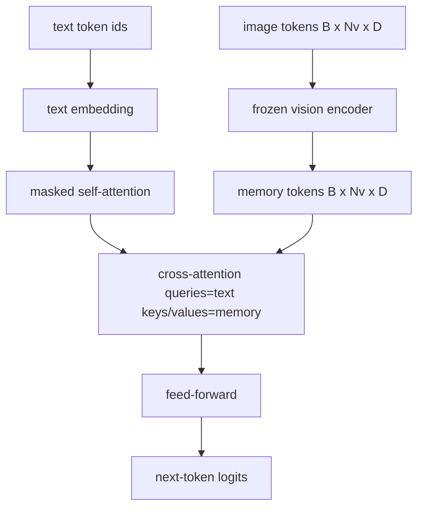
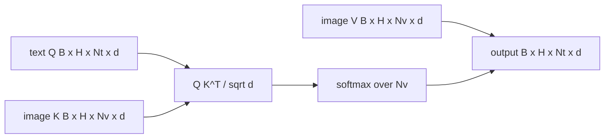

# 交叉注意力融合

> 投影层只能把一个图像向量和一个 caption 向量对齐。真正的视觉语言 decoder 需要让每个文本 token attend to 每个 patch token，这样模型才能把每个词落到图像区域上。Cross-attention 正是这种 grounding 发生的地方：文本发出 query，视觉 keys 和 values 给出回答。本课会构建 cross-attention block、causal text self-attention，以及让二者保持合法的 mask shapes。

**Type:** Build
**Languages:** Python
**Prerequisites:** Phase 19 lessons 30-37 (Track B foundations)
**Time:** ~90 minutes

## 学习目标

- 实现 multi-head cross-attention，其中 query stream 来自文本，key/value stream 来自视觉。
- 组合一个 decoder block：causal self-attention + cross-attention + feed-forward。
- 正确处理 mask shapes：self-attention 使用 causal mask，cross-attention 不使用 mask。
- 用 batched text tokens 和固定 image tokens 池运行一次 forward pass。

## 问题

把 image tokens 和 text tokens 拼接成一个 sequence，是一种 fusion 方案（early fusion，Chameleon 和 Emu3 走的是这条路）。Cross-attention 是另一种方案（late fusion，Flamingo 引入了这条路，此后每个 Flamingo-shaped decoder 都复制了它）。在 late fusion 中，text decoder 只在 text-only tokens 上运行，并在每一层通过 cross-attention 伸手读取 image stream。

Late fusion 有两个优点。第一，text stream 保持干净，模型可以保留 text-only 能力。第二，image stream 每张图只计算一次，并为每个 decode step 复用，所以即使生成很长的 captions，generation 也很便宜。代价是每个 block 多一个 attention sub-layer。

## 概念





### Mask shapes

Decoder block 里的两种 attention 需要不同的 masks：

| Attention | Query length | Key length | Mask | Why |
|-----------|--------------|------------|------|-----|
| Self-attention | `Nt` (text) | `Nt` (text) | Causal: lower-triangular `(Nt, Nt)` | Text tokens 在 autoregression 时不能向前看 |
| Cross-attention | `Nt` (text) | `Nv` (vision) | No mask | 整张图像对每个文本位置都可见 |

本课包含一个 shape-validation function，让混用 mask 的错误以 `ValueError` 暴露出来，而不是悄悄变成一条坏掉的 loss curve。

### 为什么 cross-attention 不需要 mask

在生成任何文本之前，图像已经被完整观测。Caption 的第 `t` 个 token 可以 attend to 图像的任意 patch；image patches 之间没有时间顺序。有些 Flamingo variants 在交错多个 images 和 text segments 时会加入 per-sample masking pattern，但对于单张图加一段 caption，cross-attention 可以看到全部内容。

### Key/value caching

Image keys 和 values 会在 decode 开始时计算一次，并保存在 cache 中。每个新的 text token 都复用这个 cache，不再重新计算。这就是 captioning 在 inference 时很快的原因：重的 ViT 只运行一次；cross-attention 会为每一步复用它的 keys 和 values。本课会暴露 cache，并测试 cache-hit path。

### Block composition

一个 decoder block 的执行顺序是：pre-LN -> self-attention -> residual -> pre-LN -> cross-attention -> residual -> pre-LN -> feed-forward -> residual。三个 sub-layers，每个都有自己的 LayerNorm。Flamingo paper 在 cross-attention 上加了 learned gate，让模型可以选择不走 image path，但训练稳定性会付出代价；这里使用的 canonical baseline 没有 gate。

```python
class DecoderBlock:
  def forward(self, text_tokens, image_tokens, text_mask, cross_mask):
      text_tokens = text_tokens + self.self_attn(self.ln1(text_tokens),
                                                 mask=text_mask)
      text_tokens = text_tokens + self.cross_attn(self.ln2(text_tokens),
                                                  image_tokens,
                                                  mask=cross_mask)
      text_tokens = text_tokens + self.ffn(self.ln3(text_tokens))
      return text_tokens
```

## 动手构建

`code/main.py` 实现：

- `CrossAttention(hidden, heads)`，带独立 `q` 和 `kv` projections 的 multi-head cross-attention。
- `CausalSelfAttention(hidden, heads)`，标准 decoder 中的 masked self-attention。
- `DecoderBlock`，用 pre-LN residuals 组合三个 sub-layers。
- `VisionLanguageDecoder`，四层 decoder，输入来自 mock vision encoder output 和一个小 text embedding table。
- `causal_mask(length)`，返回 `(length, length)` 的 lower-triangular boolean tensor。
- 一个 demo：喂入 batch size 为 2、长度为 10 的 text sequences，以及长度为 197 的 image memory，并打印 output shape、self-attention mask shape 和每个位置的 cross-attention output norm。

运行：

```bash
python3 code/main.py
```

输出：decoder 会生成一个 `(2, 10, text_vocab)` logits tensor。Mask shape 是 `(10, 10)`。KV-cache 复用检查会确认 cached 和 uncached paths 的 logits 完全一致（在数值容差内）。

## 投入使用

Cross-attention 出现在两个 production families 中：

- **Flamingo 和 IDEFICS。** 每 K 个 language model blocks 插入一个 cross-attention sub-layer，并冻结 LM。Vision-language adapter 就是 cross-attention block 加上它的 gate。
- **BLIP-2。** Q-Former 使用来自固定 32 个 query tokens 的 cross-attention 读取 image features，然后把这些 queries 投影到 LM embedding space。

本课里的 block shape 可以直接映射到这两类系统。Mask discipline（self 使用 causal，cross 不使用）也是一样的。

## 测试

`code/test_main.py` 覆盖：

- causal mask 是 lower-triangular，并且匹配预期 boolean shape
- cross-attention output shape 始终是 `(B, Nt, hidden)`，不受 key length 影响
- KV-cache path 在 float tolerance 内匹配 uncached path
- text 和 image streams 之间的 shape mismatch 会抛出清晰的 `ValueError`
- 完整 decoder forward pass 会产生正确的 batch 和 sequence shape

运行：

```bash
python3 -m unittest code/test_main.py
```

## 练习

1. 给 cross-attention residual 添加一个 learned tanh gate（Flamingo trick），并验证训练能从接近 0 的初始 gate 收敛。Gate 从 0 开始；模型先恢复 text-only behavior，再逐步混入 image stream。

2. 实现 interleaved attention，让同一个 decoder 消费多张 images 加多段 text segments。构建 per-sample cross-attention mask，阻止 text segment 2 attend to image 1。

3. 在 `Nt=64, Nv=576`（更高分辨率下的 24x24 grid）时 profile cross-attention 和 self-attention layer。Cross-attention 的成本是 `Nt * Nv`，在高图像分辨率下会占主导。

4. 在 cross-attention map 上添加 query-side dropout，并在 demo 上测量 caption diversity（cross map 中的 dropout 会提高 caption sample variance）。

5. 把 cross-attention layer 替换成 Q-Former-style attention block，让固定的 32-token query pool 每层 attend to image features 一次。

## 关键术语

| Term | What it means |
|------|---------------|
| Late fusion | 文本和视觉保持在分离 streams 中；cross-attention 在每个 block 中桥接它们 |
| Cross-attention | Q 来自一个 stream，K 和 V 来自另一个 stream |
| Causal mask | Lower-triangular boolean mask，用于在 autoregression 中阻止向前看 |
| KV cache | Image keys 和 values 只存储一次，并为每个 decode step 复用 |
| Memory tokens | Decoder 会读取的 frozen image tokens |

## 延伸阅读

- Flamingo (2022)：canonical late-fusion design，使用 gated cross-attention。
- BLIP-2 (2023)：Q-Former，也就是伪装成 learned query pool 的 cross-attention block。
- IDEFICS (2023)：Flamingo recipe 的 open-weight reproduction。
