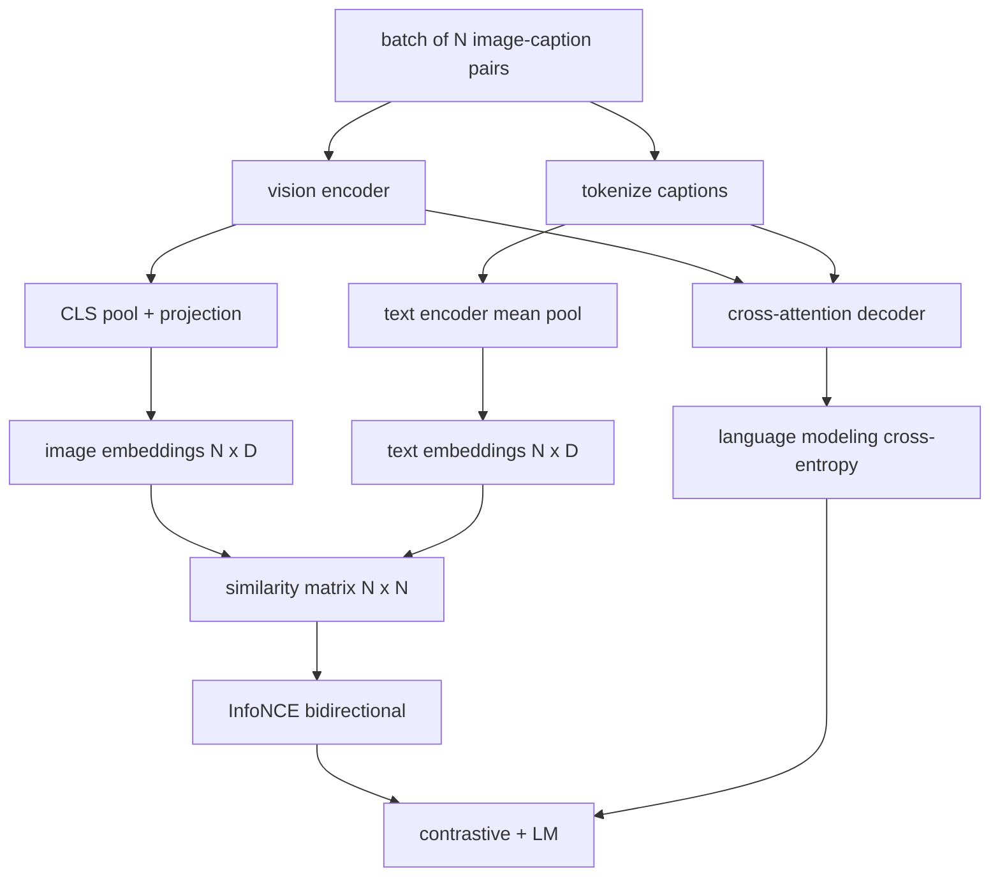

# 视觉-语言预训练

> Encoder、projection 和 decoder 都已经接好了。现在要把它们一起训练。两个目标共同驱动学习：一个是对比式图文损失（InfoNCE），把匹配的图像与文本拉近到同一个 joint embedding space；另一个是 language modeling loss，让 decoder 为每张图像写 caption。合在一起，它们教会网络两件事：根据 caption 找到正确图像，以及根据图像写出 caption。

**Type:** Build
**Languages:** Python
**Prerequisites:** Phase 19 lessons 30-37 (Track B foundations)
**Time:** ~90 minutes

## 学习目标

- 在一批 image-caption pairs 上实现 InfoNCE contrastive loss。
- 把 contrastive loss 与 autoregressive language modeling loss 组合起来。
- 合成一个 200 对 mock image-caption corpus，不下载真实数据集。
- 运行 50-step demo training loop，并观察两个 loss 都在下降。

## 问题

一个 vision-language model 需要两种能力。它必须会 rank：给定一条 caption，在很多图像中找出正确图像。它也必须会 generate：给定一张图像，写出一条 caption。只在单一能力上预训练，只能得到半个系统。CLIP 很擅长 ranking，但不能 caption。GPT-4V 能 caption，但 ranking 依赖另一套 retrieval head。Multi-objective pretraining 可以在一次训练中同时获得这两种能力。

InfoNCE 负责 ranking 的一半。对于一批 N 对样本，模型把 N 个匹配 pair 当成 positives，把 `N^2 - N` 个不匹配 pair 当成 negatives，然后在得到的 `(N, N)` similarity matrix 上运行 cross-entropy loss。LM loss 负责 generation 的一半：在图像条件下做标准 next-token prediction。两个 loss 都可微，并且可以共享 encoder、projector 和 decoder weights。

## 概念



### 用一段话解释 InfoNCE

把 N 个 image embeddings 按行堆起来，再把 N 个 text embeddings 按行堆起来。对两边都做 L2-normalize。计算 `N x N` 矩阵 `S = I T^T / tau`，其中 `tau` 是一个可学习的 temperature。对角线上的条目是匹配 pair；非对角线条目是 negatives。用沿对角线向下移动的 `argmax` 作为 target 做 cross-entropy：第 `i` 行的最高分应该出现在第 `i` 列。再沿列方向对称地做一次。总 loss 是两者的平均值。这就是八行代码里的 CLIP loss。

### Temperature 很重要

Temperature `tau` 控制 softmax 的尖锐程度。太小（例如 `tau = 0.01`）时，gradient 几乎只来自最难的 negative，训练会很嘈杂。太大时，softmax 会变平，gradient 会消失。CLIP 把 `tau` 当作参数学习；本课 demo 也采用同样做法。

### Language modeling loss

Decoder 通过 cross-attention 消费 image memory tokens，并在每个位置预测下一个 text token。Loss 是标准 cross-entropy，target 是 next-position token。Padding positions 会从 loss 中 mask 掉。

### 组合两个 loss

`total = contrastive + lm_weight * lm`，其中 `lm_weight` 是一个 scalar（通常为 1.0）。两个 loss 都会把 gradient 传入 encoder 和 projection；只有 decoder 会收到 LM-loss gradient。这就是 CoCa、BLIP 和 SigLIP-style models 都会使用的 multi-task recipe，只是各自 weighting 不同。

| Component | Loss surface | Affects |
|-----------|--------------|---------|
| InfoNCE | joint space 中的 pair ranking | Encoder + projection + text head |
| LM | 以图像为条件的 token prediction | Encoder + projection + decoder |
| Combined | Multi-task | Whole stack |

### 为什么 50 steps 足够做 demo

Mock corpus 是一个 synthetic 200-pair set，包含随机图像和随机 caption ids。使用 batch size 16 训练 50 个 SGD steps 后，即使绝对值仍然高于真实数据模型能达到的水平，两个 loss 也会明显下降。Demo 的重点是确认 gradient plumbing 端到端能跑通，并且加入 LM loss 不会让 contrastive objective 失稳。

## Build It

`code/main.py` 实现：

- `MultimodalModel`：组合一个小 ViT encoder、MLP projector、一个 tiny text-side encoder（对 embedded ids 做 mean-pool），以及 lesson 61 的 cross-attention decoder。
- `info_nce_loss(image_emb, text_emb, temperature)`：bidirectional CLIP-style contrastive loss。
- `lm_loss(logits, target_ids, padding_id)`：masked next-token cross-entropy。
- `make_mock_corpus(seed, n_pairs)`：返回 200 个 deterministic `(image, caption_ids)` pairs。
- 一个 training loop：batch size 16，Adam optimizer，learned log-temperature parameter，运行 50 steps。每 5 steps 打印两个 loss。

运行：

```bash
python3 code/main.py
```

输出：contrastive loss 会从大约 `ln(16) = 2.77` 降向 2.4；LM loss 会从 random-uniform baseline `ln(512) ≈ 6.24` 降到大约 4.7。两个数字都在下降，证明 gradient 已正确接线。真实模型会训练数百万 steps；动态是一样的。

## Use It

这是以下系统中使用的同一种 loss recipe：

- **CLIP (2021)。** 只做 image-text contrastive，并配合一个单独的 frozen-encoder caption probe。
- **CoCa (2022)。** 在同一个模型中同时使用 image-text contrastive 和 image-captioning LM loss。本课构建的正是这个模式。
- **BLIP (2022) 和 BLIP-2。** Contrastive + LM + image-text matching head。三个 loss 组合在一起。
- **SigLIP (2023)。** 把 InfoNCE 换成 sigmoid pair loss；contrastive 角色相同，函数形式不同。
- **LLaVA family。** 两阶段训练：第一阶段是 alignment（在 frozen LM 上做 cosine），第二阶段在 unfrozen LM 上加入 LM loss。Lesson 60 对应第一阶段；本课对应第二阶段。

## Tests

`code/test_main.py` 覆盖：

- InfoNCE loss 在 image/text rows 之间是 symmetric 的。
- 当 similarity matrix 是大正数完美对角线时，InfoNCE loss 返回 0。
- LM loss 会正确 mask padding positions。
- Model forward pass 能无错误地产出两个 loss。
- 5-step training loop 会降低 combined loss。

运行：

```bash
python3 -m unittest code/test_main.py
```

## 练习

1. 把 InfoNCE 替换成 SigLIP-style sigmoid pair loss，并比较它在 mock corpus 上的 convergence。

2. 添加 hard-negative mining step：每隔一个 batch，从前一个 batch 中选择最难的 off-diagonal pair 并 append 进去。训练后检查 contrastive loss 是否下降得更快。

3. 在 joint embedding 顶部添加一个 image-text matching binary head（true/false：这两者是否匹配？），作为第三个 loss，复现 BLIP 的 three-head setup。

4. 把 mock corpus 替换成从 Markov chain 中抽样得到的 caption-id sequences，且 transition matrix 由 image hash 条件化。由于出现了真实可学习信号，captioning loss 应该进一步下降。

5. 分别用 `lm_weight = 0` 和 `lm_weight = 1` 训练同一个模型。比较 contrastive loss；LM loss 不应该让 ranking objective 退化。

## 关键术语

| Term | What it means |
|------|---------------|
| InfoNCE | Noise contrastive estimation：在 similarity matrix 上做 cross-entropy |
| Temperature | 控制 contrastive softmax 尖锐程度的 scalar |
| Hard negative | 一个让模型困惑的 off-diagonal pair，对 sampling 很有用 |
| LM loss | Captioning 侧的标准 next-token cross-entropy |
| Joint embedding space | 图像和文本 vectors 在 projection 后共同所在的 shared space |

## 延伸阅读

- CLIP paper：原始 contrastive recipe。
- CoCa paper：在同一个模型中组合 contrastive 和 captioning。
- SigLIP paper：sigmoid pair-loss 变体，以及它为什么更容易 scale。
