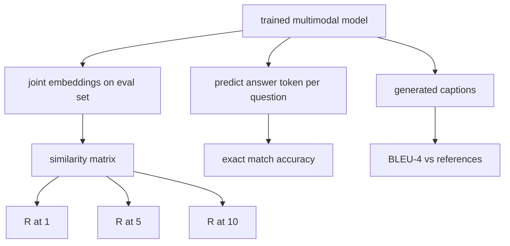

# 多模态评估

> 训练只是循环的一半，另一半是测量。本课会从 primitives 构建三个 evaluation surfaces：image-caption retrieval 用 R@1、R@5、R@10 报告；visual question answering 用 exact match accuracy 报告；image captioning 用 BLEU-4 报告。每个 metric 都是一个作用在模型输出上的函数，并配有一个几秒内就能跑完的 synthetic eval suite。

**Type:** Build
**Languages:** Python
**Prerequisites:** Phase 19 lessons 58-62 (Track E foundations: encoder, transformer, projection, cross-attention fusion, pretraining)
**Time:** ~90 minutes

## 学习目标

- 从 image 和 caption embeddings 之间的 similarity matrix 计算 Recall@K。
- 从一个把 `(image, question)` pairs 映射到固定 answer vocabulary 的模型计算 exact-match VQA accuracy。
- 不依赖任何外部库，从 generated 和 reference token sequences 计算 BLEU-4。
- 在 lesson 62 训练出的模型之上构建 synthetic suite，并运行全部三个 evals。

## 问题

当 training loss 进入平台期时，很容易想宣布一个多模态模型已经完成。Training loss 衡量的是模型对训练分布的拟合；它不衡量模型能否在 held-out batch 中排序配对、回答问题，或者写出人类能接受的 caption。三个 eval surfaces 是标准配置：

- **Retrieval (R@1, R@5, R@10)。** 为 query caption 构建 joint embedding；按 cosine 对 eval pool 中的每张 image 排序；报告 matching image 是否落在 top 1、top 5、top 10。Symmetric 形式（image-to-text）也以同样方式运行。
- **Visual question answering (exact match)。** 给定 `(image, question)`，模型输出一个 answer token。Exact match 对每个 sample 是一位判断：predicted answer 是否等于 reference answer？然后在 eval set 上取平均。
- **Captioning (BLEU-4)。** 生成一个 caption。根据 reference captions 计算 1-gram 到 4-gram precisions 的几何平均，并加上 brevity penalty。Multi-reference 是标准形式（一张 image，对应多条 reference captions）。

每个 metric 都是很薄的一层函数。本课会把它们全部写进代码，让数学保持具体，也让评估表面留在你自己的控制之下。真实 benchmark suites（MS-COCO、VQA v2、GQA、OK-VQA）可以接入同样的函数形状。

## 概念



### 从 similarity matrix 计算 Recall@K

构建 image embeddings 和 caption embeddings 之间的 `(N, N)` cosine similarity matrix。对每一行，按 similarity 降序排序 columns。Recall@K 是所有 rows 中，diagonal column index 落在 top K positions 内的比例。Symmetric Recall@K（caption-to-image）在 transposed matrix 上计算。两个数字都会报告。对一个 N=100 的 eval 来说，R@1 = 0.6 表示 100 条 captions 中有 60 条把正确 image 排在第一位。

### VQA exact match

对每个 `(image, question, answer)`，编码 image、嵌入 question、通过 decoder 融合，并读出 next token。Predicted token id 会和 reference id 比较；相等则为 correct。然后在 eval set 上取平均。真实 VQA datasets 每个 question 会带有多个人工标注 answers，并使用 soft-accuracy 公式（10 个 annotators 中至少 3 个同意时为 1.0，低于此则缩放）；为了清晰，本课使用 single-answer exact match。

### BLEU-4

```text
BLEU-4 = BP * exp(mean(log p1, log p2, log p3, log p4))
```

其中 `p_n` 是 modified n-gram precision（generated n-grams 中出现在任意 reference 里的 clipped count，除以 generated n-grams 总数），`BP` 是 brevity penalty：

```text
BP = 1                if generated length > reference length
   = exp(1 - r/g)     otherwise, where r is reference length and g is generated
```

对于某些 `p_n` 为零的小样本，需要 smoothing。实现采用 Chen and Cherry "method 1"（对任何 zero count，在 numerator 和 denominator 上都加 1），这是 low-count regimes 下最稳妥的默认选择。

### Synthetic eval suite

一个 50-sample eval suite 会使用 lesson 62 中相同的 mock corpus pattern、但用 held-out seed 在内存中构建。Suite 由三个 lists 组成：

- `pairs`：50 个 `(image, caption_ids)` pairs，用于 retrieval。
- `vqa`：50 个 `(image, question_ids, answer_id)` triples。
- `caps`：50 个 `(image, [reference_caption_ids, ...])` entries，每张 image 最多有 3 条 references。

Suite 由 seed 决定，且从 training corpus 中 held out，因此 metrics 会在模型从未见过的数据上计算。把 suite 持久化到 JSON 留作练习（见下方）。

| Metric | Range | Random baseline (N=50) |
|--------|-------|------------------------|
| R@1 | 0 to 1 | 0.02 (1 / N) |
| R@5 | 0 to 1 | 0.10 |
| R@10 | 0 to 1 | 0.20 |
| VQA EM | 0 to 1 | 1 / vocab |
| BLEU-4 | 0 to 1 | small but nonzero |

对 synthetic data 进行 50-step training run 时，metrics 不一定会很高；预期是高于 random baseline，这也是 demo 会检查的事情。

## 动手构建

`code/main.py` 实现：

- `recall_at_k(sim_matrix, k)`，为两个方向返回 `[0, 1]` 范围内的 float。
- `vqa_exact_match(predictions, references)`，返回 `int` equality 的平均值。
- `bleu4(generated, references, smoothing=True)`，支持 multi-reference。
- `build_eval_suite(seed, n_samples, vocab_size, max_len)`，返回三个 deterministic eval lists。
- `evaluate(model, suite)`，运行全部三个 metrics，并返回一组数字组成的 `dict`。
- 一个 demo：加载 lesson 62 中 freshly-initialized multimodal model，先评估，再训练 50 steps 后重新评估，并打印 before/after metrics。

运行：

```bash
python3 code/main.py
```

输出：before/after metric table 会显示 retrieval 从接近 random 向模型学到的 signal 改善，VQA 提升到 random 以上，BLEU-4 也改善（synthetic structure 足以带来 4-gram precision lift）。

## 投入使用

每个 metric 都能直接映射到 production benchmark：

- **Retrieval。** MS-COCO 5K val、Flickr30K、ImageNet zero-shot 都是在同一个 similarity matrix 上计算 R@K 的问题。把 synthetic eval 替换成真实文件，function signature 不需要改变。
- **VQA。** VQA v2、GQA、OK-VQA 使用同样的 exact-match shape（VQA v2 使用 soft-acc，而不是 single-answer EM）。
- **BLEU-4。** MS-COCO captioning、NoCaps、Flickr30K captioning 都使用 BLEU-4，加上 CIDEr 和 METEOR。添加 CIDEr 只是再写一个函数。

对真实 benchmarks，只需要把 `build_eval_suite` 换成真实 loader，并保留函数主体。数学本身与 benchmark 无关。

## 测试

`code/test_main.py` 覆盖：

- recall@k 在 perfect identity similarity matrix 上返回 1.0，并在 flipped matrix 且 k < N 时返回 0.0
- recall@k 遵守 `k <= N` upper bound
- generated 与其中一条 references 完全相等时，bleu4 返回 1.0
- 词表完全不相交时，bleu4 返回 0.0
- vqa exact match 等于相等 pairs 的比例
- build_eval_suite 返回预期数量的 pairs、vqa items 和 caption entries

运行：

```bash
python3 -m unittest code/test_main.py
```

## 练习

1. 在 captioning metrics 中加入 CIDEr。CIDEr 对 n-grams 使用 TF-IDF weighting，会奖励信息量更高的 tokens。

2. 实现 soft-accuracy VQA：每个 question 有多个人类 answers，若任意答案匹配，则 accuracy 为 `min(human_count / 3, 1)`。这复现了 VQA v2。

3. 添加一个 NaN-safe 版本的 `bleu4`，能处理 empty generated sequences 而不崩溃。

4. 在 R@K 旁边计算 mean reciprocal rank (MRR)。MRR 对正确 item 落在 top K 之后的具体位置敏感；R@K 只关心它是否落入 top K。

5. 在训练期间的五个 checkpoints（step 0、10、20、30、40、50）上运行 eval，并绘制 learning curve。确认 metric trajectories 和 loss trajectory 同步变化。

## 关键术语

| Term | What it means |
|------|---------------|
| R@K | 正确 match 落在 top K results 内的 queries 比例 |
| Exact match | 最简单的 VQA scoring：predicted answer 等于 reference |
| BLEU-4 | 1-gram 到 4-gram precisions 的几何平均，并带 brevity penalty |
| Multi-reference | Captioning metric 接受每张 image 对应多条 reference captions |
| Held-out | Eval set 使用与 training corpus 不相交的 seed 采样 |

## 延伸阅读

- VQA v2 paper：soft-accuracy formula 和 dataset statistics。
- CIDEr paper：基于 TF-IDF-weighted n-gram 的 captioning metric。
- BLEU original (Papineni et al., 2002)：smoothing variants。
- MS-COCO captioning eval scripts：canonical reference implementation。
