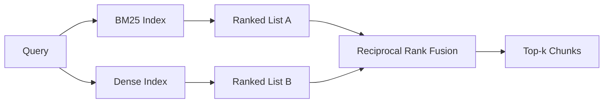

# BM25 与 Dense Embeddings 的 Hybrid Retrieval

> Lexical retrieval 和 semantic retrieval 会在相反的 query distributions 上失效。使用 reciprocal rank fusion 的 hybrid retrieval 不是插值，而是投票，并且这张票会在每一类 query 上赢。

**Type:** Build
**Languages:** Python
**Prerequisites:** Phase 11 lessons 04 (embeddings), 06 (RAG); Phase 19 Track B foundations (lessons 20-29); Phase 19 lesson 64 (chunking strategies)
**Time:** ~90 minutes

## 学习目标

- 从 Robertson and Sparck Jones 公式出发，从零实现 BM25，包含 field weighting、document length normalization，以及可调的 `k1` 和 `b`。
- 在 deterministic mock embedding 之上构建 dense retriever，让 loop 可以离线运行。
- 严格按照 Cormack、Clarke 和 Buettcher 在 2009 年发表的公式实现 reciprocal rank fusion，并解释为什么它优于 score-weighted interpolation。
- 调整 RRF 的 `k` 常数和每种 modality 的 weights，并在一个小 fixture corpus 上读出 trade-offs。

## 问题

当 query 携带 corpus 中逐字出现的 literal identifier 时，lexical search 会赢。查询 `AbortMultipartOnFail` 时，BM25 可以在微秒级返回正确的 Go function。同一个 query 被 embedding 之后，会落在三个 similarity clusters 的边界上，于是 dense retriever 可能把错误文件排在第一。

当 query 是对 corpus literal tokens 的改写时，dense search 会赢。用户问 “how do we handle cancelled uploads” 时，并没有输入 abort 或 multipart。BM25 会返回 “uploading large files” 的 documentation chunk，因为那一页包含 uploads 这个词。Dense retrieval 会找到那个 summary 提到 cancellation 的 abort function。

二者之间的选择并不是静态的。变量是 query distribution。Production RAG system 要从同一个 endpoint 处理两类 query，因此 retrieval 必须同时覆盖二者。这就是 hybrid retrieval。真正必须做对的是 merge step。

## 核心概念



### 用一段话理解 BM25

BM25 会对 query terms 求和，给 query-document pair 打分。每个 query term 的贡献由两部分相乘得到：inverse document frequency factor，以及一个带 length-normalization correction 的 saturating term-frequency factor。两个旋钮。`k1` 控制 term-frequency saturation；默认值 1.5 是论文推荐值，没有 benchmark 不要乱动。`b` 控制 document length 的影响程度；默认值 0.75 表示更长的 documents 会被惩罚，但不是线性惩罚。

IDF 公式使用 smoothed Robertson and Sparck Jones definition：`log((N - df + 0.5) / (df + 0.5) + 1)`。Log 里面的 plus-one 会在某个 term 出现在超过一半 corpus 时仍然保持 IDF 为正。在小 corpus 中这很重要，因为 stopwords 在统计上也可能“并不常见”。

Field weighting 让你告诉 BM25：symbol name 中的 match 比 body 里的 match 更重要。实现方式是在 indexing 时给 term counts 乘上 multiplier，而不是在 scoring time 额外处理。这样可以保持数学形式不变，也避免为每个 field 维护单独 score。

### 用一段话理解 dense retrieval

用 embedding model 把每个 chunk 嵌入成固定维度向量。Query time 时，先 embed query，再按 cosine similarity 对每个 chunk 排名，并返回 top-k。Model 是决定质量的变量。Retrieval algorithm 本身只有两行：dot product 和 sort。

本课使用 deterministic hash-based embedding，因此你可以在没有 network call 的情况下读懂 fusion math。Hash 会把 token-keyed offsets 加到一个 96 维向量中，然后 normalize。Cosine ranks 在每次运行之间都是 deterministic 的，这也是 test suite 需要的性质。

### Reciprocal rank fusion 的发表公式

两个 ranked lists。对出现在任一 list 中的每个 candidate，累加它的 reciprocal-rank contributions。2009 年论文使用 `1 / (k + rank)`，并把 k 的默认值设为 60。然后按 total score 排序。整个算法就是这样。

发表公式里的常数 k = 60 并不是随便选的。当 k = 60 时，rank-1 contribution 是 1 / 61，rank-10 contribution 是 1 / 70。Contribution 衰减很慢，因此较深位置的 candidates 仍然能投票。更小的 k 会让 top results 主导排序。更大的 k 会让 contribution curve 更平。

我们的实现里有两个可调旋钮。一个是 `k` 常数。另一个是每种 modality 的 weights，因此当你有先验认为某个 modality 在你的 corpus 上更好时，可以 boost BM25 或 dense。用 weight 乘 rank contribution 是最简单且有原则的实现：它保留 rank-decay shape，并且仍然 scale-free。

### 为什么 fusion 优于 score-weighted interpolation

BM25 scores 无上界，并且依赖 corpus。Cosine similarities 被限制在 -1 到 1 之间。线性组合 `alpha * bm25 + (1 - alpha) * cosine` 需要为每个 corpus 调 alpha，并且每次 reindex 都可能破坏它。Rank-based fusion 不会这样。两个 ranks 可以跨 modalities 比较。自 2010 年以来，发表的 RRF baseline 在每个 public TREC track 上都胜过 score-interpolation。

这和你在 Vespa 与 Weaviate 文档里看到的 RankFusion vs RRF 论点相同。他们得出了同样的结论：除非你有很强的证据要做 score interpolation，否则保持 rank-based。

## Build It

`code/main.py` 实现了：

- `tokenize(text)`：一个快速 regex tokenizer。
- `BM25Index`：支持 field weighting，包含 `add` 和 `search`，并且可调 `k1`、`b`。
- `mock_embed`、`DenseIndex`：使用和第 64 课相同的 deterministic embedding，因此 chunks 可以比较。
- `rrf(rankings, k, weights)`：带 multi-modality weights 的发表版 fusion。
- `HybridRetriever`：组合 BM25 和 dense。
- 一个 demo `main()`：加载一个小 fixture corpus，运行三个分别针对两类 retriever 强项和弱点的 queries，并打印每个 modality 产生的 rankings，以及 fused list。

运行：

```bash
python3 code/main.py
```

并排阅读 demo output。Literal identifier query 在 BM25 中 rank 1，在 dense 中 rank 4，在 RRF 中 rank 1。Paraphrased query 在 BM25 中 rank 6，在 dense 中 rank 1，在 RRF 中 rank 1。Ambiguous query 在 BM25 中 rank 3，在 dense 中 rank 3，在 RRF 中 rank 1。Fusion 不是 tie-breaker；它是在每一类 query 上获胜的系统。

## 调整这些旋钮

| Knob | Default | Move it up when | Move it down when |
|------|---------|----------------|------------------|
| BM25 k1 | 1.5 | Terms repeat in documents and you want frequency to matter more | Documents are short and term repetition is noise |
| BM25 b | 0.75 | Long documents really do say less per word | Document length is uncorrelated with topic |
| RRF k | 60 | Deep candidates should keep voting | The top-1 should dominate |
| BM25 weight | 1.0 | Your corpus contains literal identifiers and queries match them | Your queries are user-paraphrased |
| Dense weight | 1.0 | Queries are paraphrased | Queries are literal |

调参应该通过重新运行第 68 课的 eval harness，在你的 held-out query set 上完成，而不是凭直觉。

## Demo 会隐藏的 failure modes

**Out-of-vocabulary tokens.** BM25 的 IDF 从 corpus 中计算，因此只出现在 query 里的 terms 贡献为零。Dense embeddings 会为同一个 term 幻觉出一个向量。在 out-of-corpus identifiers 上，dense modality 会返回看起来合理但实际错误的 neighbors。Fusion 可以吸收这一点，因为 BM25 什么都不返回，rank contribution 会消失，但前提是你按 document 去重，而不是按 chunk 去重。

**Stop-token domination.** BM25 查询单词 "the" 会在整个 corpus 上产生一个几乎均匀的 ranking。你可以在 indexer 中过滤 stop tokens，或者接受 high-IDF terms 会自然主导排序。

**Identical content across modalities.** 如果你的 corpus 足够小，BM25 的 top-1 也是 dense 的 top-1，那么 RRF 会给出同样的 top-1 和同样的 neighbors。这是正确行为，不是 failure，但它会让 fusion 看起来不可见。在 eval 中加入一组 adversarial query pair，验证 fusion 确实在工作。

## Use It

Production patterns：

- 在 process 内索引 BM25；瓶颈是 term-frequency dictionary，不是 vectors。
- 把 dense vectors 索引到单独的 store 中（本课使用 flat list；production 中你会使用 HNSW）。
- 并行运行两类 queries；fusion 是对 union 做 constant-time merge。
- 持久化每个 retrieved hit 的 modality，这样 downstream reranker 可以看到是哪种 modality 给它投了票。

## Ship It

第 66 课会接收本课 fused top-k，并用 cross-encoder rerank。第 68 课会用 precision、recall、MRR 和 nDCG 评估整条 pipeline。本课的 hybrid retriever 是第 69 课端到端系统的第一阶段。

## 练习

1. 用你的 provider 提供的真实 model 替换 `mock_embed`。重新运行 demo，并报告 dense-only ranking 在 paraphrased query 上如何变化。
2. 添加第三种 modality：把 chunk summaries 单独建索引，并作为第三个 ranked list 参与 fusion。测量收益。
3. 在 10、30、60、100、200 之间 sweep RRF k。绘制第 68 课中的 recall@k curve。报告在你的 corpus 上让曲线达到峰值的 k。
4. 正确实现 BM25F（per-field length normalization，而不是 multiplier trick），并在 symbol matches 最重要的 corpus 上比较效果。

## 关键术语

| Term | What people say | What it actually means |
|------|-----------------|------------------------|
| BM25 | "Lexical search" | 概率排序：idf x saturating tf x length normalization |
| RRF | "Rank fusion" | 跨 ranked lists 累加 1 / (k + rank)；k = 60 是默认值 |
| k1 | "TF saturation" | 控制一个重复 term 多快停止继续增加 score |
| b | "Length penalty" | 0 表示忽略 document length，1 表示完整 normalization |
| Field weighting | "Symbol boost" | 在 indexing 时重复 tokens，以 boost 该 field 中的 matches |
| Rank-based vs score-based fusion | "Why RRF beats linear" | Ranks 可以跨 modalities 比较；scores 不行 |

## 延伸阅读

- Cormack, Clarke, Buettcher, "Reciprocal Rank Fusion outperforms Condorcet and individual rank learning methods", SIGIR 2009
- Robertson, Walker, Beaulieu, Gatford, Payne, "Okapi at TREC-3"（原始 BM25 paper）
- [Vespa: Hybrid Retrieval with BM25 and Embeddings](https://docs.vespa.ai/en/tutorials/hybrid-search.html)
- [Weaviate: Hybrid Search](https://weaviate.io/developers/weaviate/search/hybrid)
- Phase 11 lesson 06 - RAG fundamentals
- Phase 19 lesson 64 - 本课索引的 chunkers 输出
- Phase 19 lesson 66 - 消费 fused top-k 的 cross-encoder reranker
