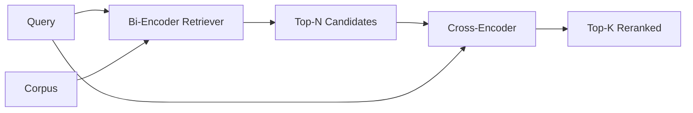

# Cross-Encoder Reranker

> Bi-encoder 会分别嵌入 query 和 document。Cross-encoder 会把它们拼接起来，一次性读完两者。Cross-encoder 是最聪明的 reader，也是最慢的 reader。把它作为 bi-encoder top-k 之后的第二阶段使用，它的成本就值得付出。

**Type:** Build
**Languages:** Python
**Prerequisites:** Phase 11 lesson 06 (RAG), Phase 11 lesson 07 (advanced RAG); Phase 19 Track B foundations (lessons 20-29); Phase 19 lesson 65 (hybrid retrieval feeding this stage)
**Time:** ~90 minutes

## 学习目标

- 从 input shape、parameter count 和 per-query cost 上区分 bi-encoder retriever 与 cross-encoder reranker。
- 从零实现一个小型 cross-encoder：它是一个 transformer block，消费 packed（query、document）sequence，并输出单个 relevance scalar。
- 接好两阶段 retrieve-then-rerank pipeline：用便宜的 retriever 取 top-N，用 cross-encoder 把 N 重排成 top-K，并返回 K。
- 在一个小型 fixture corpus 上衡量 latency-vs-quality trade-off，并为给定 latency budget 选择合适的 N。

## 问题

Bi-encoder 会把 query 和 document 映射到同一个向量空间，然后按 cosine 排序。两边的编码过程彼此看不见。模型必须把 document 中所有有用信息压进一个单独向量，而且压缩时并不知道 query 是什么。这很快：index time 每个 document 嵌入一次，query time 每个 query 嵌入一次。这也是在 corpus scale 上排序的唯一现实方式。

代价是 precision。两个 document 可能整体 topic 几乎一样，因此 embeddings 也几乎一样，但其中一个回答了 query，另一个没有。Bi-encoder 分不出来。

Cross-encoder 通过同时阅读 query 和 document 解决这个问题。模型收到 `[query] [SEP] [document]` 作为一个单独 sequence，在拼接后的序列上运行 full attention，并产生一个 relevance scalar。Document 的每个 token 都可以 attend 到 query 的每个 token。模型会在完整上下文里决定分数。

代价是 throughput。Bi-encoder 是嵌入一次、反复查询；cross-encoder 则要对每个（query、document）pair 跑一次。对于 1000 万 document 的 corpus，这意味着每个 query 要跑 1000 万次 forward pass。在 request budget 里跑不动。

解决办法是 staging。先用 bi-encoder 取回 top-N。再用 cross-encoder 把这 N 个候选重排成 top-K。N 很小（50 到 200），而 cross-encoder 带来的质量提升集中在最重要的位置上。总 latency 仍然留在 request budget 内。总质量接近 cross-encoder 的质量，但上限由 bi-encoder 在 N 上的 recall 决定。

## 核心概念



### Cross-encoder 的 input shape

标准 packing 是 `[CLS] query_tokens [SEP] document_tokens [SEP]`。CLS 位置的 output 会送进一个单层 linear head，输出 relevance scalar。有些实现会用 mean-pooling 代替 CLS；差异不大。重点是模型对每个 pair 只产生一个数字。

一个 22M 参数的 cross-encoder（公开的 `ms-marco-MiniLM-L-6-v2` 权重级别）是典型 production sweet spot。更小的模型质量下降通常快过 latency 节省。更大的模型（例如 568M 参数的 `bge-reranker-v2-m3`）更适合 offline reranking，或者只在 K 很小的 first-page reranking 中使用。

### 为什么本课训练一个很小的版本

真实 cross-encoder 是 finetuned encoder transformer。Production 中你会加载 checkpoint 并直接运行它。本课的目标不是训练 state-of-the-art ranker，而是展示模型形状以及 latency-quality curve 的形状。因此我们构建一个小型 `nn.Module`：一个 transformer block、multi-head attention（默认 4 heads）和一个 regression head。它会从 seed deterministic 初始化，所以 demo 不需要磁盘上的 weights 也可以复现。

这个 toy model 会从 fixture corpus 中学到正确形状：relevant query-document pairs 的预测分数高于 irrelevant pairs。端到端 pipeline 会重排 bi-encoder 的输出，而 rerank 后的 top-k 会和 gold labels 相关。

### Latency vs quality

两阶段 pipeline 只有一个可调参数：N。在 held-out query set 上把 N 从 5 sweep 到 100，就会得到这条曲线。

| N | Recall@1 of stage 2 | Cross-encoder forward passes per query | Latency |
|---|--------------------|---------------------------------------|---------|
| 5 | 0.62 | 5 | low |
| 20 | 0.81 | 20 | medium |
| 50 | 0.86 | 50 | high |
| 100 | 0.86 | 100 | very high |

上面的数字只是说明形状，不是这个 fixture 的测量结果。这个形状是真实的。通常在 20 到 50 个 candidates 附近会有一个 knee，rerank lift 在那里开始饱和。过了这个 knee，你基本是在白白付费。

结合 eval curve 和 latency budget 来选择 N。Cross-encoder 无法把 recall 提升到 bi-encoder 在 N 上的 recall 之上，所以太低的 N 限制的不只是 latency，也限制 quality。

## Build It

`code/main.py` 实现：

- `CrossEncoder` - 一个小型 `torch.nn.Module`：token embedding、一个带 multi-head attention 和 feedforward 的 transformer block、以及产生单个 scalar 的 mean-pooled head。
- `tokenize_pair(query, document)` - 把两个字符串 pack 成一个 id sequence，并用 type ids 标记边界；deterministic 且 stdlib。
- `train_tiny(pairs)` - 在手工标注的（query、document、relevance）triples list 上做一次 supervised training，让模型能在 fixture 上产生合理分数。
- `rerank(query, candidates, top_k)` - production interface。
- `pipeline(query, retriever, top_n, top_k)` - 两阶段流程。
- 一个 demo `main()`：按第 65 课的 pattern 加载 corpus，取回 top-N，重排为 top-K，并排打印两个列表，同时报告每个 stage 的 latency。

运行：

```bash
python3 code/main.py
```

输出会展示 bi-encoder 的 top-N、cross-encoder 的 top-K，以及 timing summary。Cross-encoder 每次调用更慢，但它不会跑在整个 corpus 上。两阶段总耗时仍在 request budget 内，同时能挑出 bi-encoder 排在第二或第三的正确答案。

## Demo 会隐藏的 failure modes

**Cross-encoder 不是 symmetric。** `rerank(q, d)` 和 `rerank(d, q)` 是不同分数。永远把 query 放在前面。如果不小心交换，recall 会崩掉。

**N 太低，暴露不出 bug。** 如果设置 N = K，cross-encoder 不能 reorder；它只能重新加权。Lift 看起来会是 0。让 N 至少是 K 的三倍。

**Training data 泄漏进 eval。** 如果手工标注的 training pairs 包含 eval queries，rerank 会看起来像魔法。即使在 fixture 上，也要严格分离 train 和 eval。

**Production weights 是 dense 的。** 一个 22M 参数的 cross-encoder 在 float32 下是 88MB。在承诺 sub-100ms p95 之前，先规划 model server 的内存。

**Batching 很重要。** 真实 cross-encoder 会把 N 个 candidates 放在一个 batch 中运行。本课在 `_batch_encode` 中这样做：用 `torch.tensor(...)` 构建 batched id 和 type-id tensors，然后跑一次 forward pass。跳过 batching，latency 会乘以 N。

## Use It

Production patterns：

- 把 bi-encoder、cross-encoder 和 N 绑定在一起。改动任何一个，都会让 eval 失效。
- 按（query、document_id）hash 缓存 reranker output。同一个 query 对稳定 corpus 的 rerank 顺序相同；cache hit 可以免费削掉一段 latency。
- 记录 rank-1 cross-encoder score。如果某个 query 的 top-1 score 低于 corpus-specific threshold，它就是 out-of-domain hit；把它以 “I am not confident” 的形式暴露给 LLM。

## Ship It

第 68 课会端到端评估这条两阶段 pipeline。第 69 课会把这个 reranker 接在第 65 课的 hybrid retriever 后面、answer generator 前面。Reranker 是端到端系统的第二阶段。

## 练习

1. 把 N 从 5 sweep 到 50，并绘制 reranked output 的 recall@1。在这个 fixture 上找到 knee。
2. 把 cross-encoder 训练十个 epochs，而不是一个 epoch。测量每个 epoch 中 positive 和 negative pairs 之间的 score-margin。
3. 用 CLS-token head 替换 mean-pooling。比较它在这个 fixture 上的 convergence。
4. 增加第二个 cross-encoder head，用来预测二值标签 “is this answer in the document”。Inference 时同时使用两个 heads：一个用于 rank，一个用于 threshold。
5. 用第 65 课中的 deterministic mock bi-encoder 替换当前版本，并把两阶段串起来。测量相对于单独 bi-encoder 的 top-K 变化。

## 关键术语

| Term | What people say | What it actually means |
|------|-----------------|------------------------|
| Bi-encoder | "Vector retriever" | 分别编码 query 和 doc；用 cosine 排序 |
| Cross-encoder | "Reranker" | 联合编码（query、doc）；输出一个 relevance scalar |
| Two-stage pipeline | "Retrieve and rerank" | 便宜的 retriever 返回 N，昂贵的 reranker 保留 K |
| N (candidate budget) | "Rerank pool" | Cross-encoder 每个 query 要打分的候选数量 |
| Mean-pooling head | "Mean of last hidden" | 把 encoder 最后一层 outputs 平均成一个 vector |

## 延伸阅读

- Nogueira, Cho, "Passage Re-ranking with BERT", 2019 - canonical cross-encoder ranker paper
- Reimers, Gurevych, "Sentence-BERT: Sentence Embeddings using Siamese BERT-Networks", 2019 - 关于 bi-encoders vs cross-encoders
- [SentenceTransformers Cross-Encoders documentation](https://www.sbert.net/examples/applications/cross-encoder/README.html)
- [BGE Reranker v2 model card](https://huggingface.co/BAAI/bge-reranker-v2-m3)
- Phase 19 lesson 65 - feeding this rerank stage 的 hybrid retriever
- Phase 19 lesson 68 - 衡量这个 rerank 带来提升的 eval
