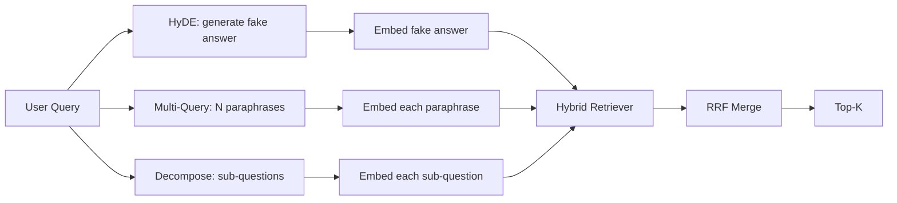

# Query Rewriting：HyDE、Multi-Query 与 Decomposition

> 用户输入的 query，并不是 retriever 最想要的 query。Rewriting 会在 retrieval 之前补上这段差距，让 index 看到更接近答案长相的内容。

**Type:** Build
**Languages:** Python
**Prerequisites:** Phase 11 lessons 04 (embeddings), 06 (RAG); Phase 19 Track B foundations (lessons 20-29); Phase 19 lessons 64 and 65
**Time:** ~90 minutes

## 学习目标

- 实现 Hypothetical Document Embeddings（HyDE）：生成一个假答案，embed 它，并用这个 vector 检索，而不是用原始 query vector。
- 实现 multi-query expansion：把一个 query 改写成 N 个 paraphrases，分别检索，再用 reciprocal rank fusion 合并 union。
- 实现 query decomposition：把复杂问题拆成 sub-questions，分别检索每个 sub-question，再合并结果。
- 在同一份 fixture 上正面对比三种 rewriter，并解释每种策略什么时候会赢。
- 接入一个 mock LLM，让它产生 deterministic、on-fixture 的输出，因此整个 rewriter loop 可以 offline 运行。

## 问题

用户输入 `"what does our team do when uploads fail and the budget is gone?"`。Corpus 里有一篇文档写着 `"AbortMultipartOnFail aborts an in-flight S3 multipart upload and decrements the per-bucket retry budget when the upload fails"`。Query 和 document 没有共享 noun phrase。BM25 会漏掉。Bi-encoder 会把这个 document 排到第三或第四，因为 query vector 落到了 embedding space 中更偏向 cancelled jobs 文档的区域，而不是 aborted uploads 文档所在的区域。第 66 课的 two-stage rerank 如果答案在 top-N 里，还能把它救回来；但如果它连 top-N 都没进，reranker 根本看不到它。

修复方式是在 query 接触 retriever 之前先改写它。2023 年论文 "Precise Zero-Shot Dense Retrieval without Relevance Labels"（Gao et al.）提出了 HyDE：让 LLM 写出一篇可以回答该 query 的 document，embed 这篇 hypothetical document，然后用它的 embedding 作为 retrieval vector。Hypothetical document 会落到 embedding space 中正确的区域，因为它使用 corpus 自己的语言风格写成。原始 query vector 做不到这一点。

HyDE 旁边还有两个 cousin techniques。Multi-query expansion（Microsoft GraphRAG 使用过这个术语）会生成 N 个 query paraphrases，分别检索再合并。Decomposition（在 2024 Stanford DSPy work 中以 "subquery decomposition" 流行起来）会把 `"what does our team do when uploads fail and the budget is gone"` 拆成两个问题：`"what happens when an upload fails"` 和 `"what happens when the retry budget is gone"`。两次 retrieval，一个 merged result，答案的两个部分都能被触达。

本课会实现这三种策略，并让它们在同一份 fixture corpus 上运行。

## 概念



### HyDE 详解

HyDE 会把用户的 query vector 替换成一篇由 LLM 写出的 hypothetical document vector。Prompt 很短：

```text
You are a domain expert. Write a one-paragraph passage that answers the question
below. Use the same vocabulary and phrasing the documentation in this domain would
use. Do not refuse. Do not say you do not know.

Question: {user_query}

Passage:
```

LLM 的 answer 作为 factual answer 是错的，因为 LLM 不知道你的 corpus。没关系。Retriever 不关心 factual correctness，只关心 token distribution。Hypothetical passage 会包含 `"abort"`、`"multipart"`、`"bucket"`、`"budget"` 这些词，因为这个主题下的 documentation passage 大概率会这么写。Embed 这段 passage。Vector 会落到真实 passage 附近。

Production 里通常把 hypothetical document 限制在两三句话以内。更长的 hypothetical 会收集更多噪声。更短的 hypothetical 又会失去 HyDE 需要的 lexical signal。

### Multi-query expansion 详解

生成用户 query 的 N 个 paraphrases。最简单的 prompt：

```text
Rewrite the following question in {N} different ways. Each rewrite must preserve
the original intent. Number them 1 to {N}. Do not add explanations.
```

对每个 paraphrase 检索 top-k。用 RRF（第 65 课中的同一个算法）合并 N 个 ranked lists。便宜、parallel、deterministic。

当用户的措辞只是许多同样合理问法中的一种，并且某些 rewrite 会问得更好时，multi-query 会赢。当所有 rewrite 都一样糟，因为原始 query 的问题会被等价继承时，它会输。

### Decomposition 详解

一次 retrieval 无法满足一个 multi-faceted question。Decomposition 会让 LLM 把问题拆成 sub-questions，系统再按 sub-question 分别检索。Prompt：

```text
The following question may require information from multiple distinct topics.
Decompose it into a list of sub-questions. Each sub-question must be answerable
independently. If the question is already atomic, return it unchanged.

Question: {user_query}
```

对每个 sub-question 检索，再合并结果。对于包含 conjunctions、multi-clause comparisons 或两个无关 topic 的问题，decomposition 是正确工具。对于 atomic questions，它是错误工具；decomposer 在这种场景下的职责是返回单个原问题，而不是发明假 sub-questions。

### 为什么三种策略都存在

三者互补。HyDE 弥合 query-corpus token gap。Multi-query 覆盖 paraphrase variance。Decomposition 覆盖 multi-topic queries。Production system 会三种都运行，并按 query 选择策略（第 69 课的 end-to-end system 会展示 selector）。

## Mock LLM

本课离线运行。Mock LLM 是一个小 lookup table，以用户 query 为 key，并为未见过的 query 提供 fallback。Lookup table 包含：

- 对每个 fixture query：一段 written hypothetical passage、三个 paraphrases 和一个 decomposition。
- 对 unknown query：一种 deterministic transformation：取 query 的 content words，用 synonym map 扩展它们，并返回结果。

重要的是 mock 的 shape，而不是里面的数据。Production 中你会把 mock 换成真实 model call。Retriever 不需要改变。

## Build It

`code/main.py` 实现：

- `MockLLM`：上面描述的 deterministic stand-in。
- `HyDERewriter`：调用 LLM 写 hypothetical document，并把 rewriter output 作为 `RewriteResult` 返回，其中包含 hypothetical text 和 retriever 应该使用的 query。
- `MultiQueryRewriter`：调用 LLM 生成 N 个 paraphrases，并返回 query list。
- `DecomposeRewriter`：调用 LLM 做 decomposition，并返回 sub-questions。
- `retrieve_with_rewriter`：接收一个 rewriter 和一个 retriever，运行 rewrites，并 fuse 结果。
- 一个 demo：在 fixture 上运行三个 rewriters，并打印哪种策略最先返回 gold answer document。

Retriever shape 复用第 65 课（hybrid BM25 + dense）。Fusion 也是同一个 RRF。唯一新的 shape 是 rewriter interface，而且它很小。

运行：

```bash
python3 code/main.py
```

输出是一份 per-strategy ranking 和最终 summary。HyDE 会在 phrasing-mismatched query 上胜出。Multi-query 会在 paraphrase-variance query 上胜出。Decomposition 会在 multi-topic query 上胜出。Fallback（不使用 rewriter）至少会在三个 query 中输掉一个。

## Demo 会掩盖的 failure modes

**HyDE hallucinate 了错误的 corpus-specific identifiers。** 模型发明了一个 function name。由于这个发明出来的名字变成了不出现在 index 里的 high-weight token，hypothetical 在正确 doc 上的 BM25 score 会崩掉。限制 hypothetical 的长度，并在 fusion 里降低 BM25 权重。

**Multi-query rewrites 全部收敛。** 弱模型会产出三个几乎相同的 paraphrases。N 次 retrieval 返回同一批 top-k。RRF merge 不会比单次 retrieval 更好。给 rewrite prompt 加明确的 diversity instruction，并用 Jaccard 检测 duplicates。

**Decomposition 过度拆分。** Decomposer 把 atomic question 变成一个 list。多次 retrieval 都返回同一篇 document，但 rank 被稀释。Merge 比原始 query 更差。在 fan-out 之前，加一次 "are these sub-questions distinct enough" 检查来检测这个问题。

**Latency 成倍增加。** HyDE 花费一次 LLM call。Multi-query 花费一次 LLM call 来生成 N 个 rewrites，然后做 N 次 retrieval。Decomposition 花费一次 LLM call 做 decomposition，然后做 M 次 retrieval。Retrievals 可以 parallel；LLM call 是下限。

## Use It

Production patterns：

- 按 query length 做 per-query strategy selection：atomic short queries 用 multi-query，复杂 multi-clause queries 用 decomposition，jargon-heavy queries 用 HyDE。
- 按 query hash 缓存 rewriter output。很多 query 会重复。
- 三种策略并行运行，并用 RRF 把三份 result sets fuse 成一份。成本是三次 LLM calls 和一次 fusion；质量是三种策略覆盖范围的 union。

## Ship It

第 69 课会把这个 rewriter stage 接在第 65 课的 retriever 和第 66 课的 reranker 之前。第 68 课会评估 rewriter 对 retrieval recall 带来的提升。

## 练习

1. 实现 RAG-Fusion（multi-query 的 2024 变体）：rewriter 的 paraphrases 要有意保持 diverse，然后由 rerank step（第 66 课）选择最终 list。
2. 添加第四种策略：step-back prompting（让 LLM 先提出更 general 的问题，基于它检索，再 narrow）。在 fixture 上比较。
3. 训练 decomposer 识别 atomic queries，添加一个 "is the question atomic" head。测量前后的 over-split rate。
4. 把 mock LLM 替换成真实 model call。测量你自己 stack 上每种策略的 latency。
5. 为每个 rewrite 添加 confidence score。丢弃低于 threshold 的 rewrites。测量它对 recall 的影响。

## 关键术语

| Term | What people say | What it actually means |
|------|-----------------|------------------------|
| HyDE | "Fake-document retrieval" | LLM 写出答案；embed 它并用它检索，而不是用原始 query |
| Multi-query | "Paraphrase expansion" | Query 的 N 个 rewrites；检索 N 次，用 RRF 合并 |
| Decomposition | "Subquery split" | Multi-topic queries 被拆成 sub-questions，并分别检索 |
| Atomic query | "Single-topic" | 不发明假 sub-questions 就无法继续拆分的问题 |
| Step-back | "Abstract the query" | 先问更 general 的问题，检索后再 narrow |

## 延伸阅读

- Gao, Ma, Lin, Callan, "Precise Zero-Shot Dense Retrieval without Relevance Labels" (HyDE), 2023
- Microsoft Research, "Multi-Query Expansion for Retrieval"
- Stanford DSPy, "Subquery Decomposition for Multi-Hop QA"
- [LlamaIndex query transformations documentation](https://docs.llamaindex.ai/en/stable/optimizing/advanced_retrieval/query_transformations/)
- Phase 11 lesson 07 - advanced RAG patterns
- Phase 19 lesson 65 - the retriever this rewriter feeds
- Phase 19 lesson 68 - the eval that measures the rewriter lift
