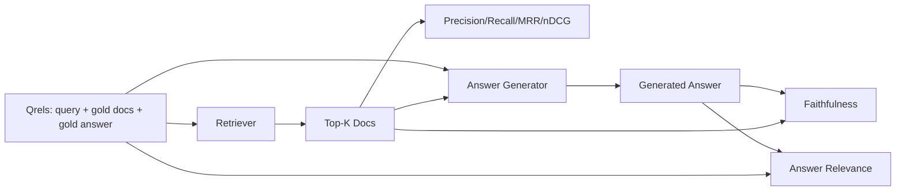

# RAG Evaluation：Precision、Recall、MRR、nDCG、Faithfulness、Answer Relevance

> 如果你不能同时评估 retrieval 和 answer，就不能把系统上线。二者不是同一个 metric，同一个 prompt 也会在不同轴线上失败。

**Type:** Build
**Languages:** Python
**Prerequisites:** Phase 11 lessons 06 (RAG), 10 (evaluation); Phase 19 Track B foundations (lessons 20-29); Phase 19 lessons 64, 65, 66, 67
**Time:** ~90 minutes

## 学习目标

- 从 gold qrels 计算四个 retrieval metrics：precision@k、recall@k、MRR（mean reciprocal rank）和 nDCG@k。
- 计算两个 answer-grade metrics：faithfulness（每个 claim 都有 retrieved context 支撑）和 answer relevance（answer 是否回应了 question）。
- 构建一份 fixture qrels file（queries、gold doc ids、gold answer text），让 eval 可以端到端读取。
- 通过 metric values 诊断 pipeline 的失败位置：retrieval、ranking、generation，还是 grounding。

## 问题

一个 RAG system 至少有四个活动部件：chunker、retriever、reranker、generator。错误答案可能来自其中任何一个。没有 per-stage metrics，你就是在盲飞。

用户报告了一个错误答案。原因是 chunker 切断了 answer span 吗？是 retriever 没有把正确 chunk 放进 top-k 吗？是 reranker 把正确 chunk 推到了第一名之后吗？还是 generator 忽略了 chunk，自己编了内容？只看最终答案，你无法判断。你需要：

- Retrieval metrics，用来评估 retriever 输出了什么。
- Ranking metrics，用来评估正确 chunk 在排序里的位置。
- Faithfulness，用来评估 generator 是否停留在 retrieved context 内。
- Answer relevance，用来评估 answer 是否真的回应了 question。

本课会基于一份 fixture qrels file 构建全部六个指标。Eval 是 offline 且 deterministic 的；production 中你会把 mock LLM-as-judge 换成真实模型。

## 概念



### Precision@k

Retriever 返回的 top-k documents 中，有多少比例属于 gold set？如果 gold 有三篇文档，而 top-3 返回了其中两篇和一篇错误文档，那么 precision@3 是 2 / 3。当 irrelevant retrieved chunk 的成本很高时使用 precision：比如 generator 会浪费 token，或者错误 chunk 会污染答案。

### Recall@k

Gold documents 中，有多少比例进入了 top-k？如果 gold 有三篇文档，而 top-5 包含全部三篇，那么 recall@5 是 1.0。当漏掉答案的成本很高时使用 recall：你宁愿多看到一个错误 chunk，也不想完全错过 answer chunk。

Production RAG 中最常被引用的指标通常是 recall@k。Generation 很容易丢掉 irrelevant chunks；但如果一个 chunk 从未被看见，它就无法凭空生成答案。

### MRR（Mean Reciprocal Rank）

对每条 query，找到 ranked list 中第一个 relevant document 的位置。Reciprocal rank 是 1 / position。再对 query set 求平均。MRR 是一个单数值摘要，用来表示 retriever 把最佳答案放到顶部的能力。

MRR 对 position 1 权重很大。Gold doc 在 rank 1 的 query 贡献 1.0；rank 2 贡献 0.5；rank 10 贡献 0.1。这个 metric 被 list 顶部强烈主导。

### nDCG@k

Normalized Discounted Cumulative Gain。完整公式会给每个 retrieved document 分配 gain（通常 relevant 为 1，irrelevant 为 0），按位置的 log 做 discount，求和，然后除以 ideal DCG（完美排序时的 DCG）。取值范围是 0 到 1。

nDCG 支持 graded relevance：gold 可以说 "doc A is 3, doc B is 2, doc C is 1"。MRR 和 recall@k 会把一切压平成 binary。当一个 query 在 corpus 中有多篇部分相关文档时，使用 nDCG。

### Faithfulness

对 generated answer 中的每个 claim，检查该 claim 是否被 retrieved context 支撑。标准实现会使用 LLM-as-judge prompt，输入 `(claim, context)`，输出 yes 或 no。Metric 是通过检查的 claims 占比。

Faithfulness 能抓住 generator invents content 的失败模式。即使 retriever 返回了正确 chunks，只要 generator hallucinate，系统仍然是坏的。Faithfulness 也叫 groundedness、support、attribution。

本课用 deterministic mock judge 实现 faithfulness：它检查每个 claim 的 tokens 与 retrieved context 的重叠是否超过 threshold。Production 中你会替换成真实 model call。Metric 的 shape 保持不变。

### Answer relevance

答案是否真的回应了问题？Faithfulness 问的是 "answer 是否 grounded in context?"。Answer relevance 问的是 "answer 是否 grounded in question?"。一个 faithful 但 off-topic 的 answer，faithfulness 会高，relevance 会低。一个简短、on-topic 但忽略 context 的 answer，relevance 会高，faithfulness 会低。

标准实现同样使用 LLM-as-judge：输入 `(question, answer)`，询问 answer 是否回应了 question。本课实现的是 token-overlap-plus-judge stand-in。

## fixture qrels

```python
{
  "qid": "q1",
  "query": "what is the abort threshold for multipart uploads",
  "gold_doc_ids": ["d1", "d3"],
  "gold_answer_substring": "three failed parts",
  "graded_relevance": {"d1": 3, "d3": 2},
}
```

每条 query 携带：

- query string，
- 一组 gold doc ids（用于 precision / recall / MRR），
- graded relevance dict（用于 nDCG），
- gold answer substring（作为 reference metadata 保留在每条 qrel 上；本课中的 faithfulness 是通过判断 extracted claims 是否被 retrieved context 支撑来计算的，不直接对这个 substring 打分）。

Production 中这些需要人工标注。本课附带一份手写 fixture，让 eval 开箱即跑。

## Build It

`code/main.py` 实现：

- `precision_at_k(retrieved, gold, k)` - 字面定义。
- `recall_at_k(retrieved, gold, k)` - 字面定义。
- `mean_reciprocal_rank(retrieved_list_of_lists, gold_list)` - 对 queries 求平均。
- `ndcg_at_k(retrieved, graded_relevance, k)` - 使用 binary 或 graded gains 计算 DCG / IDCG。
- `extract_claims(answer)` - 把 answer 拆成 sentence-shaped claims。
- `faithfulness(claims, context_texts, judge)` - 被 judge 判定为 supported 的 claims 占比。
- `answer_relevance(question, answer, judge)` - judge answer 是否回应 question。
- `MockJudge` - deterministic token-overlap judge，让 eval 可以 offline 运行。
- `evaluate_pipeline(pipeline_fn, qrels, ks)` - 运行所有 metrics 的 orchestrator。
- 一个 demo：让三个 pipeline variants（chunker baseline、hybrid retrieval、hybrid + rerank）在 qrels 上运行，并打印 metrics table。

运行：

```bash
python3 code/main.py
```

输出会在一张 metrics table 中展示每个 variant 的 precision@k、recall@k、MRR、nDCG@k、faithfulness 和 answer relevance。Hybrid retrieval 行的 recall 会胜过 chunker baseline；rerank 行的 MRR 会胜过 hybrid。

## 通过 metrics 诊断失败

| Symptom | Likely cause | What to fix |
|---------|-------------|-------------|
| Low recall@k, low precision@k | Chunker cut the answer or retriever cannot find it | Chunker boundaries (lesson 64) or retriever modality (lesson 65) |
| Decent recall@k, low MRR | Right chunk is in top-k but not at position 1 | Reranker (lesson 66) |
| High MRR, low faithfulness | Generator invents content despite right context | Generation prompt; force-cite-or-refuse |
| High faithfulness, low relevance | Answer is grounded but off-topic | Query rewriter (lesson 67) or generation prompt |
| All four high, users still complain | Eval set is unrepresentative | Expand qrels with real user queries |

## Demo 会掩盖的 failure modes

**LLM-as-judge bias.** 模型会把自己的输出判得比实际更 faithful。Judge 应该使用和 generator 不同的 model family，或者人工抽样评分。

**Qrels rot.** Corpus 变化时，gold answers 会漂移。2024 年 1 月对 q1 来说是 gold 的 doc，到 2024 年 10 月可能已经不是正确答案，因为团队重命名了 function。安排季度 qrels review。

**Faithfulness micro-checks miss macro-claims.** Per-sentence faithfulness 可能通过，但整体答案结构仍然误导。需要在自动 metric 之上增加 sample-level qualitative review。

**Recall@k masks per-query failures.** 90% 平均 recall 可能掩盖某一类 query 总是 miss。按 query class（literal、paraphrased、multi-topic）切片 qrels，并报告 per-slice。

## Use It

Production patterns：

- 每次 retriever 或 generator 变更都运行 eval。把 recall@k regression 当成 test failure。
- 持久化每条 query 的 metric trace。当用户投诉时，查找匹配的 qrels entry，看它本来是否会被捕获。
- 对 qrels 分层：20 条 query 的 smoke set 跑在 CI；200 条 regression set 每晚跑；2000 条 deep set 每周跑。

## Ship It

第 69 课会接好完整 pipeline（chunker、retriever、reranker、generator），并用本课 eval 评估端到端系统。

## 练习

1. 添加第五个 retrieval metric：hit-rate@k。把它和 recall@k 对比，并解释二者何时不同。
2. 实现 graded faithfulness：0（unsupported）、1（partially supported）、2（fully supported）。相应更新 metric。
3. 把 mock judge 替换成真实 model call。测量 fixture 上 mock 和真实 judge 的 disagreement。
4. 添加 query-class slice（"literal"、"paraphrased"、"multi-topic"）。报告 per-slice metrics。
5. 添加 "answer length" metric，并把它和 faithfulness 做 correlation。画出曲线。

## 关键术语

| Term | What people say | What it actually means |
|------|-----------------|------------------------|
| Precision@k | "Hit rate over retrieved" | top-k 中属于 gold 的比例 |
| Recall@k | "Hit rate over gold" | gold 中进入 top-k 的比例 |
| MRR | "First-hit position" | 第一个 relevant document 的 1 / rank 的均值 |
| nDCG@k | "Graded ranking quality" | top-k 的 DCG 除以 ideal DCG |
| Faithfulness | "Groundedness" | answer claims 中被 retrieved context 支撑的比例 |
| Answer relevance | "Did it address the question?" | answer 是否匹配 question 的意图 |
| Qrels | "Gold labels" | 标注好的 queries 及其 gold documents 和 answers |

## 延伸阅读

- Buckley, Voorhees, "Evaluating Evaluation Measure Stability", SIGIR 2000 - ranking metrics 的 canonical paper
- Jarvelin, Kekalainen, "Cumulated Gain-based Evaluation of IR Techniques" - nDCG paper
- [Ragas: Automated Evaluation of RAG Pipelines](https://docs.ragas.io)
- [Anthropic, Evaluating RAG](https://www.anthropic.com/news/evaluating-rag)
- Phase 11 lesson 10 - evaluation framework foundations
- Phase 19 lessons 64-67 - components evaluated here
- Phase 19 lesson 69 - the end-to-end pipeline this eval grades
