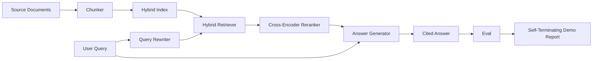

# 端到端 RAG 系统

> 六节课的组件。一个 pipeline。一个 eval loop。一个 self-terminating demo。这就是你会交付的系统。

**Type:** Build
**Languages:** Python
**Prerequisites:** Phase 11 lessons 06 (RAG), 10 (evaluation); Phase 19 Track B foundations (lessons 20-29); Phase 19 lessons 64, 65, 66, 67, 68
**Time:** ~90 minutes

## 学习目标

- 把 chunker、hybrid retriever、query rewriter、cross-encoder reranker 和 answer generator 组合成单个端到端 pipeline。
- 实现一个 answer generator，让每条 claim 都用 chunk anchor 标注 citation，并在低置信度时 fallback 为拒答。
- 对组装后的 pipeline 运行第 68 课的 eval，并证明 staged build 在每个 metric 上都优于孤立使用的同一批组件。
- 构建一个 self-terminating CLI demo：ingest fixture corpus，运行固定 query set，并带 summary report 以 zero exit 结束。

## 问题

六个孤立组件不能证明任何系统能力。Chunker 可以在 corpus 上赢得 recall@5，却在系统的 recall@5 上输掉，因为 retriever 无法排序 chunker emit 的内容。Reranker 可以在 synthetic candidate pool 上提升 MRR，却在真实 bi-encoder candidates 上失败，因为 bi-encoder 在 rerank budget 内的 recall 太低。Query rewriter 可以在单个 query 上提升 gold doc，却在下一个 query 上崩掉，因为 LLM mock 返回了退化的 hypothetical。

真正的 integration test 是整条 pipeline 端到端运行：面对同一份 fixture qrels、同一个 metric、同一个 orchestrator file，并把所有东西接在一起。本课构建的就是这个。如果 integrated pipeline 的 metrics 胜过每个 stage 的 isolated demo，你才证明了系统本身。

## 核心概念



### Wiring choices

Pipeline 是一个小 graph。每个 stage 都是一个签名清晰的 function。

| Stage | Input | Output |
|-------|-------|--------|
| Chunker | Document text | List of Chunk records |
| Retriever | Query string | Top-N Chunk records |
| Rewriter (optional) | Query string | List of rewrites + hypothetical |
| Reranker | Query, candidates | Top-K Chunk records with cross scores |
| Generator | Query, top-K Chunk records | Answer string with citations |

只要每个 signature 稳定，composition 就很直接。本课的 `Pipeline` class 持有这五个 stages，并提供一个按顺序运行它们的 `query` method。每个 stage 都可以替换：传入不同的 chunker、retriever、rewriter、reranker 或 generator，pipeline 仍然可以运行。

### 带 citations 的 answer generator

Generator 是最后一个 stage，也是最容易出错的 stage。本课提供一个 deterministic mock generator，它会：

1. 接收 top-K reranked chunks。
2. 选出最多两个 chunks，这些 chunks 的 text 与 query 有最高的 content-token overlap。
3. 输出一个 answer：把每个 selected chunk 中的一句话拼接起来，并在每句话后面附上 `[doc_id:chunk_index]` anchor。
4. 如果没有任何 chunk 的 overlap 高于 refuse threshold，就输出没有 citation 的 "I do not know"。

Production 中，你会用真实 LLM call 替换 mock，并使用这个 prompt template：

```text
You are answering a question using only the snippets below.
Cite every claim with the anchor in parentheses.
If the snippets do not answer the question, say "I do not know".

Question: {query}

Snippets:
{enumerated chunks with anchors}

Answer:
```

Refuse-on-low-confidence path 正是 cross-encoder rank-1 score 被记录下来的原因。如果它低于 corpus threshold，generator 就拒答。这是对 hallucinated answers 的 safety valve。

### Self-terminating demo

Demo 会端到端运行所有内容。它打印某个 query 的 per-stage breakdown，在四个 fixture qrels 上运行 eval，打印 metrics table，并且当所有第 68 课 metrics 都达到 demo 中设置的 thresholds 时，以 status zero 退出。如果某个 metric 低于 threshold，demo 会以 non-zero status 退出，并在消息中点名失败的 metric。

这就是 CI smoke test 的形状。Pipeline 离线运行、快速、deterministic。Fixture 上的 thresholds 故意设得很紧，这样六节课中任何一节发生 regression，demo 都会失败。

## Build It

`code/main.py` 实现了：

- `Chunk`：贯穿所有 stages 的 record（扩展第 64 课的 shape，增加 `chunk_index` 和 source `doc_id`）。
- `Chunker`：从第 64 课选择一种 strategy（默认 recursive split）。
- `HybridIndex`：封装第 65 课的 BM25 + dense + RRF。
- `Rewriter`（optional）：根据 query length 和 conjunctions 是否存在，从第 67 课选择 HyDE、multi-query 或 decomposition。
- `Reranker`：第 66 课训练好的 cross-encoder；使用更小的 fixture training set，让它几秒内收敛。
- `Generator`：带 citations 和 refuse-on-low-confidence 的 deterministic mock generator。
- `Pipeline`：组合五个 stages，并提供 `query(question)` method，返回 `Result(answer, top_k, latency_ms_per_stage)`。
- `run_demo()`：ingest corpus，运行三个 fixture queries，运行 eval，打印结果，并根据 threshold 设置 exit code。

运行：

```bash
python3 code/main.py
```

输出包含一条 printed query trace、完整 eval table，以及最终 pass/fail status。在 fixture 上返回 exit code 0。

## Demo 会隐藏的 failure modes

**Chunker boundary drift.** 如果你在 eval qrels labeling pass 和 demo 之间更换 chunker strategy，gold doc ids 就不再对齐。把 chunker strategy 锁进 qrels file。Demo 里包含一个 header，会点明 chunker。

**Reranker training set leaks into the eval.** 第 66 课的 14 个 training triples 包含与 eval queries 相似的 queries。Production 中必须严格 hold out eval queries。Demo 的 eval queries 被刻意设计成与 rerank training set 不重叠。

**Mock generator hides hallucination risk.** Mock 不会 hallucinate，因为它只 emit retrieved chunks 中的 text。本课明确说明这一点，并把 production swap-in path 指向真实 model。

**No streaming.** Pipeline 会在每个 stage 结束后返回完整 answer。Production system 通常会 stream generator output。Streaming 不在本课范围内；answer-grade metrics 无论如何都基于 final string。

**Latency is offline.** Mock LLM calls 是 constant time。真实 LLM calls 会主导 latency。需要在 request scope 中规划 latency budget；本课的 per-stage timing 只测 CPU work。

## Use It

Production patterns：

- 把 pipeline file 放在一个 orchestrator 下，并保持显式 stage interfaces。避免把 wiring 分散到整个 repo。
- 每次 merge 触碰某个 stage 之前都运行 eval。如果 eval 下降，merge 不应该落地。
- 持久化每次 CI run 的 metric trace，这样你可以把 regression 归因到某次 stage swap。
- 添加一个 20 queries 的 smoke set（regression set 的子集），每个 PR check 都在 30 秒内跑完；完整 regression set 每晚运行。

## Ship It

本课里的 pipeline file 是 Phase 19 Track F 后续课程默认使用的形状。后续课程会在其上添加 ingestion automation、incremental re-index、telemetry 和 serving layer。Retrieval、rerank、rewrite 和 eval 这几半在这里已经完整。

## 练习

1. 在 rewriter 内部添加 per-query strategy selector：根据第 67 课的 heuristics（length、conjunctions、jargon ratio）选择 HyDE、multi-query 或 decomposition。
2. 在 env flag 后面为 generator 添加真实 LLM call。默认保持 mock。测量 latency delta。
3. 扩展 demo，添加一个 `--corpus path` flag 来加载真实 corpus。重新运行 eval 和 threshold check。
4. 给 chunker 添加 `--strategy` flag。测量每种 strategy 对端到端 recall 的贡献。
5. 添加 streaming generator interface，并把它接入 eval。确认 faithfulness 是在 final string 上计算，而不是在 streamed prefix 上计算。

## 关键术语

| Term | What people say | What it actually means |
|------|-----------------|------------------------|
| Pipeline | "RAG pipeline" | 从 ingestion 到 cited answer 的组合 stages |
| Citation anchor | "Source link" | 附着在每条 claim 上的 `(doc_id, chunk_index)` reference |
| Refuse-on-low-confidence | "I do not know" | 当 reranker top-1 score 低于 threshold 时，generator 不返回答案 |
| Smoke set | "CI eval" | 每个 PR check 中都会运行的最小 qrels subset |
| Stage interface | "Function signature" | 每个 pipeline stage 稳定的 input 和 output type |

## 延伸阅读

- [Anthropic, Building search and retrieval](https://www.anthropic.com/news/contextual-retrieval)
- [Pinterest, MCP internal search](https://medium.com/pinterest-engineering) - reference production architecture
- [Ragas: Automated Evaluation of RAG Pipelines](https://docs.ragas.io)
- Phase 11 lesson 06 - RAG fundamentals
- Phase 19 lessons 64-68 - 本课组合的组件
