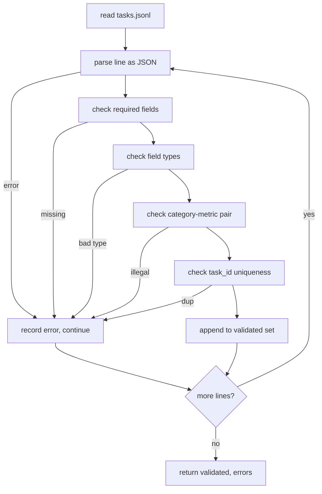

# 任务规格格式

> Eval harness 的质量取决于它的 tasks 遵守怎样的 contract。在写任何 scoring function 之前，先冻结 JSONL 形状和 metric vocabulary。

**Type:** Build
**Languages:** Python
**Prerequisites:** Phase 19 Track B foundations
**Time:** ~90 min

## 学习目标

- 定义一种 JSONL task record schema，用同一种形状覆盖 arithmetic、multiple-choice、code execution、classification 和 free-text summarisation。
- 固定一组封闭的 metric names vocabulary，让后续课程（71-73）可以只根据一个字段 dispatch。
- 把 few-shot examples 和 post-processing rules 作为 task 的一部分，而不是 runner 的一部分，这样同一个 prompt 在不同 models 上会产出同一个 target。
- 实现一个 strict validator，在 malformed records 到达 runner 之前拒绝它们。
- 交付一组 10-task fixture set，覆盖 spec 的每个分支，让 validator 有真实数据可检查。

## 为什么需要冻结 spec

研究代码库积累 eval scripts 的速度，往往比积累 tests 更快。六个月后，每个 notebook 都有自己的 JSON 形状，每个 metric 都被重复实现两次，任何 run 之间都无法比较。修复方式很无聊：选一个 schema，写一个 validator，拒绝其它所有形状。本课做的就是这件事。

这个形状借鉴了 BIG-bench、HELM 和 lm-eval style harnesses 的一些思路，但字段名由我们自己定义。每个字段都有唯一 owner。Runner 读取 task。Metric 读取 targets。Post-process step 规范化 generation。没有字段会在 pipeline 中途被修改。

## Record shape

一个 task 是单行上的一个 JSON object。Harness 读取 `tasks.jsonl`，并独立验证每一行。坏行会终止那条 record，而不是终止整个 run。

```json
{
  "task_id": "arith_001",
  "category": "arithmetic",
  "prompt": "Compute the result. Question: 17 + 24\nAnswer:",
  "targets": ["41"],
  "metric_name": "exact_match",
  "few_shot_examples": [
    {"prompt": "Question: 2 + 2\nAnswer:", "completion": "4"}
  ],
  "post_process": "strip_whitespace",
  "metadata": {"difficulty": "easy"}
}
```

必填字段是 `task_id`、`category`、`prompt`、`targets`、`metric_name`、`post_process`。`few_shot_examples` 和 `metadata` 是可选字段。未知的 top-level fields 会导致验证失败。

## 字段规则

`task_id` 是不含空白字符的字符串。Validator 会强制它在整个文件中唯一。

`category` 是 `arithmetic`、`mcq`、`code_exec`、`classification`、`summary` 之一。Category 会约束哪些 metric 和 post-process pair 合法。`code_exec` task 必须使用 `metric_name = code_exec`，`mcq` task 必须使用 `metric_name = exact_match`，并匹配一个单字母 target。

`prompt` 是非空字符串。Validator 会禁止 trailing whitespace，并拒绝 prompt body 中已经包含 few-shot block 的 records。Few-shot rendering 发生在 runner 中，而不是 author 写进 prompt 里。

`targets` 是非空字符串列表。对 `exact_match` 来说，任一元素匹配都算正确。对 `f1` 和 `rouge_l` 来说，取最高分 target。对 `mcq` 来说，列表必须正好包含一个元素。

`metric_name` 是 `exact_match`、`f1`、`bleu_4`、`rouge_l`、`accuracy`、`code_exec` 之一。Vocabulary 是封闭的。新增 metric 需要一节新课，并在这里添加新条目。

`few_shot_examples` 是 `{prompt, completion}` pairs 的列表。Validator 会把列表限制在最多 8 个 entries，以保持 prompts 有界。

`post_process` 是 `none`、`strip_whitespace`、`lower`、`extract_letter`、`extract_code_block`、`extract_first_line` 之一。每条规则都有唯一 deterministic behaviour。Validator 禁止组合多条规则。

## Validator 行为



Validator 返回两个 lists：validated records，以及 error records。Error records 会包含出错行、被违反的 rule 和出问题的 field。除非显式设置 `--allow-bad-tasks` flag，否则只要 error list 非空，runner 就会拒绝启动。

## Few-shot rendering

Runner 会把 few-shot examples 拼接到 prompt 前面，用一个空行分隔。每个 model 都走同一条代码路径，所以唯一的 variance 来源是 model 本身。Authors 只写一次 examples，而不是为每个 provider 写一次。

```python
def render(task):
    parts = []
    for ex in task.get("few_shot_examples", []):
        parts.append(ex["prompt"] + " " + ex["completion"])
    parts.append(task["prompt"])
    return "\n\n".join(parts)
```

## Post-process rules

Post-process step 在 generation 之后、metric 之前运行。它是 deterministic 且 stateless 的。

- `none` 返回原字符串，不做修改。
- `strip_whitespace` 去掉开头和结尾的空白字符。
- `lower` 把字符串转成小写。
- `extract_letter` 返回第一个匹配 `[A-E]` 的字符，用于 MCQ。
- `extract_code_block` 返回第一个 triple-backtick fenced block 的 body，用于 code-exec。
- `extract_first_line` 返回第一个非空行，用于 summary classification。

需要此列表之外规则的 task，应该放到一节新课里。

## 本课不做什么

本课不评分，不调用模型，也不运行代码。这些会在 lessons 71、72 和 75 中完成。本课冻结的是它们都要遵守的 contract。

10-task fixture 覆盖两个 arithmetic items、两个 MCQ items、两个 code-exec items、两个 classification items 和两个 summarisation items。Validator 会在全部 10 条上通过。另一个 fixture（`tasks_bad.jsonl`）会触发每条规则，validator 会返回正好对应数量的 errors。

## 如何阅读代码

`main.py` 定义 `TaskSpec`、`validate_task`、`validate_file` 和一个 CLI entry point。Fixture loader 是 `load_fixtures`。Render 和 post-process helpers 与 validation 放在一起，因此 lesson 75 的 runner 只需要 import 一个 module。

从上到下阅读 `main.py`。然后阅读 `code/tests/test_spec.py`。Tests 会固定每条 validation rule 和每个 post-process behaviour。`main.py` 底部的 demo 会验证 bundled fixture，并打印 summary。

## 继续扩展

真实 eval suites 增长 categories 的方式，就像 schemas 增长 columns 一样。稳妥做法是：拒绝添加任何没有同时附带 metric、post-process rule 和至少一个 fixture task 的 category。把 spec 当作 database migration。每次变更都要 review、version，并配套 tests。本课的 validator 就是 gate。
