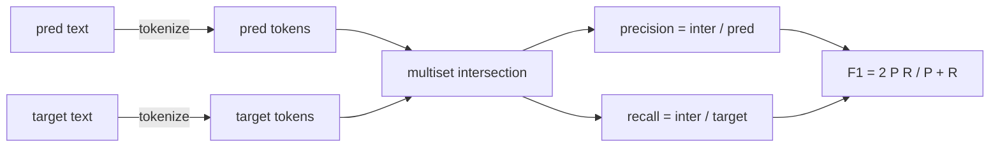
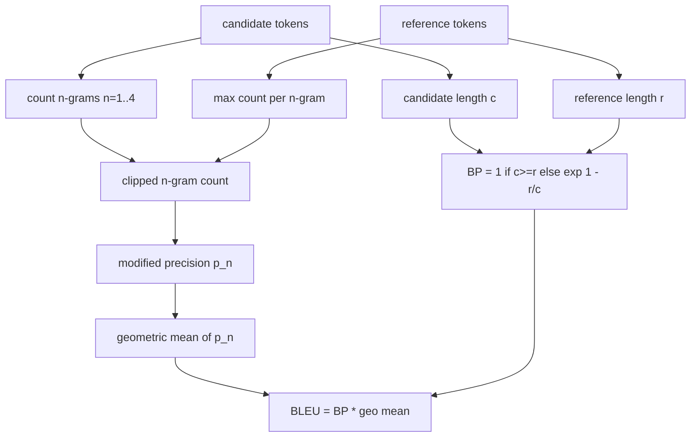

# 经典指标

> BLEU、ROUGE-L、F1、exact-match、accuracy。五个指标仍然覆盖了大多数公开 LLM eval 数字。把它们从 first principles 实现一遍，你才知道每个数字到底是什么意思。

**Type:** Build
**Languages:** Python
**Prerequisites:** Phase 19 Track B foundations, lesson 70
**Time:** ~90 min

## 学习目标

- 用显式 tokenisation 规则实现 token-level exact-match、F1 和 accuracy。
- 从零实现 BLEU-4：modified n-gram precision、n 等于 1 到 4 的 geometric mean、brevity penalty。
- 用 longest common subsequence 实现 ROUGE-L，并用 F-beta 组合 precision 和 recall。
- 根据第 70 课的 `metric_name` field 做 dispatch，让 runner 保持 metric-agnostic。
- 用 worked examples 里的 reference vectors 固定行为，而不是依赖第三方库。

## 为什么要重新实现

你会读到一篇论文报告 BLEU 28.3，另一篇报告 BLEU 0.283。你会发现两个库算出的 ROUGE-L 相差十分，因为一个会转成 lowercase，另一个不会。摆脱困惑最快的方法，是自己把指标写出来，然后能指出 tokenizer 在哪一行决定、smoothing 在哪一行应用。之后，跨论文比较数字就变成阅读 metric setup，而不是争论库。

Stdlib 加 numpy 就够了。BLEU 是计数和 clamp。ROUGE-L 是 dynamic programming。F1 是 tokens 上的 set intersection。最难的部分是选择一个 tokenizer，并承诺一直使用它。

## Tokenisation

Tokenizer 是 `re.findall(r"\w+", text.lower())`。Lowercase，保留 alphanumeric runs，丢掉 punctuation。本课所有 metric 都使用这一个 tokenizer。Runner 没有选择权。如果你换 tokenizer，你就在跑另一个 benchmark。

```python
TOKEN_RE = re.compile(r"\w+", re.UNICODE)
def tokenize(text):
    return TOKEN_RE.findall(text.lower())
```

这是刻意简化。Production setups 会关心 CJK、contractions 和 code identifiers。本课的重点是：tokenizer 是 contract，不是 knob。

## Exact match

```python
def exact_match(pred, targets):
    return float(any(pred.strip() == t.strip() for t in targets))
```

它对每个 task 返回 1.0 或 0.0。Dataset 上的 aggregate 是 mean。这是 arithmetic、MCQ 和 short classification tasks 的主力指标。

## Token-level F1

为 prediction 和 target 建立 token multiset。Precision 是 multiset intersection 除以 prediction 的 multiset。Recall 是同一个 intersection 除以 target 的 multiset。F1 是 harmonic mean。实现会处理 empty-prediction 和 empty-target edge cases。



对于 multi-target tasks，我们取 target list 中最好的 F1。这与文献中广泛报告的 SQuAD-style behaviour 匹配。

## BLEU-4

BLEU 是 canonical machine-translation metric，也仍然会出现在 summarisation 工作里。我们使用的 formulation 是 corpus-level BLEU-4，带标准 brevity penalty，并在 modified n-gram counts 上使用 additive-one smoothing，避免单个缺失的 4-gram 把分数压到 0。

对于每个 candidate-reference pair，我们统计 n 等于 1、2、3、4 时的 modified n-gram precision。Modified precision 会用任意 reference 中该 n-gram 的最大计数来 clip candidate n-gram count，因此 candidate 不能靠重复同一个 phrase 来刷分。四个 precisions 的 geometric mean 再乘上 brevity penalty。



Smoothing rule 使用 Lin 和 Och 称为 method 1 的规则：在取 log 之前，对每个 n-gram precision 的 numerator 和 denominator 都加一。这会避免 reference 没有匹配 4-gram 时出现 `log 0`，并且在长 candidate 上保持接近 unsmoothed value。

## ROUGE-L

ROUGE-L 比较 candidate 和 reference token sequences 的 longest common subsequence。LCS 能捕捉 word order，同时不要求连续，这就是它成为默认 summarisation metric 的原因。我们用标准 dynamic-programming table 计算 LCS length，然后得到 recall：`lcs / reference length`，precision：`lcs / candidate length`，并用 beta 等于 1 的 F-beta 组合，也就是对称 F1 形式。

```python
def lcs_length(a, b):
    n, m = len(a), len(b)
    dp = numpy.zeros((n + 1, m + 1), dtype=int)
    for i in range(n):
        for j in range(m):
            if a[i] == b[j]:
                dp[i+1, j+1] = dp[i, j] + 1
            else:
                dp[i+1, j+1] = max(dp[i+1, j], dp[i, j+1])
    return int(dp[n, m])
```

Numpy table 让实现更清晰；纯 Python lists 也可以工作。选择 ROUGE-L 的 task 会为每个 task 支付 O(n m) 成本。对于典型 summary 长度，这仍然低于一毫秒。

## Accuracy

对于 multi-target classification tasks，accuracy 会退化成对单个 normalised target 做 exact-match。我们把它暴露成独立函数，这样 dispatcher 可以按 `metric_name` dispatch，而不需要 runner 内部再做 string comparisons。

## Dispatch contract

唯一入口是 `score(metric_name, prediction, targets)`。它返回 `[0, 1]` 范围内的 float。Runner 不根据 metric name 分支。它把调用交出去，并写入结果。这就是第 75 课会接到第 70 课 task spec 上的 surface。

```python
def score(metric_name, pred, targets):
    if metric_name == "exact_match":
        return exact_match(pred, targets)
    if metric_name == "f1":
        return max(f1_score(pred, t) for t in targets)
    if metric_name == "bleu_4":
        return max(bleu4(pred, t) for t in targets)
    if metric_name == "rouge_l":
        return max(rouge_l(pred, t) for t in targets)
    if metric_name == "accuracy":
        return accuracy(pred, targets)
    raise ValueError(f"unknown metric_name: {metric_name}")
```

`code_exec` 会在第 72 课处理，并在那里接入 dispatcher。

## 本课不做什么

它不会调用模型。它不会在第 70 课已有的 post-process rules 之外再 normalise generations。它不计算 confidence intervals。它不做 BLEURT 或 BERTScore（那些需要模型，属于另一课）。重点是打好底座：五个 metrics，一个 tokenizer，一张 dispatch table。

## 如何阅读代码

`main.py` 把每个 metric 定义成 free function，并额外提供 dispatcher。Reference vectors 位于文件底部的 `_reference_examples` block。Demo 会用 dispatcher 跑八个 examples，并打印 per-metric scores。`code/tests/test_metrics.py` 中的测试会固定 reference vectors，并压测每个 edge case（empty prediction、empty reference、no shared tokens、exact match、repeated phrase clipping）。

从上到下阅读 `main.py`。函数按复杂度排序。`exact_match` 和 `accuracy` 各一行。F1 是六行。BLEU 和 ROUGE-L 是重的部分，并且包含关于 smoothing rule 和 LCS recurrence 的详细注释。

## 继续扩展

Classical metrics 是必要的，但不充分。它们奖励表面重叠，却会错过 meaning。修复方式是在你信任 classical floor 之后，再叠加 model-based metrics（BLEURT、BERTScore、GEval）。这是后续课程的内容。现在要做的是：让这五个指标工作，用测试固定它们，然后你就拥有一个 auditable、fast、reproducible 的 metric stack。
