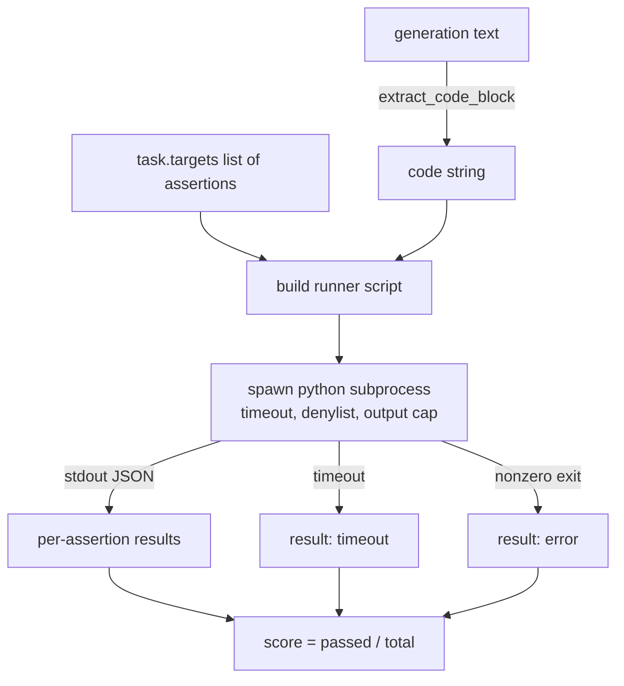
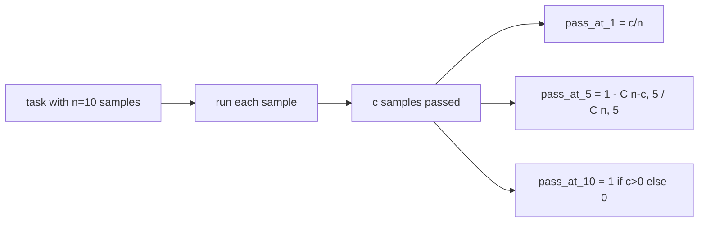

# Code Exec Metric

> 生成代码是否正确，要看它能不能通过测试。Eval harness 必须提取代码、在不拖垮 host 的前提下运行它，并诚实统计 pass-rates。本课会构建这层表面。

**Type:** Build
**Languages:** Python
**Prerequisites:** Phase 19 Track B foundations, lessons 70 and 71
**Time:** ~90 min

## 学习目标

- 从 free-form generation 中提取 code block，并让提取方式匹配第 70 课的 post-process rule。
- 在隔离的 subprocess 中执行 candidate code，并带上 wall-clock timeout、output cap 和 import denylist。
- 把一个 task 评分为 supplied assertion strings 中通过项所占的比例。
- 为从同一个 model 采样多个 generations 的 tasks 计算 pass-at-k。
- 把 sandbox crashes、syntax errors 和 timeouts 当作一等 fail modes，并提供 distinct exit codes，方便 runner 记录。

## 为什么要用隔离 subprocess

Inline `exec` 是 security 和 stability hazard。生成的 `while True: pass` 会让 eval 永远卡住。生成的 `import shutil; shutil.rmtree('/')` 会像听起来一样灾难。修复办法是为每个 candidate 启动一个新的 Python interpreter，通过 stdin 传入代码，把 assertion results 写到 stdout，并在超时时杀掉进程。Host eval process 会继续运行。

HumanEval、MBPP、BigCodeBench、LiveCodeBench 这类真实 evals 都使用 subprocess sandbox。有些还会在外面再套 Docker。本课停在 subprocess 这一层是有原因的：它 portable、stdlib-first，并且能捕捉 educational eval 中重要的 failure modes。Production deployments 会增加 seccomp、network isolation 和 read-only filesystem。下一课的 hardening 会在这条 track 之外展开。

## Code-exec task 的形状

一个 `code_exec` task 会在 `targets` 中携带 assertion strings。Runner 从 generation 中提取 fenced code block，围绕它构建 test harness，然后运行结果。



Score 是 `[0, 1]` 之间的 fraction。一个有三条 assertions 的 task，如果通过两条，分数就是 0.667。无论哪里失败，runner 都返回同一种 shape：subprocess crashes 会被映射为 normalised error code，而不是让 Python traceback 冒泡到 harness。

## Denylist

Denylist 是基于 import 的。在运行 candidate code 之前，runner script 会把危险模块的 imports 重写为一个 stub，该 stub 会抛出 `ImportError("denied")`。列表刻意保守：`os.system`、`subprocess`、`socket`、`requests`、`urllib`、`urllib.request`、`urllib.error`、`urllib.parse`、`ctypes`、`shutil`、`http.client`、`asyncio.subprocess`。

我们并不假装它是 bulletproof。坚定的 adversarial code 可以逃出任何 Python in-process sandbox。Denylist 是 backstop。Wall-clock timeout 和 output cap 才是承重控制。

```python
DENIED = {
    "os.system": True,
    "subprocess": True,
    "socket": True,
    "shutil": True,
    "requests": True,
    "urllib": True,
    "ctypes": True,
}
```

我们会在 candidate 前面 prepend `import sys`，再加一段 guard，把 `os.system` monkey-patch 成会 raise 的版本。完整 template 在 `main.py` 里。

## Wall-clock timeout

每个 subprocess 默认获得三秒 wall-clock budget。Runner 使用 `subprocess.run(..., timeout=t)`。如果触发 timeout，runner 会捕捉 `TimeoutExpired`、杀掉进程，并为该 task 记录 `timeout` exit reason。该 task 的 score 是零。Runner 会继续处理后续任务。

Timeout 可以通过 `task.metadata.timeout_s` 按 task 配置。Long-running unit tests 可以申请更多时间；第 70 课的 validator 会把这个值 cap 在三十秒，保证 suite 有边界。

## Output cap

Subprocess 可能狂刷 stdout，耗尽 host memory。Runner 会把 stdout stream 到一个 buffer 中，并在 running total 超过 256 KB 时立刻杀掉 child。结果会记录为 `exit_code = error`，detail string 是 `"output overflow"`。实际中，当 generation 意外写出一个会不断打印的 infinite loop 时，经常会看到这个结果。

## Pass-at-k

Pass-at-k 是 HumanEval 及同类基准使用的 unbiased estimator。给定每个 task 的 `n` 个 independent samples，其中 `c` 个通过，那么从这 `n` 个里取大小为 `k` 的 sample，至少包含一个 passing solution 的概率是：

```text
pass_at_k(n, c, k) = 1 - C(n - c, k) / C(n, k)
```

当 `n - c < k` 时，numerator 未定义，取值为 `1`。实现会直接处理这个 edge case。我们暴露 `pass_at_k(n, c, k)`，供第 74 课的 leaderboard layer 使用。



## Exit codes

Runner 会为每个 task 返回五种 outcome 之一：

- `pass`：所有 assertions 都通过。
- `assertion_fail`：代码运行了，但至少一条 assertion 失败。
- `syntax_error`：代码无法 import，或存在 SyntaxError。
- `timeout`：wall clock 过期。
- `error`：其他任何 crash，包括 denylist hits 和 output overflow（overflow 的 detail 是 `"output overflow"`）。

Score 仍然是 fraction。Exit code 是 metadata。Downstream lessons 可以自己决定把 timeout 算作零，还是算作 missing data。

## 本课不做什么

它不会给你一个真正的 sandbox。它不会运行来自 open web 的 untrusted code。它不会处理 file I/O 或 network calls 这类 stateful tasks。这些需要 container 或 microVM。本课的重点是 contract：隔离 subprocess、denylist、timeout、output cap、清晰的 exit-code vocabulary，以及 pass-at-k math。

## 如何阅读代码

`main.py` 定义 `extract_code`、`run_candidate`、`score_code_exec` 和 `pass_at_k`。Subprocess runner script 会被构建成一个 string，并作为 `-c` 传给一个新的 Python interpreter。`code/tests/test_exec.py` 中的 tests 会基于 HumanEval 风格的 worked examples，覆盖四种 exit codes 和 pass-at-k。

从上到下阅读 `main.py`。Runner template 是承重部分。盯住 assertion loop，直到你能预测它写回 parent process 的 JSON envelope。

## 继续扩展

Subprocess 形状跑通之后，下一个问题是 portability。不同 Python versions 在 Windows 上处理 SIGKILL 的方式不同。最干净的修复是把 runner 放进 Docker image。再往后，是用真实 unit test files 替换 assertion strings，让 eval 匹配 production CI 的做法。到了那一步，就不要再把 assertion strings 叫 tests；它们是 toy tests，也有 toy failure modes。
