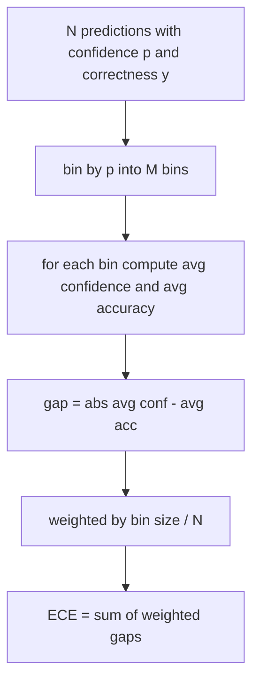
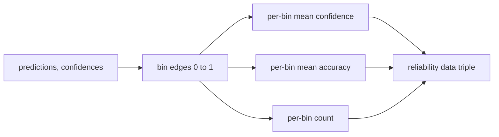

# Perplexity 与 Calibration

> 如果你的模型在一千个答案上都说自己有 90% 置信度，却只答对六百个，它就没有校准好。Calibration 是可信 eval 的一半。另一半是 perplexity，它告诉你模型是否认为 held-out text 本身合理。

**Type:** Build
**Languages:** Python
**Prerequisites:** Phase 19 Track B foundations, lessons 70 and 71
**Time:** ~90 min

## 学习目标

- 根据 model adapter 提供的 token negative log-probabilities，在 held-out corpus 上计算 token-level perplexity。
- 从 binned predicted probabilities 计算 classifier 或 multiple-choice eval 的 expected calibration error（ECE）。
- 计算 Brier score（预测概率与 correctness indicator 的 mean squared error），并解释它什么时候能补上 ECE 没覆盖的东西。
- 构建 reliability diagram 所需的数据，用来绘制 confidence-versus-accuracy curve。
- 把三者全部接入 eval harness，让 runner 可以把 `perplexity`、`ece` 和 `brier` numbers 附到 model report 上。

## Perplexity 告诉你什么

Perplexity 是 per-token average negative log-likelihood 取指数后的结果。越低越好。Perplexity 等于 1，表示模型给每个真实 token 都分配了概率 1。Perplexity 等于 vocabulary size，表示模型是均匀分布，什么也没学到。真实数字落在中间：一个强的 2026 base model 在 WikiText-103 上大约是 8 到 12；差的模型在同一文本上会到 50 以上。

Harness 不自己计算 log-probabilities。它们来自 model adapter。Harness 负责聚合：接收一个 per-token log-probabilities 列表、一个每个 sequence 的 token counts 列表，并返回 corpus perplexity。

```python
def perplexity(neg_log_probs, token_counts):
    total_nll = sum(neg_log_probs)
    total_tokens = sum(token_counts)
    return math.exp(total_nll / total_tokens)
```

实现会处理 zero-token edge cases，并断言 negative log-probabilities 非负。一个常见错误是忘记取负号：adapter 返回 `log p` 而不是 `-log p`，就会得到低于 1 的 perplexity，这是不可能的。函数会把这种情况捕捉为 contract violation。

## ECE 衡量什么

Expected calibration error 会按 confidence 把 predictions 分到固定数量的 bins 中，然后计算每个 bin 内 confidence 和 accuracy 的平均差距，再按 bin size 加权求和。



标准 formulation 在 `[0, 1]` 上使用 10 个 equal-width bins。实现支持任意正整数数量。我们暴露 `bins` parameter，让 runner 可以在发表惯例（10）和比较惯例（15）之间选择。

ECE 会被 bin count 和 sample size 影响。用 10 个 bins 和 100 个 predictions 时，你无法区分 0.02 ECE 和随机噪声。实现会在返回 ECE 的同时返回 populated bins 数量，这样 runner 可以在 samples 太少时拒绝报告单个数字。

## Brier score 做了 ECE 没做的什么

ECE 只关心平均差距。一个模型如果在一半 bins 上 overconfident，在另一半 bins 上 underconfident，可能仍然有很低的 ECE，但局部校准很差。Brier score 会逐条 prediction 衡量它与真实 outcome 的 squared error，因此会直接惩罚分布的 spread。

对于 binary outcomes，Brier 是 `mean((p_i - y_i)^2)`。它可以分解为 reliability、resolution 和 uncertainty。我们会计算 score 和 decomposition。Runner 报告 scalar，但把 decomposition 记录给 dashboard。

```python
def brier(p, y):
    return float(np.mean((p - y) ** 2))
```

## Reliability diagram 数据

Reliability diagram 会画出每个 bin 中 predicted confidence 与 empirical accuracy 的关系。对角线代表 perfect calibration。函数返回三个 arrays：per-bin average confidence、per-bin average accuracy，以及 per-bin count。绘图代码位于下游；本课停在数据形状。



返回的 tuple 正是调用层绘图或计算 custom ECE variants（adaptive ECE、sweep ECE 等）所需的东西。我们返回 numpy arrays，这样下游代码不必再转换。

## Confidence 来源

Harness 不假设 confidence 来自 softmax。它接受每条 prediction 对应的任意 `[0, 1]` 数字。对于 multiple-choice tasks，自然的 confidence 是 `softmax over option log-likelihoods`。对于 free-text，自然的 confidence 是模型自报概率，或者 average log-likelihood 的指数。Eval 只消费这个数字。它来自哪里，是 adapter 的职责。

## Edge cases

- 全部 predictions 都错：ECE 是 average confidence，Brier 很高，perplexity 取决于模型怎么看待文本。
- 全部 predictions 都正确且 confidence 很高：ECE 接近 0，Brier 接近 0。
- 完全不确定的 predictor，`p=0.5`：ECE 是 0.5 减去 accuracy，Brier 是 0.25 减去一个 correction term。
- Empty input：ECE、Brier 和 reliability 返回 `0.0`（或 zero-filled arrays）。Perplexity 在 zero-token case 下返回 `NaN`。这些路径都不会 emit warning；runner 会检查数值，并决定 report 还是 skip。

这些 cases 都写进了 tests。真实 benchmark 上的真实模型不会命中它们，但 buggy adapter 或 tiny sample 会命中，runner 不应该因此 crash。

## Dispatch

Calibration 不是 F1 这样的 per-task metric。它是 per-model report。Runner 会在整个 eval 中累计 `(confidence, correct)` pairs，然后只计算一次 ECE、Brier 和 reliability data。Perplexity 则在 held-out text corpus 上计算，与逐 task scoring 分开。

接口是：

```python
report = CalibrationReport.from_predictions(confidences, correct)
report.ece          # float
report.brier        # float
report.reliability  # tuple of three numpy arrays
report.populated_bins  # int
```

`PerplexityResult.from_token_nll(neg_log_probs, token_counts)` 会返回 perplexity 和 per-token average negative log-likelihood。

## 本课不做什么

它不调用模型。它不实现 softmax。它不从 output tokens 中估计 confidence；那是 adapter 的职责。它不做 temperature scaling 或 Platt scaling；这些是 post-hoc fixes，属于另一节课。本课的重点是让三个数字（perplexity、ECE、Brier）可信、可复现。

## 如何阅读代码

`main.py` 定义 `perplexity`、`expected_calibration_error`、`brier_score`、`reliability_diagram`，以及 `CalibrationReport` / `PerplexityResult` dataclasses。Demo 会在已知 ground truth 的 synthetic predictions 上运行：一个 well-calibrated model、一个 overconfident model，以及一个 underconfident model。`code/tests/test_calibration.py` 中的 tests 会固定每个 edge case，并为 synthetic predictors 固定 reference values。

从上到下阅读 `main.py`。函数顺序从 scalar 到 vector，再到 report。每个函数都有一个短 docstring，说明数学和 contract。

## 继续扩展

Calibration 是 published eval 中最常被忽略的轴。多数 leaderboards 报一个 accuracy number 就结束了。一个 accuracy 更高但 Brier 更差的模型，作为 production deployment，可能不如一个 accuracy 低几分、但能可靠报告不确定性的模型。只要 calibration plumbing 到位，就可以在 held-out validation slice 上添加 temperature scaling，重新计算 ECE，然后观察 gap 缩小。这属于另一节课，但地基在这里。
