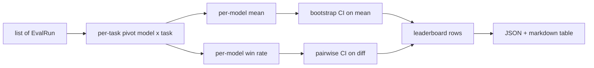
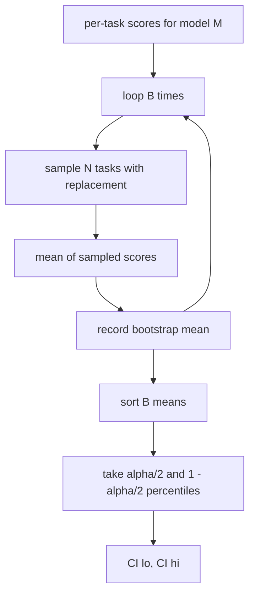

# Leaderboard 聚合

> Per-task scores 很容易。跨 heterogeneous tasks 给多个模型做 per-model ranking 更难。基于一千条 prediction 的 leaderboard 做 statistical significance，是大家最常跳过的部分。本课不会跳过它。

**Type:** Build
**Languages:** Python
**Prerequisites:** Phase 19 Track B foundations, lessons 70, 71, 73
**Time:** ~90 min

## 学习目标

- 把多个模型、多个任务的 per-task scores 聚合成整洁的 per-model row。
- Normalise heterogeneous scores，避免 pass rates 和 BLEU values 对 aggregate 产生过度影响。
- 按 mean 和 win-rate 排序模型，并解释什么时候每种 summary 更合适。
- 计算每个模型 mean score 的 bootstrap confidence intervals，以及 pairwise differences 的 confidence intervals。
- 把 leaderboard 输出为 JSON report，以及一张 lesson 75 的 runner 可以贴进 CI comment 的 markdown table。

## 输入形状

Aggregator 消费一组 `EvalRun` records：

```python
@dataclass
class EvalRun:
    model_id: str
    task_id: str
    metric_name: str
    score: float          # in [0, 1]
    category: str
```

第 75 课的 runner 会为每个 `(model, task)` pair 发出一条 record。Aggregator 不关心 score 是怎么产生的。它期待 normalisation 已经发生：每个 score 都在 `[0, 1]` 内。

## 输出

会产出三张表：



Leaderboard row 包含：`model_id`、`mean_score`、`mean_ci_lo`、`mean_ci_hi`、`win_rate`、`tasks_completed`，以及一个可选的 `categories` map，用于 per-category mean。

## Normalisation

如果一个 task 的 score 在 `[0, 1]`，另一个在 `[0, 100]`，第二个会悄悄主导 mean。Aggregator 会验证每个 input score 都位于 `[0, 1]`，否则拒绝本次 run。修复位置在 upstream：metric 应该已经返回 fraction。第 71 到 73 课会强制这个 contract。

## Mean 和 win-rate

两种 ranking schemes 服务于不同目标。

Mean score 是某个模型的 per-task scores 平均值。它是 leaderboard 报告的 headline number。它对 outliers 和 task imbalance 敏感。

Win-rate 统计一个模型在同一 task 上击败所有其他模型的频率。对每个 task，score 最高的模型获胜（ties split）。Win rate 等于 wins 除以该模型有 score 的任务数量。它不太受 outliers 和 scale differences 影响，但会丢失信息。

```python
def win_rate(model_id, runs_by_task, all_models):
    wins, total = 0, 0
    for task_id, runs in runs_by_task.items():
        scores = {r.model_id: r.score for r in runs if r.model_id in all_models}
        if model_id not in scores:
            continue
        total += 1
        best = max(scores.values())
        if scores[model_id] >= best:
            wins += 1
    return wins / total if total else 0.0
```

Harness 会同时报告两者。第 75 课的 runner 默认按 mean 排名；markdown 中的 win-rate column 也在那里，方便用户选择。

## Bootstrap confidence intervals

Per-model means 会附带一个 confidence interval，通过在 tasks 上做 bootstrap resampling 估计。我们有放回地重采样 task ids，计算 resampled set 上的 mean，重复 `B` 次，然后取 level `alpha` 下的 percentile interval。



对于 pairwise comparisons，我们会 bootstrap per-task difference `score_A - score_B`，取 percentile interval，并报告它。用户可以直接看 interval 是否排除 zero。如果排除，则差异在 alpha level 下显著。如果没有排除，leaderboard 会把这些模型视为 tied。

Low-level helpers（`bootstrap_mean_ci`、`bootstrap_pairwise_diff`）默认使用 `B=1000`；public aggregators（`aggregate`、`pairwise_diffs`）默认使用 `b=500`，让 demo 和 tests 保持快速。默认 alpha 是 0.05。本课保持 bootstrap 只用 pure numpy，不用 scipy。

## Categories

如果设置了 `EvalRun.category`，aggregator 也会报告 per-category mean。这就是每个 leaderboard 上写着 `math`、`reasoning`、`code`、`safety` 的那一列。它能让 runner 发现某个模型整体很好但 code 很弱，而 headline mean 会隐藏这类信息。

## Markdown rendering

Leaderboard 会渲染成 markdown table：

```text
| Rank | Model | Mean | 95% CI | Win rate | Tasks |
|------|-------|------|--------|----------|-------|
| 1    | gpt   | 0.78 | 0.74-0.82 | 0.62 | 50 |
| 2    | claude| 0.75 | 0.71-0.79 | 0.34 | 50 |
| 3    | random| 0.10 | 0.07-0.13 | 0.04 | 50 |
```

Table 按 mean score 排序。CI 会渲染到两位小数。过长的 model ids 会截断到二十个字符。

## 本课不做什么

它不会运行模型。它不会调用 metric layer。它不会实现 adaptive ECE 或其他 calibration variants；那些是第 73 课。本课也不实现 task weighting。这里每个 task 权重相同。Production leaderboards 会给 task 加权；我们通过 `weight` field 留出 hook，但 aggregator 会忽略它。如果你需要 weighting，可以在后续课程中添加。

## 如何阅读代码

`main.py` 定义 `EvalRun`、`LeaderboardRow`、`aggregate`、`bootstrap_mean_ci`、`bootstrap_pairwise_diff` 和 `render_markdown`。Demo 会构造一个包含三个模型和十二个任务的 synthetic suite，执行 aggregation，并打印 leaderboard 与 pairwise diff table。`code/tests/test_leaderboard.py` 中的测试会固定 bootstrap、markdown rendering、win-rate edge cases 和 empty-input behaviour。

从上到下阅读 `main.py`。Data shape（`EvalRun`、`LeaderboardRow`）在最前面，然后是 aggregator，第三部分是 bootstrap，最后是 rendering。每个函数都有聚焦的 contract。

## 继续扩展

自然的下一步是 paired-task significance，而不是 unpaired bootstrap。如果 model A 和 B 都跑了同一百个 tasks，合适的检验是 task-by-task differences 上的 paired bootstrap，本课已经实现。再往后，你会想要 hierarchical bootstrap，它尊重 task families（math problems 之间并非彼此独立；一种 arithmetic error pattern 会影响其中十道题）。那是后续工作。本课的重点是把底座做对，让 eval report 给出的数字经得起解释。
