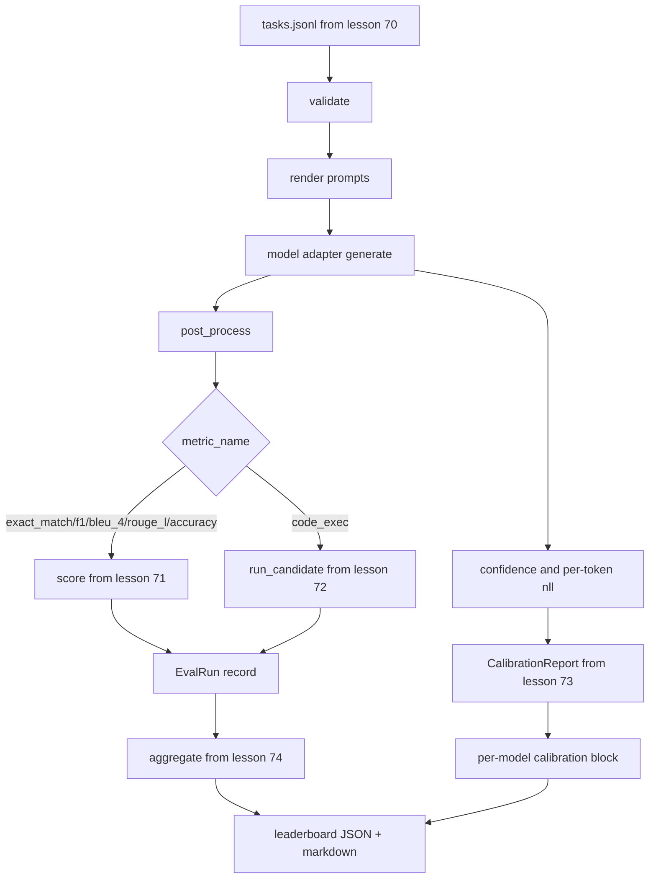

# 端到端 Eval Runner

> 五节课搭管道，一节课把它们粘起来。Runner 读取第 70 课的 task spec，通过 adapter 调用 model，用第 71 和 72 课评分，附上第 73 课的 calibration report，并输出第 74 课的 leaderboard。Demo 会 self-terminate。

**Type:** Build
**Languages:** Python
**Prerequisites:** Phase 19 Track B foundations, lessons 70 through 74
**Time:** ~90 min

## 学习目标

- 定义一个 `ModelAdapter` interface，让任何 model（mock、local、API）都能用很小的方法表面接入。
- 在 fixture JSONL 文件上运行 eval，并通过 worker pool 并行执行 tasks。
- 在单次 pass 中组合 metric layer（exact_match、F1、BLEU-4、ROUGE-L、code_exec）和 calibration layer。
- 产出每个 model 的 `EvalRun` records，并直接送进 leaderboard aggregator。
- 同时输出 JSON report 和 markdown table；clean run 时以 exit zero 自行结束，validation 或 runtime failure 时返回 non-zero。

## Pipeline



Runner 是 integration point。第 70 到 74 课各自拥有一个 module，runner 会把它们组合起来。Runner 不重复这些 modules 里的任何逻辑：它只 import 它们。

## Adapter interface

Adapter 是 runner 和任意 model 之间的边界。Interface 刻意保持很小。

```python
class ModelAdapter:
    model_id: str

    def generate(self, prompt: str, task: TaskSpec) -> Generation: ...
```

`Generation` 是一个 dataclass，包含：

- `text`：model 的 free-form output
- `confidence`：`[0, 1]` 范围内的 float，表示 model 自报的 answer probability
- `token_nll`：可选，generated tokens 上 negative log-likelihoods 的总和
- `token_count`：可选，generated tokens 的数量

Runner 中的 mock adapters 提供三种风格：`RuleBasedAdapter`（deterministic、接近完美）、`NoisyAdapter`（overconfident、经常出错）和 `BiasedAdapter`（擅长一个 category，在另一个 category 上很差）。Demo 会让这三个 adapters 跑过第 70 课的 fixture。

## Parallel execution

Runner 使用 `concurrent.futures.ThreadPoolExecutor` 按 model 并行运行 tasks。Worker count 默认为 8 和 task count 中较小的那个。Threads 足够用，因为真实 model calls 的瓶颈是 network I/O。Code-exec path 会在 task 内部生成自己的 subprocess，executor 只负责调度等待。

为了 deterministic tests，runner 暴露 `run_eval(adapters, tasks, parallel=False)`，让 tests 可以固定执行顺序。

## 单次 pass scoring loop

对每个 task：

1. Render prompt（few-shot prefix 加 prompt body）。
2. 调用 adapter，并记录调用耗时。
3. 按 task 的 rule 对 generation 做 post-process。
4. Dispatch 到 metric layer。
5. 构建带有 score 和 metric metadata 的 `EvalRun` record。
6. 把 `(confidence, correct)` pair 追加到 calibration buffer。

对于 exact_match-style metrics（`exact_match`、`accuracy`、`code_exec`），`correct` signal 是 `score >= 1.0`；对于 graded metrics，`correct` signal 是 `score >= 0.5`。Threshold 位于 `_correct_from_score` 中，runner 不暴露 public override。

## Aggregation

每个 task 都拿到 result 之后，runner 会调用第 74 课的 `aggregate` 和 `pairwise_diffs`，以及第 73 课的 `CalibrationReport.from_predictions`。输出是一个单独的 JSON envelope：

```json
{
  "leaderboard": [...],
  "pairwise": [...],
  "calibration": {
    "model_id_a": {"ece": 0.04, "brier": 0.10, "populated_bins": 8, ...},
    ...
  },
  "summary": {
    "tasks": 10,
    "models": 3,
    "wall_seconds": 1.2
  }
}
```

Runner 也会把 markdown table 写到 stdout，方便用户把结果贴进 PR review。

## Self-terminating demo

Demo 会让三个 mock adapters 跑过第 70 课的十个 fixture tasks。Wall time 应该低于十秒。Clean run 时 exit code 为零。

Clean-run criteria：

- 每个 task 都通过第 70 课的 validation。
- 每个 task 都通过第 71 和 72 课的 scoring。
- Calibration report 能在第 73 课的逻辑下无错误聚合。
- Leaderboard 把 rule-based adapter 严格排在 random adapter 之上。

如果其中任何一条破坏，runner 会以 non-zero 退出，并在 JSON envelope 中附上 structured error。

## 本课不做什么

它不会调用真实 model。它不会实现 API key flow 或 rate-limit handling。它不会实现 streaming 或 partial generation；adapter 每次调用只返回一个 generation。它不会做 retries 或 caching。这些关注点属于 adapter layer；runner 对 metric 和 provider 都保持 agnostic。

## 如何阅读代码

`main.py` 是 integration。它通过一个小型 `_load_sibling` helper 从其他五节课的 modules 中 import，helper 会按相对路径解析它们。`Generation`、`EvalReport` 和 `ModelAdapter` 这些 dataclasses 在本地定义。Mock adapters 位于文件底部。

从上到下读 `main.py`。先略读 imports，然后看 `run_eval`，再看 `_score_one`，最后看 adapters。文件末尾的 demo 是 entry point。

`code/tests/test_runner.py` 中的 tests 会固定 adapter interface、single-pass loop、parallel-vs-sequential equivalence、calibration buffer 和 JSON envelope shape。

## 继续扩展

这个 runner 是地板。Production eval system 还会加：按 `(task_id, model_id, model_version)` 缓存 results；记录每次 run 的 dollars 和 tokens 的 cost ledger；遇到 rate limits 时 backoff 的 retry layer；用于 pass-at-k tasks 的 sampling policy；以及适合 long suites 的 streaming output format。每一项都是包在 runner 外面的一层单一关注点，不需要改变 metric 或 aggregation layers。这种 separation 正是 contract 的意义。

等 mocks 跑通之后，再为真实 provider 加一个 adapter。选一个有 free tier 的 provider，写三十行 glue，看 leaderboard 亮起来。然后加第二个 provider，让 harness 替你干活。
