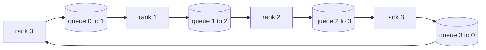

# 从零实现 Collective Ops

> 支撑 distributed training 的四个 collective operations 是 allreduce、broadcast、allgather 和 reduce_scatter。Training framework 提供的其它 primitive，基本都是围绕这些操作封装出来的。先在 `multiprocessing.Queue` mesh 上构建它们，并和 reference implementation 对齐验证，后面的 track 就会变成 plumbing。

**Type:** Build
**Languages:** Python
**Prerequisites:** Phase 19 Track C lessons 42-49
**Time:** ~90 min

## 学习目标

- 用两轮流程实现 ring allreduce（先 reduce-scatter，再 allgather），并证明每个 rank 的通信量是每个元素 2(N-1)/N bytes。
- 基于 `multiprocessing.Queue` 上的 point-to-point sends 构建 broadcast、allgather 和 reduce_scatter。
- 用相同输入把每个 primitive 和 `torch.distributed` gloo reference 对比验证。
- 能根据 cluster shape、latency floor 和 bandwidth ceiling，为 ring 与 tree 的选择辩护。

## 问题

一个 naive allreduce 会在 N 个 ranks 上把 N 份 tensor 发送到 root，再从 root broadcast N 份回去。每个 rank 的 bandwidth 会按 O(N) 扩张，root 会变成瓶颈，wall-clock floor 是最慢链路乘以 N。Ring allreduce 会把它压平成 2(N-1) 个大小为 T/N 的 chunks，因此每个 rank 的 bytes 降为 2T(N-1)/N，并且与 cluster size 解耦。Tree allreduce 在小 N 和高延迟链路上会赢，因为深度是 log2(N) hops，而不是 2(N-1)。如果为 cluster shape 选错 topology，最慢的 GPU 就会决定 step time。

你在这个 track 里读到的每个 distributed training framework 都依赖这四个 primitives。PyTorch DDP 会为每个 parameter bucket 用一次 allreduce 同步 gradients。ZeRO 通过 reduce_scatter 分片 optimiser state，并通过 allgather broadcast 更新后的 parameters。FSDP 会把完整 forward 变成 allgather 加 reduce_scatter。Pipeline parallel 需要 broadcast 在 stage groups 之间发送 activations。如果你不能实现这四个 collectives，就无法解释为什么 training stall、为什么 gradient mismatch 出现在 rank 3，或者为什么切换 topology 后 pipeline bubble 翻倍。

## 概念



### 两轮 Ring allreduce

把 tensor 切成 N 个等长 chunks，索引为 0..N-1。每个 rank 拥有与自己 rank 相同索引的 chunk。第一轮 reduce-scatter 运行 N-1 步。在 step s，rank r 把 chunk `(r - s) mod N` 发送给 rank `(r + 1) mod N`，并从 rank `(r - 1) mod N` 接收 chunk `(r - s - 1) mod N`，再把收到的 chunk 累加到本地副本。N-1 步之后，rank r 拥有 chunk r 的完整 sum。第二轮 allgather 再运行 N-1 步，把已经完成的 chunks 沿 ring 旋转，直到每个 rank 都持有每个 chunk 的完整 sum。

| Primitive | Per-rank bytes | Steps | When to use |
|-----------|---------------|-------|-------------|
| Ring allreduce | 2T(N-1)/N | 2(N-1) | Large T, fat-pipe homogeneous cluster |
| Tree allreduce | T log2(N) | 2 log2(N) | Small T or high-latency links |
| Broadcast | T | log2(N) tree | Parameter init, scalar config |
| Allgather | T(N-1)/N | N-1 | Sharded forward, ZeRO unshard |
| Reduce_scatter | T(N-1)/N | N-1 | ZeRO gradient sharding |

### Queue mesh 作为 NCCL 的 stand-in

NCCL 运行在 PCIe 和 NVLink 上，并使用硬件卸载的 reductions。在 CPU 上你没有这些能力。为 ring 的每条边创建一个 `multiprocessing.Queue`，可以得到有序的 point-to-point delivery，并且每条边只有一个 producer 和一个 consumer。Reduction 发生在 user space，因此你会付出 Python overhead，但 wire pattern 和 NCCL ring allreduce 一样。先在 queue 版本上推理 correctness，cluster behavior 也就跟着清晰起来。

### 用 gloo 验证

每个 primitive 都配有 unit test：在同一 world size 下，把相同 tensor 交给 `torch.distributed` 的 gloo backend，然后把输出与本课实现对比。如果你的 ring allreduce 与 gloo 的差异超过 float32 epsilon，test 就会失败。用 reference implementation 做 verification 是不可协商的；没有它，primitive 会一直看起来正确，直到真实训练跑到 step 10000 才暴露问题。

## Build It

`code/main.py` 实现：

- `Mesh` class，把 N 个 `multiprocessing.Queue` 实例接成一个 ring，并为每个 rank 暴露 `send(dst, tensor)` 和 `recv(src)`。
- `ring_allreduce(mesh, rank, world_size, tensor)`，运行两轮算法。
- `broadcast(mesh, rank, world_size, tensor, src)`，基于 logarithmic tree。
- `allgather(mesh, rank, world_size, tensor)`，使用 N-1 次 rotations。
- `reduce_scatter(mesh, rank, world_size, tensor)`，也就是 allreduce 的前半段。
- `_gloo_reference(op, world_size, tensor)`，把相同输入通过 `torch.distributed` gloo 运行，用于 byte-equal comparison。

运行：

```bash
python3 code/main.py
```

输出：每个 primitive 的 verification table，对比 queue-mesh 和 gloo outputs；随后是 per-rank byte counter，用来证明 2T(N-1)/N scaling。

## 真实生产中的 patterns

有三个 pattern 会把这些 primitives 加固到可上线的程度。

**Bucket gradients before allreduce.** 一个 1B-parameter model 会有成千上万个 gradient tensors。每个 tensor 做一次 allreduce，会重复支付 N 次 latency floor。DDP 会把 gradients bucket 成约 25 MB 的 chunks，并对每个 bucket 发起一次 allreduce；small tensors 会搭大 tensors 的顺风车。没有 bucketing，latency overhead 会主导 step。

**Overlap communication with computation.** Backward 会按反向顺序逐层计算 gradients。最后一层 gradient 刚准备好，就启动它的 allreduce，同时下一层继续计算。PyTorch DDP 用 bucket-ready hooks 接线这个过程。当 network 有余量时，这种 overlap 会把可见 communication time 减半。

**Pick ring or tree by message size, not religion.** NCCL 带有 topology detector，会对大于约 1 MB 的 messages 选择 ring，对更小的 messages 选择 tree。Crossover 是 bandwidth 与 latency 的权衡：1 MB 以上，bandwidth term 2T(N-1)/N 主导，ring 赢；1 MB 以下，log2(N) hop count 赢。硬编码一种 topology，会在错误 message size 上损失 throughput。

## Use It

Production patterns：

- **PyTorch DDP.** Backward 之后对 bucketed gradients 调用 `dist.all_reduce`。Bucket size 可调；默认 25 MB 对 100Gbit Ethernet 来说比较合理。
- **DeepSpeed ZeRO.** 使用 reduce_scatter 分片 gradients，并在 forward 前使用 allgather 重建完整 parameters。本课的 primitives 正是 ZeRO 调用的操作。
- **FSDP.** Forward 以 allgather 开始，用来 unshard layer；计算之后用 reduce_scatter reduce，并丢弃 unshard。相同 primitives，不同 schedule。

## Ship It

在第 77-81 课中使用 queue-mesh primitives。第 77 课把 allreduce 接进 DDP。第 78 课把 reduce_scatter 接进 ZeRO。第 79 课把 broadcast 接进 pipeline activations。第 81 课把全部四个 primitives 组合进端到端 demo。

## 练习

1. 添加一个 tree allreduce variant，并按 message size 在 ring 和 tree 之间切换。测量 crossover。
2. 添加 `recv_timeout_ms`，让 stalled rank 抛出 deadline error，而不是永远 hang 住。
3. 把四个 primitives 里的 `multiprocessing.Queue` 换成 TCP sockets。测试保持相同，但走真实 wire。
4. 添加 bandwidth instrumentation hook，让 per-rank byte counter 写入 JSONL。
5. 在 4 ranks 上，对 1KB、1MB、16MB tensors 比较 ring 与 tree 的 wall-clock time。用实证结果为 crossover 辩护。

## 关键术语

| Term | What people say | What it actually means |
|------|----------------|------------------------|
| Allreduce | "Sum across ranks" | 调用结束后，每个 rank 都持有同一个 reduced tensor |
| Ring | "The fast topology" | 大小为 T/N 的 N-1 个 chunks 沿 cycle 流动两轮 |
| Tree | "The log topology" | Reduction 按 binary tree 进行；深度是 log2(N) hops |
| Allgather | "Concatenate shards" | 每个 rank 最终都持有其它所有 rank 的 shard |
| Reduce_scatter | "Split the sum" | 每个 rank 最终只持有一个 chunk 的 sum |
| Bucket | "Fuse small tensors" | 把 N 个小 allreduces 合并成一个大的 allreduce |

## 延伸阅读

- [PyTorch Distributed: NCCL collectives](https://pytorch.org/docs/stable/distributed.html#collective-functions)
- [Horovod ring allreduce paper](https://arxiv.org/abs/1802.05799)
- [NCCL topology and algorithm selection](https://docs.nvidia.com/deeplearning/nccl/user-guide/docs/index.html)
- [Patarasuk and Yuan, Bandwidth optimal allreduce algorithms](https://www.cs.fsu.edu/~xyuan/paper/09jpdc.pdf)
- Phase 10 Lesson 05 - distributed training overview
- Phase 19 Lesson 77 - DDP wired on top of these primitives
