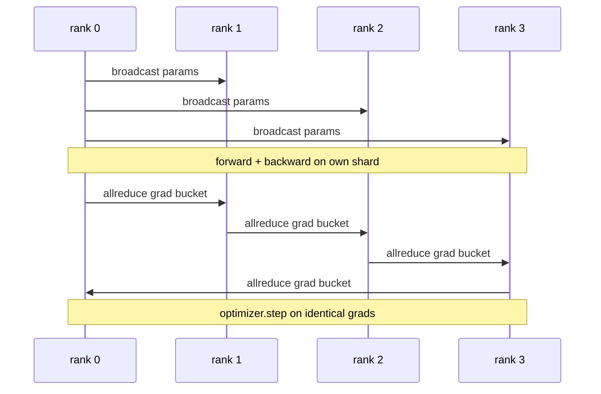

# 从零实现数据并行 DDP

> DistributedDataParallel 是 allreduce 之上的一个 hook。包装一个 model，从 rank 0 广播初始参数，让每个 rank 从相同状态开始；在每个 parameter 上安装 backward hook，对 gradient 发起 allreduce；剩下的就是 gradient descent。整个模式 200 行就够。

**Type:** Build
**Languages:** Python
**Prerequisites:** Phase 19 Track C lessons 42-49
**Time:** ~90 min

## 学习目标

- 接出一个 `DistributedDataParallel` 形状的 wrapper：广播初始参数，并在 backward 之后 allreduce gradients。
- 使用 `torch.multiprocessing.spawn` 在 gloo backend 和 file-based rendezvous 上启动 N 个 CPU ranks。
- 通过在相同数据上 sequentially 训练同一个 model，并展示每一步的参数等价，证明 gradient-sync 的正确性。
- 解释 buckets（gradient fusion）和 overlap（backward 期间通信）为什么是把可工作的 DDP 变成 production DDP 的两个关键变化。

## 问题

一个 10 亿参数模型加上 12 GB activations，放不进一张消费级 GPU。即使能放下，训练也可能耗时数周。Data parallel 会把 batch 切分到 N 个 ranks，每个 rank 在自己的 shard 上计算 forward 和 backward；每一步都会汇总每个 rank 的 gradients，让所有 N 份 copies 保持一致。汇总后的 gradient 就是 optimiser 用来 step 的东西。

如果没有 gradient sync，N 个 replicas 到第 2 步就会分叉。它不再是“一个模型在更多数据上训练”，而是 N 个碰巧共享初始 weights 的独立模型。如果 gradient sync 做得很糟（一参数一次 allreduce、没有 overlap、没有 bucketing），网络会成为瓶颈，GPU 会空转等待通信。DDP 的手艺，就是让 gradient sync 相对 compute 几乎免费。Canonical PyTorch DDP 通过 bucketing gradients、把 allreduce 与下一层 backward 重叠、并在 NVLink 上使用 NCCL 来做到这一点。我们可以在 CPU 上用 gloo 做到这三件事，并学到同样的 lessons。

## 概念



### DDP 需要的三个操作

| Stage | Collective | Why |
|-------|-----------|-----|
| Init | broadcast from rank 0 | 每个 rank 都以相同 parameters 开始 |
| After backward | allreduce of each grad | Mean gradient 是 optimiser 用来 step 的内容 |
| Sometimes | broadcast of buffers | Batchnorm running stats 保持同步 |

### 为什么是 mean，不是 sum

Allreduce-SUM 除以 world_size 会得到 mean gradient。Mean 对 world_size 不敏感：在一个 rank 上调好的 learning rate，到四个 ranks 上也能工作，因为每一步 gradient magnitude 不会改变。如果只做 Allreduce-SUM 而不除以 world_size，每次改变 cluster size 都得重新调 learning rate。DDP 会包装 SUM 并执行除法；本课也做同样的事。

### 为什么要 bucket gradients

一个 transformer 有成千上万个 parameter tensors。每个 tensor 一次 allreduce，会支付成千上万次 gloo latency floor。DDP 把 gradients 组合成约 25 MB 的 buckets，并对每个 bucket 发起一次 allreduce。线上传输的总字节数相同，但 latency 被摊到 bucket 上。对本课的 tiny model，我们会把所有东西组合成一个 bucket；重要的是这个结构可以迁移到大模型上。

### 为什么要固定 seed

每个 rank 必须为 shuffling 调用 `torch.manual_seed(seed + rank)`，但为 parameter init 调用 `torch.manual_seed(seed)`。单个共享 seed 会让每个 rank 看到相同 batch order（破坏 data parallel）；rank-specific params seed 会让初始 parameters 因 float epsilon 而不同，gradient sync 之后 replicas 也不会保持一致。Seed pattern 一旦写错，parameter equivalence test 会在第 1 步失败。

## 动手构建

`code/main.py` 实现：

- `MiniMLP`：一个 3-layer MLP，小到几秒内收敛，大到足以暴露 wiring。
- `DistributedDataParallel(model, world_size)`：构造时广播 params，返回一个 wrapper，其 `sync_grads` 会把 allreduce-summed grads 除以 world_size。
- `worker(rank, world_size, ...)`：完整 training loop，使用 `torch.distributed` 在 gloo 上 init，执行 forward、backward、sync、step。
- `_reference_single_process_loop(...)`：在一个 rank 上 sequentially 训练同一 model 和同一数据，用于测试每一步之后 byte-equal parameter equivalence。

运行：

```bash
python3 code/main.py
```

输出：一张逐步 training table，对比 single-process loss 和 parameter checksum，以及 4 ranks 上的 DDP run。两条路径会产生在 float epsilon 内一致的 loss curves，证明 gradient sync 正确。

## 野外的 production patterns

三个模式可以把 DDP 加固到可上线。

**Find unused parameters。** 有些 forward paths 会有条件地跳过 parameters（early exit、mixture-of-experts router）。被跳过的 parameters 没有 gradient，但 DDP 的 bucket-ready hook 仍会等待它们，allreduce 就会 deadlock。`find_unused_parameters=True` 会告诉 DDP 在 reducing 前检查哪些 params 得到了 gradients。代价是每步多一次 graph walk，所以除非 forward 有分支，否则不要打开。

**Static graph optimisation。** 当 forward 在不同 steps 间保持稳定时，`static_graph=True` 允许 DDP 预先计算 bucket schedule。这个优化在 scale 上很重要：每步省下几毫秒，在 10000 steps 上会累积成明显收益。

**Gradient accumulation needs care。** 在 K 个 microbatches 上累积 gradients，而不是每个 microbatch 都 sync，是 10x throughput win。DDP 暴露 `no_sync()` context manager，用来暂停 post-backward allreduce。忘记这个 manager，就会无意义地 allreduce K 次；throughput 会掉到底。

## 投入使用

Production patterns：

- **PyTorch DDP。** Canonical implementation。`torch.nn.parallel.DistributedDataParallel(model)` 会接好 bucketing、overlap 和 no_sync context。
- **HuggingFace Accelerate。** 添加一个 launcher，处理 `torchrun` env vars 和 model wrap。底层仍然是同一个 DDP。
- **Megatron-LM data parallel。** 把 DDP 和 tensor parallel 组合起来训练大模型；data-parallel 部分仍然是 backward 后 allreduce 的模式。

## Ship It

Lesson 78（ZeRO sharding）会用 reduce_scatter 替换 per-parameter allreduce，这样每个 rank 只存储自己的 optimiser state shard。Lesson 81 会把 DDP 和 ZeRO 组合进端到端 demo。

## 练习

1. 添加可配置大小的 gradient buckets，并在更深的 model 上测量它相对于 one-allreduce-per-parameter 的 speedup。
2. 把 `no_sync()` 实现成 context manager，并验证 K 个 microbatches 上的 gradient accumulation 匹配 single-process baseline。
3. 添加一个 `find_unused_parameters` mode，让 forward 有时跳过 MLP layers 中的一层；不打开该 flag 时，run 应该 deadlock。
4. 用只基于 `torch.distributed.barrier()` 的同步替换 gloo，感受 allreduce-based sync 和 barrier-based sync 的区别。
5. 测量 batch sizes 为 1、16、256 时，gradient-sync overhead 在 step time 中占比多少，并解释 scaling。

## 关键术语

| Term | What people say | What it actually means |
|------|----------------|------------------------|
| DDP | “Data parallel” | 广播 params 并在每一步 allreduce grads 的 wrapper |
| Bucket | “Fuse grads” | 把 N 次小 allreduces 组合成一次大的 allreduce |
| Overlap | “Hide comm” | 在后续 layers 仍在计算 backward 时发起 allreduce |
| no_sync | “Accumulate” | 为 gradient accumulation 跳过 post-backward allreduce |
| find_unused | “Branchy forward” | 在 reducing 前检测没有 grad 的 parameters |

## 延伸阅读

- [PyTorch DistributedDataParallel docs](https://pytorch.org/docs/stable/generated/torch.nn.parallel.DistributedDataParallel.html)
- [PyTorch DDP internals tutorial](https://pytorch.org/tutorials/intermediate/ddp_tutorial.html)
- [Li et al, PyTorch Distributed: Experiences on Accelerating Data Parallel Training](https://arxiv.org/abs/2006.15704)
- Phase 19 Lesson 76：DDP 建立在其上的 collectives
- Phase 19 Lesson 78：ZeRO sharding 用 reduce_scatter 替换 per-param allreduce
