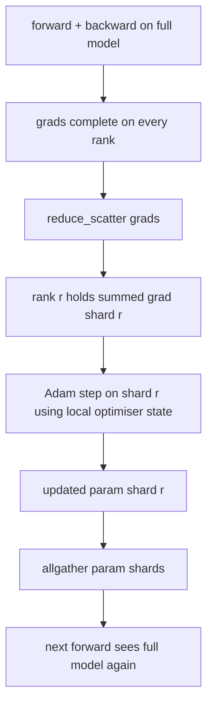

# ZeRO 优化器状态分片

> Adam 为每个 parameter 存两份 moment estimates，而且都是 float32。一个 7B-parameter model 会携带 56 GB optimiser state。ZeRO stage 1 会把它分片到 N 个 ranks 上；每个 rank 拥有 optimiser 的 1/N。Local step 之后，更新后的 parameter shards 会 broadcast 回来，每个 rank 重建完整 model，然后开始下一步。收益是在 training stack 中最大的一项单独分配上得到线性内存下降。

**Type:** Build
**Languages:** Python
**Prerequisites:** Phase 19 Track C lessons 42-49
**Time:** ~90 min

## 学习目标

- 将 optimiser state（first moment、second moment、fp32 master copy）跨 N 个 ranks 分片，让每个 rank 拥有 1/N。
- 使用 reduce_scatter 只把每个 rank 对应 shard 的 gradient sum 送到该 rank，然后用 allgather 把更新后的 parameter shards 广播回来。
- 计算 stage 1、stage 2、stage 3 相对 vanilla DDP 的 memory savings table。
- 根据 model size 和 bandwidth budget，解释为什么选择 stage 1、stage 2 或 stage 3。

## 问题

Vanilla DDP 会复制所有东西：parameters、gradients 和 optimiser state 在每个 rank 上都有完整一份。对一个用 fp16 训练的 7B-parameter model 来说，这意味着每个 rank 有 14 GB parameters、14 GB gradients 和 28 GB optimiser state。Optimiser state 是最大的一项，也是最容易分片的一项，因为它只在 step 期间被访问，不在 forward 或 backward 期间被访问。

ZeRO stage 1 会分片 optimiser state。每个 rank 持有 Adam moments 的 1/N。Backward 之后，它不再 allreduce 完整 gradient 并在本地 step，而是执行 reduce_scatter，让每个 rank 只接收自己 shard 的 summed gradient。该 rank 使用本地 optimiser state 对 master parameters 的 shard 执行 optimiser step。然后更新后的 parameter shards 会 allgather 回来，让每个 rank 在下一次 forward 前重新拥有完整 model。Optimiser memory 降低 N 倍。每步 wire traffic 与 DDP 相同：一次 reduce_scatter 加一次 allgather，在带宽意义上等于一次 allreduce。内存赢了，throughput 保住了。

## 概念



### ZeRO 的 stages

| Stage | What is sharded | Memory per rank | Comm per step |
|-------|----------------|------------------|---------------|
| DDP | nothing | params + grads + optim | 1x allreduce |
| ZeRO-1 | optimiser state | params + grads + optim/N | 1x reduce_scatter + 1x allgather |
| ZeRO-2 | optim + grads | params + grads/N + optim/N | 1x reduce_scatter + 1x allgather |
| ZeRO-3 | optim + grads + params | params/N + grads/N + optim/N | 1x allgather per layer + 1x reduce_scatter per layer |

Stage 1 是最便宜的收益，因为 optimiser state 主导内存预算。Stage 2 需要 gradient-shard accumulation logic，但带宽相同。Stage 3（FSDP）为了得到 parameter-shard memory drop，会为每个 forward 和 backward 支付 per-layer comm。本课会完整实现 stage 1。

### 内存数学，真实数字

对一个使用 Adam、mixed precision 训练、拥有 P 个 parameters 的 model：

| Term | Vanilla | ZeRO-1 | Why |
|------|---------|--------|-----|
| fp16 params | 2P bytes | 2P bytes | forward 需要 |
| fp16 grads | 2P bytes | 2P bytes | backward 需要 |
| fp32 master copy | 4P bytes | 4P/N bytes | 只有 optim 使用 |
| fp32 first moment | 4P bytes | 4P/N bytes | 只有 optim 使用 |
| fp32 second moment | 4P bytes | 4P/N bytes | 只有 optim 使用 |
| Total | 16P bytes | 4P + 12P/N bytes |   |

当 N=8：vanilla 是 16P，ZeRO-1 是 5.5P，下降 65%。当 N=64：vanilla 是 16P，ZeRO-1 是 4.19P，下降 74%。

### 为什么 reduce_scatter 优于 allreduce-then-shard

Allreduce 会让每个 rank 都拿到完整的 summed gradient。如果你只需要 shard r，那么 rank r 上被 reduce 出来的 `(N-1)/N` gradient 都是浪费。Reduce_scatter 精确交付每个 rank 拥有的 shard；per-rank bytes 与 allreduce 相同（因为 allreduce = reduce_scatter + allgather），但第二半会被后续 parameter-shard allgather 替代。最终 wire 与 DDP 相同，内存被除开。

## 动手构建

`code/main.py` 实现：

- `flatten_params(module)` 和 `unflatten_into(module, flat)`：把 model parameters 打包成一个 contiguous tensor，并解包回 model。Flat layout 让按 rank sharding 变成简单 slice。
- `ZeroOptimizer(model, world_size, rank, lr)`：拥有该 rank 的 master copy shard 和 Adam moments。
- `step()`：对 flat gradient 运行 reduce_scatter，对 rank 的 shard 应用 Adam，然后 allgather 更新后的 parameters。
- 一个 demo：训练一个 3-layer MLP 20 步，并打印每步 memory budget，与 vanilla DDP baseline 对比。

运行：

```bash
python3 code/main.py
```

输出：per-step loss 和 memory table，显示 ZeRO-1 在每个 rank 上只持有 optimiser state 的 1/N，而 DDP 持有完整 copy。

## 野外的 production patterns

三个模式可以把 ZeRO 加固到可上线。

**Sharded checkpointing matters。** ZeRO-1 的 optimiser state 分散在 ranks 之间；checkpoint 必须记录哪个 rank 拥有什么。Lesson 80 会构建 sharded checkpoint manifest，让 ZeRO run 可以在相同 world size 上 resume。没有它，保存下来的 state 在 restart 时不可读。

**Mixed precision is the point。** ZeRO 是一种 mixed-precision technique；被分片的是 fp32 master copy。如果不用 mixed precision 跑 ZeRO，就会支付 fp32 master 的内存税，却得不到对应的 fp16 forward 收益。Production runs 总是把 ZeRO 和 autocast 或 bf16 weights 配对。

**Stage 1 is a near-free win。** 从带宽角度看，通信与 DDP 相同。Memory savings 随 N 线性增长。唯一代价是 optimiser shard 的 bookkeeping。Production stacks 默认使用 stage 1，除非 parameter shard memory 也成为问题；那时 stage 2 或 3 会用更多通信换内存。

## 投入使用

Production patterns：

- **DeepSpeed ZeRO。** Reference implementation。`deepspeed_config.json` 选择 stage 1/2/3 和 partition sizes。
- **PyTorch FSDP。** PyTorch-native equivalent。`ShardingStrategy.SHARD_GRAD_OP` 是 ZeRO-2；`FULL_SHARD` 是 ZeRO-3。
- **HuggingFace Accelerate。** 用统一 config 包装 DeepSpeed 和 FSDP。

## Ship It

Lesson 79（pipeline parallel）是正交的 sharding axis：它不是在同一个 model 上分片 optimiser state，而是跨 ranks 分片 layers。Lesson 81 会把 DDP + ZeRO 组合进端到端 demo。

## 练习

1. 扩展到 ZeRO-2，分片 gradients：每个 rank 只存储自己 shard 的 gradient，通过在 backward 后清零 non-shard 部分实现。
2. 添加 memory profiler，打印 rank 0 上实际 fp32 byte usage，并与公式预测对比。
3. 测量 vanilla DDP 与 ZeRO-1 的 per-step wall-clock time，并拆分成 forward、backward、comm。
4. 在 ZeRO-1 下实现 gradient clipping：L2 norm 必须通过对 local norm squared 执行 allreduce 来跨所有 shards 计算。
5. 实现一个使用 allreduce 而不是 reduce_scatter 的 “naive ZeRO”，测量 wire-time 差异。用数字为 reduce_scatter 选择辩护。

## 关键术语

| Term | What people say | What it actually means |
|------|----------------|------------------------|
| ZeRO-1 | “Shard the optimiser” | 每个 rank 持有 fp32 master + Adam moments 的 1/N |
| ZeRO-2 | “Shard grads too” | 每个 rank 在 reduce_scatter 后也丢弃 non-shard gradients |
| ZeRO-3 | “Shard params” | 每个 rank 持有 fp16 params 的 1/N；forward 中 per layer allgather |
| Master copy | “fp32 weights” | Optimiser 更新的高精度 parameter copy |
| Reduce_scatter | “Split the sum” | 只把每个 rank 对应 shard 的 summed gradient 交付给它 |

## 延伸阅读

- [Rajbhandari et al, ZeRO: Memory Optimizations Toward Training Trillion Parameter Models](https://arxiv.org/abs/1910.02054)
- [DeepSpeed ZeRO documentation](https://www.deepspeed.ai/tutorials/zero/)
- [PyTorch FSDP documentation](https://pytorch.org/docs/stable/fsdp.html)
- Phase 19 Lesson 76：本课依赖的 reduce_scatter 和 allgather
- Phase 19 Lesson 80：ZeRO state 必须使用的 sharded checkpointing
