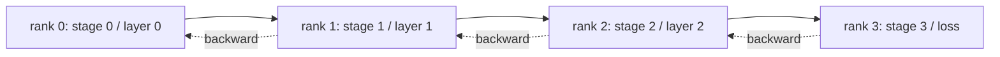

# Pipeline Parallel 与 Bubble Analysis

> Tensor parallelism 会把 matrix multiply 拆到多个 ranks 上。Pipeline parallelism 会按深度把 model 拆到多个 ranks 上，每个 rank 一个 stage。Microbatches 在 pipeline 中流动。开头和结尾的空闲时间就是 bubble；把它降到最低，就是这门手艺的核心。

**Type:** Build
**Languages:** Python
**Prerequisites:** Phase 19 Track C lessons 42-49
**Time:** ~90 min

## 学习目标

- 把一个 sequential model 拆成 N 个 stages，并模拟 N 个 ranks 上的 forward pipeline。
- 使用 GPipe schedule（先 forward-only fill，再 backward）调度 M 个 microbatches，并计算 bubble fraction。
- 把 bubble 与 Megatron-LM 和 PipeDream 使用的 interleaved 1F1B schedule 做对比。
- 能为 stage assignment 辩护：让每个 stage 的 compute 相等，比让每个 stage 的 parameter count 相等更重要。

## 问题

一个 70B-parameter model 仅 fp16 parameters 就需要 140 GB。消费级 GPU 放不下。ZeRO-3 会把 parameters 分片到多个 ranks 上，但每个 forward step 仍然需要每个 rank allgather 完整 layer，并为每层支付 log(N) hops。Pipeline parallel 走另一条路：把 model 切成 N 个 stages，每个 rank 放一个 stage。Layer 1 的 forward 在 rank 0 上结束后，把 activation tensor 交给 rank 1；rank 1 运行 layer 2，再交给 rank 2；依此类推。Backward 反向流动。Memory 会线性下降，因为每个 rank 只持有一个 stage；compute 仍然是顺序的，这就是 bubble problem。

Bubble 是 pipeline 开头的 idle time（等待第一个 microbatch 到达最后一个 stage）和结尾的 idle time（等待最后一个 microbatch 反向 drain 回来）。有 M 个 microbatches 和 N 个 stages 时，每个 stage 的 bubble fraction 是 (N-1)/(M+N-1)。M=8、N=4 时是 27%。M=64、N=4 时是 4.5%。Microbatches 越多，bubble 越小；这意味着每个 microbatch 的 batch size 越小，而这正是 microbatch design 的核心约束。

## 概念



### GPipe schedule

先用所有 M 个 microbatches 做 forward，把 pipeline 填满；然后再按反向 drain backward。每个 microbatch 的 activations 都必须保留到它的 backward，所以 memory 会随 M 线性增长。Forward 需要 M+N-1 个 cycles，backward 又需要 M+N-1 个 cycles。每个 stage 的 useful work 是 2M cycles；每个 stage 的 bubble 是 2(N-1) cycles。当每次 forward 和 backward 都耗费一个单位时间时，bubble fraction 是 (N-1)/(M+N-1)。选择远大于 N 的 M，可以隐藏 bubble。

### 1F1B schedule

Interleave：只要某个 microbatch 的 forward 到达最后一个 stage，就启动它的 backward，并让 backward 流回去。这个 schedule 在每个 stage 上交替执行 one forward 和 one backward。Bubble 仍然是 N-1，但 activation memory 由 pipeline depth 限制，而不是由 microbatch count 限制。Production pipelines 使用 1F1B（Megatron、PipeDream）。本课先实现更简单的 GPipe，再把 1F1B 留作练习。

### 为什么 equal compute per stage 更重要

如果 stage 0 需要 50 ms，而 stage 1 需要 100 ms，每个 cycle 都会被 stage 1 卡住。其它 stages 每个 cycle 都要 idle 50 ms，等待 stage 1 释放。Equal parameter count 是错误轴线：transformer 的 compute 主要来自 attention 加 MLP per layer，而 embedding layers 参数很多，但 compute 很少。Stage assignment 应该让每个 stage 的 FLOPs 相等，而不是让 weights 数量相等。

### Microbatch versus batch

一个 pipeline 会运行 M 个 microbatches，每个 microbatch 大小为 B。Effective batch size 是 M*B。Pipeline step 结束时得到的 gradient，就是组合后的 M*B 个 examples 上的 gradient。Bubble fraction 取决于 M；optimiser 看到的是 M*B。调 M 意味着在 bubble（高 M 时更低）和 per-microbatch memory（GPipe 中高 M 会带来更高 activation memory）之间取舍。

## Build It

`code/main.py` 实现：

- `PipelineStage`：一个小型 `nn.Module`，持有单个 stage 的 parameters，并暴露 `forward(activation)`。
- `Pipeline(stages, num_microbatches)`：在 simulated stages 上用 simulated wall-clock per stage 编排 GPipe schedule。
- `bubble_fraction(num_stages, num_microbatches)`：闭式公式 (N-1)/(M+N-1)。
- 一个 4-stage demo：打印 per-microbatch trace 和 measured bubble fraction。

运行：

```bash
python3 code/main.py
```

输出：一张 stage-by-microbatch Gantt chart，以及 bubble percentage 与 closed-form prediction 的对比。

## 真实生产中的 patterns

有三个 pattern 会把 pipeline parallel 加固到可上线的程度。

**Activation checkpointing pairs with pipeline.** GPipe 中有 M 个 microbatches 在途时，activation memory 是一个 microbatch 的 M 倍。Activation checkpointing 会在 backward 时重新计算 forward，用 compute 换 memory；这个组合让 long sequences 上的 pipeline 变得可行。

**Stage balance is measured, not assumed.** Production teams 会先跑 profiling pass，在目标硬件上测量真实 per-layer compute（FLOPs 和 wall-clock），再按测量结果 partition。Megatron-LM 的 `--num-layers-per-stage` flag 支持传入 list，因此当 stages 的 per-layer cost 不同时，可以使用不均匀 layer counts。

**Send-recv schedule must avoid deadlock.** 如果每个 stage 都先 send 再 receive，pipeline 会在 wire 上 deadlock。标准修复是 interleave：even-rank stages 先 send 后 recv，odd-rank stages 先 recv 后 send。本课会显式调度 ranks，让这个 pattern 看得见。

## Use It

Production patterns：

- **Megatron-LM.** 大规模 pipeline parallel 的 reference。使用 1F1B，并支持 tensor + pipeline + data parallel 组合。
- **DeepSpeed Pipeline.** 与 ZeRO 集成；ZeRO-1 + pipeline 是最大 open models 的常见组合。
- **PyTorch Pipe.** PyTorch-native pipeline wrapper，构建在 `torch.distributed.pipeline.sync.Pipe` 之上。

## Ship It

第 80 课会把 per-stage parameter shards 存入 sharded checkpoint。第 81 课会在端到端 demo 中组合 DDP + ZeRO + pipeline（精神上如此；为了运行时间，demo 仍然保持 simulated pipeline）。

## 练习

1. 实现 1F1B，并验证 bubble fraction 与 GPipe 相同，但 activation memory 有上界。
2. 在更深的 model 上 profile 真实 per-stage time，并按 measured wall-clock 重新平衡 stages。
3. 添加跨 pipeline microbatches 的 gradient accumulation，并检查 gradient 等于等价 full-batch forward 的 gradient。
4. 把 pipeline 与 activation checkpointing 配对，测量 memory drop 与 compute cost。
5. 把 pipeline 和 DDP 组合起来（每个 pipeline rank 都在 data-parallel group 中 replicated），并推导 2D schedule。

## 关键术语

| Term | What people say | What it actually means |
|------|----------------|------------------------|
| Pipeline | "Model parallel along depth" | 每个 rank 一个 stage，activations 在 stages 之间流动 |
| Bubble | "Pipeline idle time" | 开头和结尾各有 (N-1) steps，其中某些 stages 没有工作 |
| Microbatch | "Slice of the batch" | 一个 forward/backward 单元；M 越大，bubble 越小 |
| GPipe | "Fill then drain" | 所有 M 个 forwards 都先于任何 backward；activation memory 高 |
| 1F1B | "Interleaved schedule" | 每个 stage 交替执行一个 forward 和一个 backward；activation memory 有上界 |

## 延伸阅读

- [Huang et al, GPipe: Efficient Training of Giant Neural Networks](https://arxiv.org/abs/1811.06965)
- [Narayanan et al, PipeDream: Generalized Pipeline Parallelism for DNN Training](https://arxiv.org/abs/1806.03377)
- [Megatron-LM pipeline parallel docs](https://github.com/NVIDIA/Megatron-LM)
- Phase 19 Lesson 76 - the send/recv primitives the schedule uses
- Phase 19 Lesson 78 - ZeRO is orthogonal to pipeline and often combined
