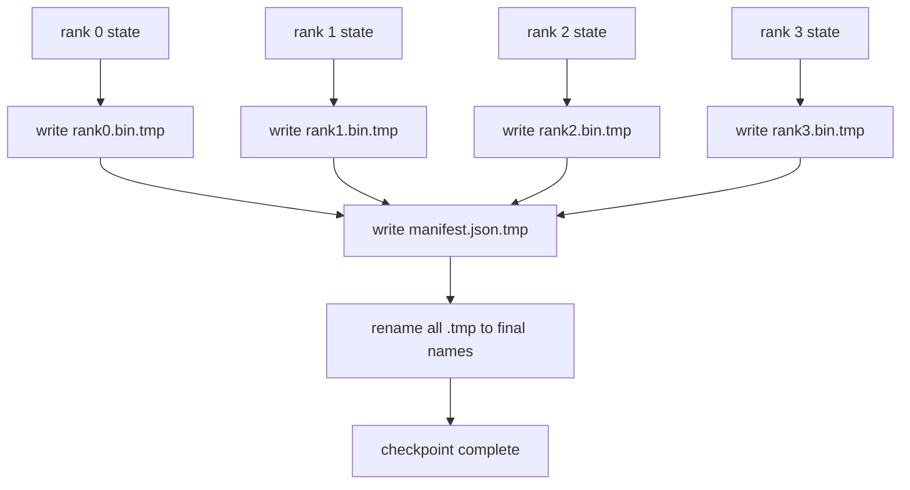

# Sharded Checkpoint 与 Atomic Resume

> 一个 700 亿参数训练任务每隔几小时就会被节点故障暂停一次。Checkpoint format 决定你损失的是 30 分钟，还是 30 小时。Sharded checkpoint 会让每个 rank 并行写自己的 shard，并在 manifest 中记录 ownership。Resume 会从各自文件中加载每个 rank 的 shard，在相同 world size 上重建 state，让 optimiser 像什么都没发生过一样继续 step。Atomic write 会防止写到一半的 checkpoint 污染下一次 resume。

**Type:** Build
**Languages:** Python
**Prerequisites:** Phase 19 Track C lessons 42-49
**Time:** ~90 min

## 学习目标

- 把 multi-rank checkpoint 保存为 per-rank shard file，再配一个 manifest，记录哪个 rank 拥有什么。
- 使用 atomic write pattern（先写 temp path，再 rename），确保 mid-write crash 永远不会产生 half-finished checkpoint。
- 从 manifest resume，并验证每个 rank 上的 fp16 parameters 和 ZeRO optimiser state 都 byte-equal。
- 让 manifest schema 防住三种 failure modes：world-size change、shard count mismatch 和 partial write。

## 问题

Vanilla checkpoint 会把所有 parameters 和 optimiser state 读到 rank 0，gather，然后写成单个文件。对 70B model 来说，这意味着 1.1 TB state 都要经过一个 rank 的 network port。写入会阻塞其它所有 ranks，因为它们都在 idle 等 gather。IO bandwidth 由最慢的单张 GPU 的网络链路决定，而不是 aggregate bandwidth。在真实 cluster 上，gather-then-write step 可能比前一个训练小时还长，这意味着 job 每个训练日连一个 checkpoint 都交付不了。

Sharded checkpoints 会反转这个模式：每个 rank 把自己的 shard 并行写到自己的文件中。Manifest 记录哪个 rank 拥有哪些 shard，因此 resume 可以把每个 shard 放回原来的位置。Aggregate write bandwidth 会随 cluster 扩展。一个通过单 rank 写入需要 4 小时的 1 TB checkpoint，通过 64 个 ranks 写入可能只需要 4 分钟。更重要的是，manifest 给 incompatible resumes 提供了 contract：world-size change 可检测，partial writes 可检测，load path 可以 loud failure，而不是悄悄使用 stale data。

## 核心概念



### Manifest schema

```json
{
  "world_size": 4,
  "step": 1234,
  "wall_clock_seconds": 4521,
  "shards": [
    {"rank": 0, "path": "rank0.bin", "sha256": "...", "param_shard_offset": 0, "param_shard_numel": 65536},
    {"rank": 1, "path": "rank1.bin", "sha256": "...", "param_shard_offset": 65536, "param_shard_numel": 65536}
  ],
  "schema_version": 1
}
```

有三个字段是承重结构。`world_size` 会让不同 size 上的 resume 直接失败，而不是静默损坏。每个 shard 的 `sha256` 会捕捉 partial 或 corrupted writes。每个 shard 的 `param_shard_offset` 和 `param_shard_numel` 让 loader 能在正确位置重建 flat parameter tensor。

### Atomic write

标准模式是：把每个 shard 写到 `<name>.tmp`，把 manifest 写到 `manifest.json.tmp`，对每个文件执行 fsync，然后 rename。POSIX 在同一个 filesystem 内的 rename 是 atomic 的；新文件要么完整出现，要么旧文件仍然存在。最终 rename 之前 crash，只会让前一个 checkpoint 保持为 live one。没有 atomic write 时，crash 可能留下一个 partial shard，而 present manifest 还指向它，于是 resume 时 load 会损坏 optimiser state。

### Schema 必须防住的三种 failure modes

| Failure | Symptom | Defence |
|---------|---------|---------|
| World-size change | resume on N=8 with manifest from N=4 | world_size mismatch in manifest, fail loudly |
| Shard count mismatch | resume sees fewer rank*.bin files than shards in manifest | enumerate shards, verify every one exists |
| Partial write | shard file truncated mid-flush | sha256 verification on load |

每个 defence 都会在 load 早期拒绝坏状态；另一种选择是 silent corruption，并在 100 steps 之后以 loss 变成 NaN 的形式浮现。

### 为什么是 per-rank files，而不是一个大文件

通过 `O_APPEND` 并发写入一个文件在 POSIX 上对 byte-aligned writes 可行，但实践中一个 shard 内的 offsets 会跨越 MB 级区域，locking 会主导成本。Per-rank files 没有 contention，并且当底层 filesystem 是 parallel（Lustre、GPFS）时，可以受益于 striping。Production stacks（DeepSpeed、FSDP、NeMo）都因此使用 per-rank files。

## Build It

`code/main.py` 实现了：

- `ShardManifest` dataclass：包含上面的 schema，并提供 `to_json` / `from_json`。
- `save_sharded(state_dict_per_rank, dir, step)`：用 atomic temp-then-rename pattern，把每个 rank 的 binary state 写到自己的文件中，然后写 manifest。
- `load_sharded(dir, expected_world_size)`：读取 manifest，验证每个 shard 的 sha256，并返回 per-rank state dicts。
- 一个 round-trip test：构建 per-rank state，save，load，并断言 byte-equal。

运行：

```bash
python3 code/main.py
```

输出：写出 4 个 shard files 和 manifest，然后重新加载，并完成 byte-equal verification。

## 野外的 production patterns

有三个 pattern 会把 checkpoint 加固到可交付。

**Async write.** Production stacks 会在单独的 thread 或 process 中发起 checkpoint write，让 training 继续。Barrier 位于下一次 checkpoint：不要在上一次 save 完成之前开始下一次 save。DeepSpeed 的 `async_io` flag 正是做这件事。本课保持同步写入，让步骤清晰可见。

**Local fast disk first, then async upload.** 先写入本地 NVMe（快），再 async-upload 到 S3 或 GCS。Two-tier pattern 让 in-cluster checkpoint 对 resume 保持快速，同时把 durable copy 送出 cluster 用于归档。Manifest 携带 local path；upload manifest 携带 remote path。

**Rotation matters.** Production runs 会保留最近 K 个 checkpoints（通常 3-5 个），并轮转删除最旧的。没有 rotation，磁盘会在 run 中途写满，下一次 checkpoint 会失败。有 rotation 时，下一次 save 会先删除最旧 checkpoint，释放预算。

## Use It

Production patterns：

- **DeepSpeed checkpointing.** `deepspeed.save_checkpoint(tag=step)` 会写 per-rank files，并写一个指向 active tag 的 `latest` file。
- **PyTorch FSDP checkpointing.** `torch.distributed.checkpoint` 会用 `Planner` 决定 per-rank layout，并保存 sharded state。
- **NeMo.** 用统一的 `save_to_checkpoint` API 包装 DeepSpeed 和 FSDP，并添加 metadata。

## Ship It

第 81 课会保存 end-to-end DDP+ZeRO run 的 sharded checkpoint，并在相同 world size 上重新加载它，证明 resume contract 成立。

## 练习

1. 添加 async write：在 thread 中启动 save，让 training 继续。下一次 save 开始前，阻塞等待前一次完成。
2. 添加 `last_5_steps` rotation：保留最近 5 个 checkpoints，在保存新 checkpoint 前删除最旧的。
3. 为 inner-loop reload 添加 CRC-only fast verification path（rotation 把一个 checkpoint 滚动成新的 active one 时，不做完整 sha256）。
4. 添加 cross-world-size load：通过读取 manifest、concatenate、重新 sharding，把 N=4 的 shards re-balance 到 N=8。
5. 添加 fake S3 upload（第二个目录）并写 upload manifest。防守 two-tier storage policy。

## 关键术语

| Term | What people say | What it actually means |
|------|----------------|------------------------|
| Sharded checkpoint | "Per-rank save" | 每个 rank 并行写自己的 shard file |
| Manifest | "Index" | 记录 shard paths、offsets 和 sha256 的 JSON 文件 |
| Atomic write | "tmp then rename" | 先写入 .tmp，再用 POSIX rename；crash 时旧文件仍然 live |
| Partial write | "Truncated shard" | Write 期间 crash 产生 corrupt shard；sha256 会捕捉它 |
| Rotation | "Keep last K" | 写入新 checkpoint 前删除最旧的，限制磁盘用量 |

## 延伸阅读

- [DeepSpeed checkpointing](https://www.deepspeed.ai/tutorials/checkpointing/)
- [PyTorch torch.distributed.checkpoint](https://pytorch.org/docs/stable/distributed.checkpoint.html)
- [POSIX rename atomicity](https://pubs.opengroup.org/onlinepubs/9699919799/functions/rename.html)
- Phase 19 Lesson 78 - 本课 checkpoint 要保存的 ZeRO state 形状来源
- Phase 19 Lesson 81 - 端到端 demo 会 round-trip 已保存 state
