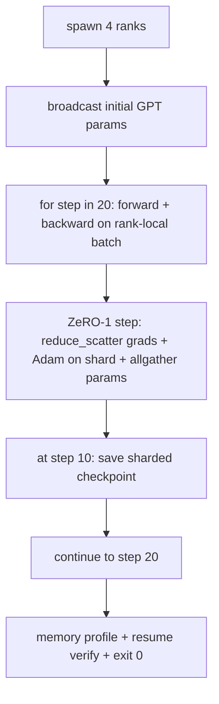

# 端到端分布式训练

> 第 76 到 80 课各自构建了一块。这里是组装：一个 tiny GPT 在 4 个 simulated ranks 上训练，用 DDP 做 gradient sync，用 ZeRO-1 做 optimiser-state sharding，并在半程写入 sharded checkpoint。Demo 运行 20 steps，self-terminates，打印 loss curve 和 memory profile，并写出一个可 resume 的 checkpoint。

**Type:** Build
**Languages:** Python
**Prerequisites:** Phase 19 Track C lessons 42-49
**Time:** ~90 min

## 学习目标

- 把 DDP（第 77 课）、ZeRO-1（第 78 课）和 sharded checkpoints（第 80 课）组合进同一个 training loop。
- 在 4 个 simulated ranks 上，用一个小型 synthetic corpus 训练 20 steps 的 2-layer transformer language model。
- 打印 per-step loss table、per-rank memory profile，以及能在同一 world size 上 byte-equal resume 的 checkpoint manifest。
- 为这次组合做辩护：每一块都已经在前面的 lessons 中独立可测，本课证明它们可以组合。

## 问题

Capstone 是证明各个 pieces 能拼起来的地方。第 76 课实现了 collectives。第 77 课把它们包装成 DDP。第 78 课用 reduce_scatter 对 optimiser state 做 sharding。第 79 课分析 pipeline。第 80 课保存 sharded checkpoint。每一课都有自己的独立测试。真实 training run 会同时使用所有 primitives；如果组合错了，loss 会 divergence，checkpoint 会拒绝 resume，或者 per-rank memory 会在本该下降的时候增长。

本课运行端到端 demo，并验证四个 invariants：(a) loss 在 20 steps 内按 float noise 范围单调下降，(b) 每个 rank 在每一步都持有相同的 parameter norm，(c) per-rank optimiser memory 等于 ZeRO-1 公式 12P/N bytes，(d) step 10 的 checkpoint 在 restart 时 byte-equal reload。Demo 会 self-terminate：20 steps、单条命令、exit 0。

## 核心概念



### Mini GPT

模型刻意保持很小：2 个 transformer blocks、embed dim 32、4 个 attention heads、vocab 64、sequence length 16、batch 4。总共几千个参数。它大到足以触发每个 wiring decision（multi-head attention 会走标准 masked path；LayerNorm 有需要同步的 weights；LM head 是单独投回 vocab 的 linear projection）。它也小到能让 4 个 CPU ranks 上的 20 steps 在几秒内完成。

### 组合规则

| Lesson piece | What it owns | What it leaves to the loop |
|--------------|--------------|----------------------------|
| DDP broadcast | Initial parameter sync | One call at construct time |
| ZeRO-1 step | Gradient sync, master copy update, parameter broadcast | One call per step replacing optimiser.step |
| Sharded checkpoint | Persist per-rank state, manifest with sha256 | Called on rank 0 with state collected via allgather |
| Training loop | Forward, backward, loss logging | Calls the three above in order |

Loop 不需要知道 reduce_scatter 或 rendezvous files。ZeRO 和 checkpoint modules 暴露的是窄接口，loop 只负责组合它们。

### 为什么用 tiny GPT，而不只是 MLP

第 77 课的 MLP 足以验证 gradient sync。Tiny GPT 额外增加三件事：单独覆盖 vocab 的 LM head（本课为了清晰没有 tie；完整 GPT 通常会把 head 和 token embedding tie 在一起）、用 softmax+cross-entropy 作为 loss（比 MSE 有更多 numerical edge cases），以及 asymmetric forward（先 embeddings，再 attention，再每层 MLP）。如果 capstone 仍然停留在 MLP，就会隐藏组合是否能正确处理 LayerNorm 或 embedding layer grad shape 的问题。

### Self-terminating 就是 exit 0

Loop 会运行固定 20 steps 然后退出。没有 `while True`，没有人工介入，也不依赖外部状态 resume。一个可以无人值守运行，并在结束后留下完整 log 的 capstone，才真正证明系统接线正确。如果任意一块 deadlock，demo 就不会返回，test rig 会抓到它。

## Build It

`code/main.py` 实现：

- `MiniGPT`：带 masked self-attention 和单独 LM head 的 2-layer transformer。
- `make_corpus(seed, total_tokens)`：deterministic next-token-prediction data。
- `_train_worker`：每个 rank spawn 一个；broadcast init params，运行 loop，调用 ZeRO step，并在 step 10 写入 sharded checkpoint。
- `verify_resume`：main run 之后，在进程内 reload step-10 checkpoint，并断言保存的 master shards 和 in-memory snapshot byte-for-byte 匹配。
- `main`：编排整个 demo，打印 loss table、memory profile 和 verification result。

运行：

```bash
python3 code/main.py
```

输出：20 行 loss table、4 行 per-rank memory profile、checkpoint manifest，以及成功时的一行 `"RESUME VERIFIED"`。

## Production patterns in the wild

真实 runs 还需要三个 pattern 来完成组合。

**每 K 分钟 checkpoint，而不是每 K steps。** Step time 会随 sequence length 和 microbatch count 变化。10 分钟一次的 checkpoint cadence 无论 model size 如何，都能捕获相同量级的 compute。本课为了简单使用 step-based；production 使用 wall-clock-based。

**尽早检测 divergence。** Production runs 会在 backward 后增加 NaN guard 和 loss-spike detector；如果 loss 在一步内跳升超过 2x，就 rollback 到前一个 checkpoint，而不是让 optimiser 继续走进 degenerate state。本课的 loss curve 很平滑，所以 guard 不会被触发，但 hook 会保留。

**跨 ranks 聚合 memory profile。** 真实 runs 中 per-rank memory 会因 rank 而异（拥有最大 pipeline stage 的 rank 会持有更多 activations）。Production 会记录跨 ranks 的 max 和 mean；本课打印 per-rank，是为了展示它与公式匹配。

## Use It

Production patterns：

- **DeepSpeed.** 在一个 config 下组合 DDP + ZeRO + pipeline + activation checkpointing。本课的组合就是 DeepSpeed shape 的 miniature。
- **PyTorch FSDP.** 原生等价物。带 `ShardingStrategy.SHARD_GRAD_OP` 的 `FullyShardedDataParallel` 就是 ZeRO-2。
- **NeMo and Megatron-LM.** 为最大的模型增加 tensor parallel；除此之外，组合形状相同。

## Ship It

完整 track 到这里结束。这 6 节课合起来，就是一个真实团队在采用 DeepSpeed 之前会亲手构建的 distributed-training subsystem；abstraction 已经通过 gloo 验证，failure modes 也已经被演练。Phase 17（infrastructure and production）会把这套组合带到真实 cluster。

## 练习

1. 增加 attention head 的 tensor-parallel split，并验证 loss 匹配 single-rank baseline。两个 ranks：每个 rank 持有一半 heads，对 attention output 做 allreduce。
2. 增加跨 4 个 microbatches 的 gradient accumulation，并证明该 gradient 等于一个大 batch 的 gradient。
3. 增加真正从 step 10 resume 的路径，继续训练到 step 20，并产生与原始 run 相同的 final loss。
4. 增加 metrics export（loss、grad norm、step time）到 JSONL，方便 run 结束后可视化。
5. 增加一个 NaN guard，在 loss spike 时 rollback 到前一个 checkpoint，并用 one-step LR multiplier 强制制造 spike 来演练 rollback。

## 关键术语

| Term | What people say | What it actually means |
|------|----------------|------------------------|
| End-to-end | "Wire it all up" | 一次 run 组合所有 pieces，而不是给每块各写一个 unit test |
| Memory profile | "GB per rank" | 每个 rank 持有的 params、grads、optimiser state 字节数 |
| Resume contract | "Save and load" | Checkpoint round-trip 后，per-rank state byte-equal |
| Self-terminating | "Bounded run" | 固定 step count，完成时 exit 0，无需人工介入 |

## 延伸阅读

- [DeepSpeed end-to-end training tutorial](https://www.deepspeed.ai/getting-started/)
- [PyTorch FSDP advanced tutorial](https://pytorch.org/tutorials/intermediate/FSDP_advanced_tutorial.html)
- [Megatron-LM training script reference](https://github.com/NVIDIA/Megatron-LM)
- Phase 19 Lessons 76-80 - 本课组合的每一个 piece
- Phase 17 - 将组合迁移到真实 cluster
