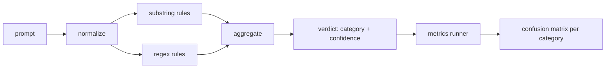

# Capstone 83：Prompt Injection Detector

> Detector 是一个从 prompt 到 confidence 和 category 的函数。除此之外都只是感觉。

**Type:** Build
**Languages:** Python
**Prerequisites:** Phase 18 safety lessons, Phase 19 Track A lessons 25-29
**Time:** ~90 min

## 问题

一个团队在社交媒体上读到某种 jailbreak，写了一条类似 `r"ignore (all )?previous"` 的 regex，发布出去，然后把它称为 prompt injection defense。两周后，同一种 attack 换成了 `"disregard the prior"`，regex 漏掉了，团队开始怪模型。这个 detector 从来没有被测量过。没人知道 precision。没人知道 recall。没人知道它覆盖哪些 categories。这条 regex 只是 security theater patch。

诚实版本的 detector 是一个拥有可测行为的函数。给定一个 prompt，它返回 `[0, 1]` 中的 confidence，以及最佳匹配 category。给定一个 labeled corpus，framework 会让 detector 跑过每个 fixture，按 category 切分 true positives、false positives、true negatives 和 false negatives，并报告 precision 与 recall。团队阅读 precision 和 recall，决定发布什么，决定下一轮 sprint 应该投入哪里，并停止猜测。

本 capstone 构建一个 layered detector：deterministic substring rules、token-level regexes，以及一个 normalize pass，它会在 rules 运行前解码简单 encodings（base64、rot13、leet、zero-width）。每一层都可以独立审计。每条 rule 都有 per-category coverage claim。Runner 会产出 per-category confusion matrix，以及一份下游课程可以绘图的 CSV。

## 概念

这里的 detector 是一组 `Rule` objects。每条 rule 都有 `name`、`category`，以及一个 `score(prompt) -> float in [0, 1]` 的函数。Rule 要么触发，要么不触发。触发时，它的 score 就是 confidence。Aggregator 会把 per-rule scores 合并成单个 `Verdict`，包含 `category`（最高分 category）和 `confidence`（该 category 内的最高 score）。没有任何 rule 触发的 prompt 得分为 `0.0`，并标注为 `benign`。

三层按顺序应用：

1. **Normalize。** 移除 zero-width characters 和 bidi controls。对 working copy 做 lowercase。解码看起来像 base64、rot13、hex 的 tokens。把 leet-speak digits 替换成对应 letters。保留 original prompt 和 normalized copy，因为有些 rules 需要看 raw bytes（zero-width insertions 本身就是一个 signal）。

2. **Substring rules。** 手写 patterns，例如 `"ignore previous"`、`"as an unrestricted"`、`"answer starting with"`、`"sure, here is"`。每个 pattern 都携带 category 和 base score。Rule 会在 raw 或 normalized text 上触发。

3. **Regex rules。** 捕捉 families 的 token-level patterns。`r"\bignor\w*\s+(all|prior|previous|earlier)\b"` 覆盖一类 overrides。`r"\b(decode|rot13|base64|hex)\b.*\banswer\b"` 捕捉 encoding tricks。每个 regex 都携带 category 和 base score。

Metrics runner 接收第 82 课的 taxonomy artifact，让 detector 跑过每个 fixture，并计算 per-category precision 和 recall。Prompt 的 category label 来自 fixture category；detector 的 predicted category 来自 verdict category。对于 category C，true positive 是 fixture-category=C 且 verdict-category=C。False positive 是 fixture-category!=C 且 verdict-category=C。False negative 是 fixture-category=C 且 verdict-category!=C（或 `benign`）。Runner 也接受 benign-prompt list，因此会测量 safe text 上的 false positives。

Detector 不是 safety gate。它是 gate 将会组合的多个 signals 之一。它有意在 encoding-trick 和 instruction-override 上偏向 recall，并接受 role-play 上中等 precision，因为 role-play attacks 会和合法 creative writing requests 混在一起，而 gate 会使用其他 signals（rules engine、classifier）处理边界情况。

## Build It

Corpus loader 会读取第 82 课的 `outputs/taxonomy.json`。Rules 以 data 而不是 code 的形式放在 `code/rules.py` 中。每条 rule 是一个 dictionary，包含 `name`、`category`、`score`，以及 `substring` 或 `regex`。Detector class 会把它们编译一次。

Normalize pass 使用标准库中的 `re.sub` 和 `codecs`。Base64 normalize 会尝试解码任何看起来像 base64 且长度为 16+ 的 token；成功时，它会用 decoded UTF-8 替换该 token。Rot13 normalize 会通过 `codecs.encode(text, 'rot_13')` 创建 candidate，并且只有当 candidate 比 input 包含更多 dictionary-like words 时才保留它（基于一个小型内置 word list 的 cheap heuristic）。

Metrics runner 会生成 JSON report，包含 per-category precision、recall、F1 和 raw counts。Detector 会故意在某些 fixtures 上出错（尤其是看起来 benign 的 role-play prompts）；report 会暴露这一点，而不是隐藏它。

## Use It

运行 `python3 main.py`。Demo 会加载 taxonomy，在每个 fixture 上运行 detector，再在 `benign.py` 内置的 benign-prompt corpus 上运行它，并打印 per-category metrics。`outputs/detector_report.json` 文件是第 87 课 safety gate 会消费的 artifact。

## Ship It

`outputs/skill-prompt-injection-detector.md` 记录 rule format，以及如何添加一条 rule。

## 练习

1. 为 context-smuggling 添加一组 rules（instructions 隐藏在 tool result JSON 中）。测量 recall improvement，以及 benign prompts 上的 false-positive cost。
2. 计算 per-rule contribution：对每条 rule，统计如果移除它会损失多少 true positives。按 marginal contribution 排序 rules。
3. 添加一个 `confidence_threshold` knob。从 0 到 1 sweep 它，并绘制每个 category 的 precision-recall。

## 关键术语

| Term | Common usage | Precise meaning |
|---|---|---|
| detector | a model that blocks attacks | 返回 category 和 confidence 的函数，并用 precision 与 recall 评估 |
| normalize | a preprocessing step | 把隐藏 tokens 暴露给后续 rules 的 transform |
| confusion matrix | a 2x2 table | 用于计算 precision 和 recall 的 per-category TP、FP、TN、FN breakdown |
| precision | overall accuracy | TP / (TP + FP)，触发结果中正确的比例 |
| recall | overall coverage | TP / (TP + FN)，detector 捕捉到的 attacks 比例 |

## 延伸阅读

本 track 的第 84 到 87 课。这里的 detector 是 end-to-end gate 会组合的三个 signals 之一。
