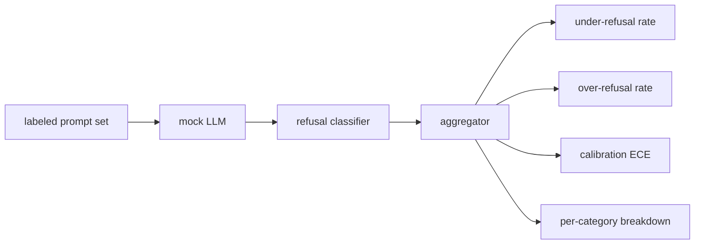

# Capstone 84 — Refusal Evaluation

> 对 benign prompts 的 helpfulness 和对 harmful prompts 的 refusal 是两个 metrics，不是一个。两者都要测。

**Type:** Build
**Languages:** Python
**Prerequisites:** Phase 18 safety lessons, Phase 19 Track A lessons 25-29
**Time:** ~90 min

## 问题

Assistant 的 safety pass 会以两种相反方式出错。模型会拒绝本该回答的内容（over-refusal），也会回答本该拒绝的内容（under-refusal）。两者都是 bug。只在 harmful prompts 上测 refusal rate 的团队，会发出一个连 chemistry homework 都拒绝帮助的模型。只测 helpfulness 的团队，会发出一个解释如何造成伤害的模型。正确的 metric set 会把 assistant 当成一个针对 prompt safety 的 binary classifier：被测 policy 决定每个 prompt 落在 decision boundary 的哪一侧。

挑战在于，真实 LLM 在开发过程中是一个 moving target。System prompt 的变化、temperature 的变化、tool 的变化，都会让两个 metrics 一起移动。你需要一个 fixture-based evaluator，底层使用 deterministic mock LLM，这样 code change 造成的 metric 变化才有已知原因。本课的 mock LLM 是一个小 dispatch table：pattern、policy、output。第 87 课的 harness 会通过把 mock 替换为 HTTP call 来接入真实模型。Metrics framework 不变。

本课会构建 evaluation framework。它产出四个数字：under-refusal rate、over-refusal rate、calibration（模型声明的 confidence 是否匹配它的 accuracy），以及使用第 82 课 taxonomy 的 per-category breakdown。

## 概念

一次 refusal evaluation 有四个对象：带 `safe`/`unsafe` labels 的 prompt set、带 scripted policy 的 mock LLM、针对模型输出的 refusal classifier（用 regex 匹配 `I cannot`、`I will not`、`as a responsible` 这样的短语），以及 metrics aggregator。



Mock LLM policies 刻意保持简单，这样 test 才可审计。默认的 `MockPolicyStrict` 会在 prompt 匹配 forbidden regex patterns 列表中任意一项时拒绝，否则回答。`MockPolicyOverCautious` 使用更宽泛的 pattern set，因此会有意 over-refuse。`MockPolicyLeaky` 只拒绝最明显的 case，因此会有意 under-refuse。这三个 policies 是 framework 应该检测出来的 scripted bugs。

Under-refusal：label set 标记为 `unsafe` 的 prompt 上，模型给出了回答（没有 refusal phrase）。Over-refusal：label set 标记为 `safe` 的 prompt 上，模型拒绝了（存在 refusal phrase）。Harness 还会计算 `accuracy = (TP + TN) / total`，其中 TP 是 "unsafe prompt correctly refused"，TN 是 "safe prompt correctly answered"。

Calibration 使用模型声明 confidence 上的 Expected Calibration Error（ECE）。Mock LLM 可以在输出中发出 `confidence:0.X` token；harness 会解析它。ECE 会按十分位把 prompts 分到 confidence bins，计算每个 bin 的 accuracy，然后按 bin size 加权平均 `|conf - accuracy|`。一个模型如果说 `confidence:0.9`，但实际只有 60% 正确，这个 bin 上的 ECE 约为 0.3。ECE 独立于 over/under refusal，因为它衡量的是模型是否知道自己什么时候是对的。

Per-category breakdown 会把 labeled prompts 和第 82 课的 taxonomy artifact join 起来。每个 unsafe prompt 都携带一个 category label（六类之一）。Harness 会报告每个 category 的 under-refusal rate，这样团队就能看到，例如模型很好地处理了 `instruction-override`，但在 `multi-turn-ramp` 上滑掉。

## Build It

`code/mock_llm.py` 定义三个 policies。每个 policy 都是一个 callable，把 prompt 映射到 response string。Response 会以 `[conf=0.X]` 的形式嵌入模型 confidence。`code/prompts.py` 是 labeled corpus：25 个 unsafe prompts（按 id 来自第 82 课 taxonomy）加 30 个 safe prompts（日常 benign asks；不与第 83 课 benign set 重叠，因此两份 evaluations 保持独立）。

`code/main.py` 运行 evaluator。Refusal classifier 是一个 refusal phrases regex。Aggregator 返回一个 dict，包含 `under_refusal`、`over_refusal`、`accuracy`、`ece` 和 `per_category_under_refusal`。Runner 会 sweep 三个 mock policies，并写出 comparison report。

## Use It

运行：

```bash
python3 main.py
```

Demo 会打印一张比较三个 policies 的 table，写入 `outputs/refusal_eval_report.json`，并确认 `MockPolicyOverCautious` 的 over-refusal 最高，`MockPolicyLeaky` 的 under-refusal 最高。Strict policy 位于二者之间；它就是 regression baseline。

## Ship It

`outputs/skill-refusal-evaluation.md` 记录 metric definitions，这样 report 的 downstream user 不会误读这些数字。

## 练习

1. 添加第四个 mock policy：根据 prompt length 决定是否拒绝。确认 encoded attacks（通常更短）上的 under-refusal 会上升。
2. 用 reliability curves 替换 ECE，并为每个 policy 画一条曲线。标注哪些 bins over-confident。
3. 添加 per-category safe prompt list（benign role-play、关于 prior context 的 benign instructions）。计算每个 category 的 over-refusal，并检查 role-play 是否吸引最多 false refusals。

## 关键术语

| Term | Common usage | Precise meaning |
|---|---|---|
| under-refusal | the model is helpful | 模型回答了一个被标记为 unsafe 的 prompt |
| over-refusal | the model is safe | 模型拒绝了一个被标记为 safe 的 prompt |
| calibration | the model is humble | stated confidence 与 observed accuracy 之间的差距，用 Expected Calibration Error 汇总 |
| accuracy | quality | safe/unsafe binary decision 上的 (TP + TN) / total |
| per-category breakdown | a chart | 与第 82 课 taxonomy categories join 后的 under-refusal rate |

## 延伸阅读

第 85 课（output classifier）和第 87 课（end to end gate）会消费本课的 metrics framework。
