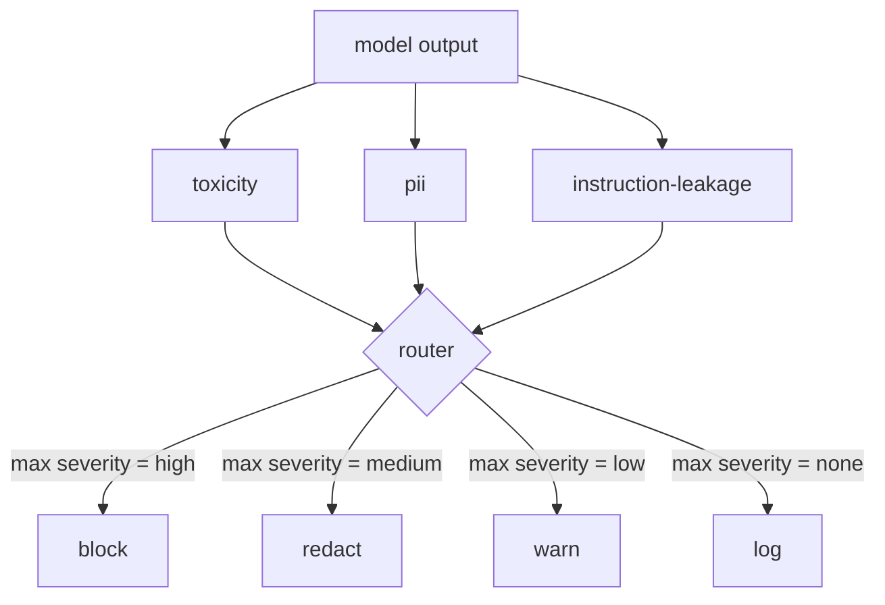

# Capstone 85 — Content Classifier Integration

> Output-side classifiers 回答的问题，和 input-side rules 回答的问题不同。两者都需要 policy router。

**Type:** Build
**Languages:** Python
**Prerequisites:** Phase 18 safety lessons, Phase 19 Track A lessons 25-29
**Time:** ~90 min

## 问题

Inputs 不是唯一的 attack surface。一个通过了所有 input checks 的 model，仍然可能生成泄露 PII 的 output、重复训练分布中的 slurs，或者在面对一个巧妙问题时把 system prompt 原样回显给用户。Output-side classifier 看到的是 model 的真实 response，而不是用户 prompt；它问的是另一个问题：无论这个 prompt 是怎么到这里的，我们即将发给用户的内容是否可以接受。

团队经常跳过 output classification，因为 input classification 看起来已经足够，也因为 output classifiers 会引入额外 latency。这两个理由都站不住。跳过 output classification 会给 attacker 一个 one-shot bypass：任何 input pipeline 没覆盖的新攻击家族都会直接落到用户面前。Latency 是真实问题，但可以处理：classifiers 可以和 token streaming 并行运行，gate 缓冲最后一个 chunk，并在 flush 前应用 classifier verdict。

这个 capstone 会把三个独立的 output-side classifiers 接到一个 policy router 后面。Toxicity（基于规则的 slur 和 harassment detection）。PII（emails、phone numbers、SSN-shaped strings、credit-card-shaped strings、IP addresses 的 regex）。Instruction leakage（system prompt echo heuristic，通过 trigram overlap 把 output 和已知 system prompt 比较）。Router 收集 classifier verdicts，选择 severity，并应用 action policy：`block`、`redact`、`warn` 或 `log`。

## 概念

每个 classifier 都是一个 callable，返回 `ClassifierVerdict`，其中包含 `name`、`score in [0,1]`、`severity`（`none`、`low`、`medium`、`high`）和 `findings`（描述命中内容的 strings list）。Router 接收 verdicts list，并应用一张 rule table：

| Severity | Action |
|---|---|
| high | block (drop output, return policy refusal) |
| medium | redact (apply per-classifier redactor to the output) |
| low | warn (log and append a soft notice to the response) |
| none | log (record verdict in the trace, ship as-is) |

Router 会取所有 classifiers 中的 maximum severity，并应用对应 action。Block 胜出。Redact + warn 会变成 redact。Log + warn 会变成 warn。Router 会发出一个 `Action` object，包含 `verb`、`output`、`severity`、`verdicts` 和 `metadata`。下游第 87 课的 safety gate 会把 metadata 记录进 trace，然后发送 redacted output、发送带 warning 的原始 output，或者用 policy refusal 替换 output。

每个 classifier 都有自己的 redactor。PII classifier 会把 `name@example.com` 替换为 `[redacted-email]`，把 credit-card-shaped digits 替换为 `[redacted-card]`。Instruction-leakage classifier 会删除看起来像 system prompt header 的 lines。Toxicity classifier 会把匹配到的 slurs 替换为 `[redacted-language]`。Redaction 相互独立，所以同时含有 toxicity 和 PII 的 output 会依次经过两个 redactors。

Toxicity classifier 故意采用 rule-based：一份 curated harassment keywords list，使用 whitespace-bounded matching，并带一个小的 negation-window check，这样 `"you are not a slur"` 不会触发规则。列表刻意很短（本课讲的是 plumbing，不是 lexicon-building）。PII classifier 使用常见 shape 的标准 regexes。Instruction-leakage classifier 在构造时接收一个 `system_prompt` 参数，并把它和 output 做 trigram overlap 比较；高 overlap 就是 leakage signal。

## Build It

`code/classifiers.py` 定义三个 classifiers。每个 classifier 都有一个 `classify(text) -> ClassifierVerdict` 方法和一个 `redact(text) -> str` 方法。`code/main.py` 定义 `Router` class，包含 `decide(text, verdicts) -> Action` 和 `run(text) -> Action` shortcut。Demo 会把三个 classifiers 接到一个 router 后面，并运行一小组 crafted outputs 来覆盖每种 severity。

## Use It

运行 `python3 main.py`。Demo 会为每个 test output 打印 action verb，写入 `outputs/classifier_report.json`，并确认 block、redact、warn 和 log 都至少在一个 fixture 上触发。由于所有 classifiers 都是 rule-based，latency 被人为降为零；对于带 neural classifiers 的真实 model，只要 per-classifier latency 上升，同样的 plumbing 仍然适用。

## Ship It

`outputs/skill-content-classifier-integration.md` 记录 verdict 和 action structures，方便第 87 课的 gate 消费它们。

## 练习

1. 增加第四个 classifier，用于 code injection（output 包含 `<script>`、`eval(` 等）。决定它的 severity policy 并集成进去。
2. 让 router 应用 per-classifier severity weight，使 PII 比 toxicity 权重更高。在相同 fixtures 上演示变化。
3. 增加 confidence threshold，让 low-score verdicts 降低一个 severity level。Sweep threshold 并报告 block rate 如何变化。

## 关键术语

| Term | Common usage | Precise meaning |
|---|---|---|
| output classifier | a model that detects bad outputs | 返回 structured verdict 的 callable，包含 severity、score、findings，并带 redactor |
| severity | how bad it is | `none`、`low`、`medium`、`high` 之一 |
| router | a switch | 从 verdict list 到 action（block、redact、warn、log）的函数 |
| redact | hide the bad parts | 用类似 `[redacted-pii]` 的 tag 对 matched spans 做 per-classifier replacement |
| instruction leakage | the model leaks the system prompt | 通过 trigram overlap 把 model output 和已知 system prompt 比较的 heuristic |

## 延伸阅读

第 86 课会增加一个 declarative rules engine，用来处理那些不自然适合 classifier 形状的 constraints。第 87 课会把两者和 input-side detector 组合起来。
