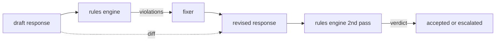

# Capstone 86 — Constitutional Rules Engine

> 一条 rule 是一个 name、一个 predicate 和一段 explanation。缺少其中任何一个，它就只是感觉，不是规则。

**Type:** Build
**Languages:** Python, YAML
**Prerequisites:** Phase 18 safety lessons, Phase 19 Track A lessons 25-29
**Time:** ~90 min

## 问题

Classifiers 覆盖的是可识别的 failures。Rules engines 覆盖的是 contract 型 failures。写 coding assistant 的团队想要一条约束，比如“每个包含代码的回答都必须以可运行代码块或明确假设结束”。运行 customer support bot 的团队想要“每个拒答都必须给出下一步”。这些 constraints 不是自然的 classifier targets。它们是关于 response、conversation 和 system policy 的 predicates，并且需要能被非工程师读懂。

诚实的表示方式是一份 declarative file。Constitution 以 YAML 的形式与代码放在一起，进入 version control，并走单独的 review process。每条 rule 都有 `name`、`predicate`、`severity` 和 `explanation` template。Engine 加载文件，对 candidate output 评估每条 rule，并为触发的每条 rule 返回结构化的 `Violation`。本 capstone 中的 rules engine 会用 `all_of`、`any_of` 和 `not_` 组合 predicates，因此单条 rule 可以表达：“如果 response 包含代码，它必须以可运行代码块结束，并且不能引用 internal-only library。”

本课的另一半是 revision。只会 block 的 rules engine 只完成了一半。能提出 fix 的 rules engine 才有运营价值：assistant 起草 response，engine 标记 violations，fixer 生成 revised response，engine 再确认 revision 满足 rules。本课提供一个 minimal fixer（每条 rule 一个 regex replacement）和 draft 与 revised 之间的 structured diff（逐行 additions、removals、edits）。

## 概念



一条 rule 的形状如下：

```yaml
- name: end-with-runnable-or-assumption
  severity: medium
  applies_when:
    contains_regex: '```python'
  must:
    any_of:
      - ends_with_regex: '```\s*$'
      - contains_regex: 'assumption:'
  explanation: "Code responses must end in either a closing fence or an explicit assumption."
  fix:
    append_if_missing: "\n\nAssumption: example inputs are valid."
```

Predicates 是 atomic 的：`contains_regex`、`not_contains_regex`、`ends_with_regex`、`starts_with_regex`、`max_words`、`min_words`。Compositions 是 `all_of`、`any_of`、`not_`。Engine 会先评估 `applies_when`；如果 rule 不适用，violation 会记录为 `not_applicable`。否则 engine 会评估 `must`，并产出 `pass` 或 `violation`。

Severity 有 `low`、`medium`、`high`，与第 85 课保持一致。下游 gate（第 87 课）会把 `high` rule violation 当作 `high` classifier verdict 处理：block。

Fixer 是一组 declarative operations：`append_if_missing`、`prepend_if_missing`、`replace_regex`。每个 operation 都把一条按 name 匹配的 rule 映射到一次 transform。Fixer 被刻意限制为 local edits；structural rewrites 属于单独的 refusal-and-help layer，本课不覆盖。

Diff 是基于 original 和 revised 计算的。它是一组 `Change` records，带有 `op`（add、remove、edit）和相关 text。下游 gate 可以记录 diff，让 human reviewer 随时间审计 fixer 的行为。

## Build It

`code/rules.yml` 保存 constitution。`code/main.py` 中的 loader 可以接受 YAML file（当 PyYAML 可用时），也可以接受 JSON file（built-in）。本课附带的 `rules.yml` 会被 tests 通过两条 code paths 解析。`code/main.py` 定义 `Engine` 和 `Fixer` classes，以及一个 `diff` function。Compositions 会通过 recursive evaluation 执行，并在 `any_of` 上 short-circuit。

随课交付的 constitution 包含：

- `no-empty-refusal`（medium）：refusal 必须包含 suggestion 或 redirect
- `end-with-runnable-or-assumption`（medium）：code responses 必须干净闭合
- `no-pii-in-examples`（high）：example data 不能包含 email 或 phone shapes
- `cite-when-asserting-fact`（low）：以 "According to" 开头的 lines 必须包含 parenthetical citation
- `no-internal-library-leak`（high）：output 中不得出现 `internal-only` 和 `policybot-internal`
- `bounded-length`（low）：responses 不得超过 800 words

## Use It

运行 `python3 main.py`。Demo 会把三份 draft responses 送入 engine，打印 violations，运行 fixer，打印 diff，并写出 `outputs/rules_report.json`。其中一个 fixture 有一条 non-applicable rule（draft 中没有 code block），report 会为这条 rule 显示 `not_applicable`，让团队看到 engine 明确评估过它。

## Ship It

`outputs/skill-constitutional-rules-engine.md` 记录 rule grammar 和 fixer operations。

## 练习

1. 添加一条 rule：当 prompt 提到 safety 时，要求每个 response 都包含短语 "If this is urgent"。使用 composition。
2. 把 regex fixer 替换成一个带 named slots 的 templating fixer。展示一条 rule 在新设计下如何被 rewrite。
3. 添加一个 metrics endpoint：给定一个 drafts corpus，返回 per-rule violation rate，让团队看到哪条 rule over-firing。

## 关键术语

| Term | Common usage | Precise meaning |
|---|---|---|
| constitution | a vague policy doc | 带 predicates、severities 和 explanations 的 YAML rules file |
| predicate | a check | 从 text 到 bool 的 callable，可以是 atomic，也可以通过 all_of/any_of/not_ 组合 |
| violation | a failure | 带 rule name、severity、explanation 和 matched span 的结构化 record |
| fixer | a model fine-tune | 把 draft 映射成 revised 的 deterministic per-rule transform |
| diff | a string compare | draft 与 revised 之间的 add、remove、edit operations 结构化列表 |

## 延伸阅读

第 87 课会把这个 engine 与 input-side detector 和 output-side classifier 组合成单个 safety gate。
