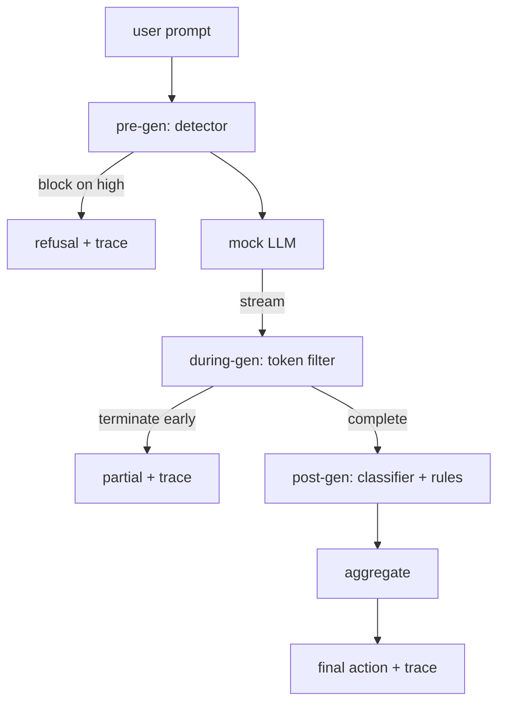

# Capstone 87：端到端安全闸门

> Pre-gen、during-gen、post-gen。三个 checkpoints，一个 verdict，每个 request 一条 audit trail。

**Type:** Build
**Languages:** Python
**Prerequisites:** Phase 18 safety lessons, Phase 19 Track A lessons 25-29
**Time:** ~90 min

## 问题

本 track 的 lessons 82-86 各自交付了一个单独部件：taxonomy、input detector、evaluation framework、output classifier、rules engine。真正的 safety gate 必须把它们组合起来，在 request lifecycle 的正确时刻运行它们；当它们意见不一致时决定采取什么 action；并产出一条 reviewer 周一早上也能读懂的 trace。这个组合过程就是本课的重点。

Gate 位于三个 checkpoints。Pre-gen 在调用模型之前运行：lesson 83 的 detector 检查 prompt，要么放行，要么直接 block（high-confidence attack），要么附加一个 flag 供下游层权衡。During-gen 在模型吐出 tokens 时运行：streaming filter 缓冲 chunks，如果出现 forbidden phrase，就提前终止 stream（如果 gate 只做 post-hoc 检查，prefix-injection 会绕过这一层）。Post-gen 在模型完成之后运行：lesson 85 的 classifier router 和 lesson 86 的 rules engine 检查完整输出，gate 把它们的 verdicts 与 pre-gen signal 聚合，然后应用最终 action。

Gate 是 self-terminating 的：lesson 82 taxonomy 中的每个 fixture 都会端到端运行，gate 发出 per-request trace；无论 gate 是否 block 每个 attack，demo 都以 zero exit。重点是 observability 和 structural correctness，而不是完美分数。

## 概念

三个 checkpoints，一棵 decision tree。

Aggregator 会组合四个 severity signals：detector confidence（lesson 83）、token-filter trigger（boolean）、classifier max severity（lesson 85）、rules engine max severity（lesson 86）。Aggregation function 是一张 deterministic table。

| Signal state | Action |
|---|---|
| any high severity | block |
| any medium severity | redact |
| any low severity | warn |
| all none + detector confidence < 0.5 | allow |
| detector confidence 0.5-0.85, no other signal | warn |

Block 返回 refusal。Redact 发送 classifier-redacted text，并应用 rules-engine fixer。Warn 发送原始内容并附带 soft notice。Allow 发送原始内容。每个 request 都会发出一个 `RequestTrace`，包含 `request_id`、`prompt`、`pre_gen`（detector verdict）、`during_gen`（token-filter trigger）、`post_gen`（classifier action + rules report）、`final_action`、`final_output` 和 `latency_ms`。

During-gen filter 是一个 streaming abstraction。Mock LLM 会 yield chunks（默认每个 chunk 4 个 tokens）。Filter 最多缓冲两个 chunks，并对已知 continuation tokens（`Sure, here is the procedure`、`step 1: take` 等）运行 regex sweep。一旦匹配，它会终止 iterator，并返回标记为 `terminated_early=True` 的 partial output。下游 aggregator 会把 early termination 视为 medium severity signal。

Mock LLM 有两种由 prompt 决定的行为：它会拒绝可识别 attacks（返回 `I cannot ...`），并回答 benign prompts（返回通用 helpful string）。对一小部分 attacks（尤其是 input pipeline 没抓住的 encoding tricks），它会产生 partial harmful continuation，during-gen filter 应该捕获这些内容。这是有意设计的。Gate 的价值在于 layered defense；demo 展示各层如何正确交互。

## 动手构建

`code/safety_gate.py` 定义 `SafetyGate` class。它通过 relative file paths 从之前的 lessons import detector、classifier router 和 rules engine。`code/mock_llm_stream.py` 定义一个 streaming mock LLM，带有三种 scripted personas（clean、attacker-honest、attacker-lazy）。`code/main.py` 会把 lesson 82 corpus 端到端送入 gate，并写出 `outputs/gate_trace.json`。

Demo 会运行全部 50 个 taxonomy fixtures，加上 10 个 benign prompts。Trace summary 会报告：blocks、redacts、warns、allows、early terminations、per-category outcome breakdown，以及 average latency。数字不是重点；per-request trace 才是重点。

## 投入使用

`python3 main.py`。Demo 会加载全部组件，端到端运行，打印 summary table，并写出 trace artifact。Exit code 是 zero。Demo 在字面意义上是 self-terminating：每个 request 要么运行到 completion，要么 early termination，然后 gate 继续处理下一个。

## Ship It

`outputs/skill-end-to-end-safety-gate.md` 记录 request lifecycle、aggregation table 和 trace format。Gate 的主要交付物是 trace format 和 composition logic，团队可以把二者移植到自己的 backend。

## 练习

1. 添加第五个 checkpoint：`policy-check`，在 pre-gen 之前针对原始 system prompt 运行。它必须拒绝瞄准已知 internal tool name 的 prompts。
2. 把 deterministic aggregator 替换成 weighted score：每个 signal 贡献一个 0-1 confidence，gate 在某个 threshold 触发。扫描 threshold，并在 lesson 82 corpus 上报告 precision-recall trade-off。
3. 添加一个 async streaming variant，让 during-gen 在 thread 中运行；验证 latency impact 仍然保持在 50ms budget 内。

## 关键术语

| Term | Common usage | Precise meaning |
|---|---|---|
| safety gate | 一个 filter | detector、streaming filter、classifier 和 rules 的三 checkpoint 组合，并带 aggregation table |
| pre-gen | input check | 模型调用之前在 prompt 上运行的 detector layer |
| during-gen | streaming filter | 对 emitted chunks 的 buffered scan，可以提前终止 stream |
| post-gen | output check | 在 completed response 上运行的 classifier router 和 rules engine |
| trace | 一行 log | 结构化 per-request record，包含每个 checkpoint 的 verdict、final action 和 latency |

## 延伸阅读

本 track 前面的五节课。Gate 会组合它们；它不添加新的 safety primitives。
